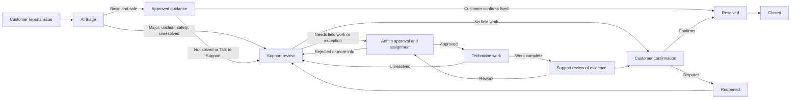
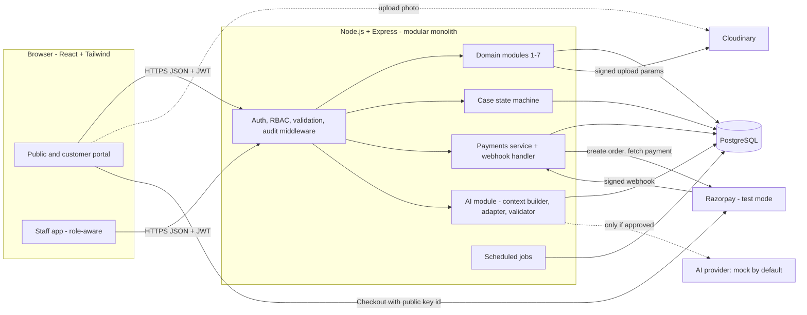
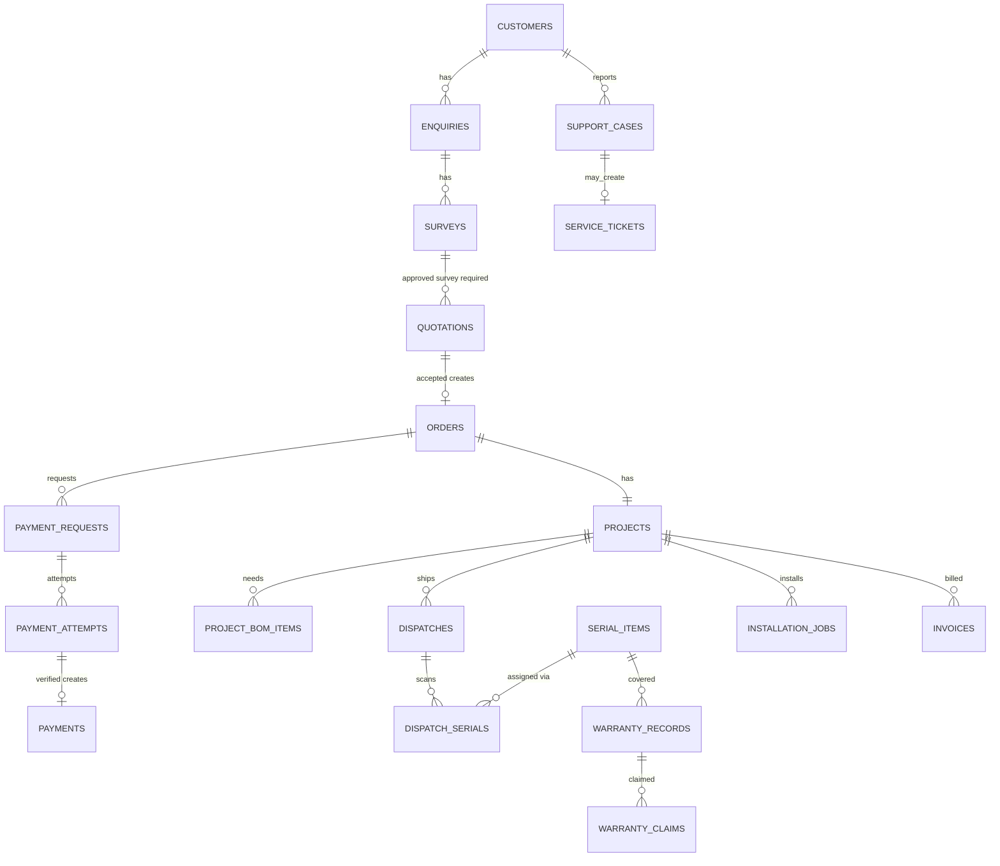
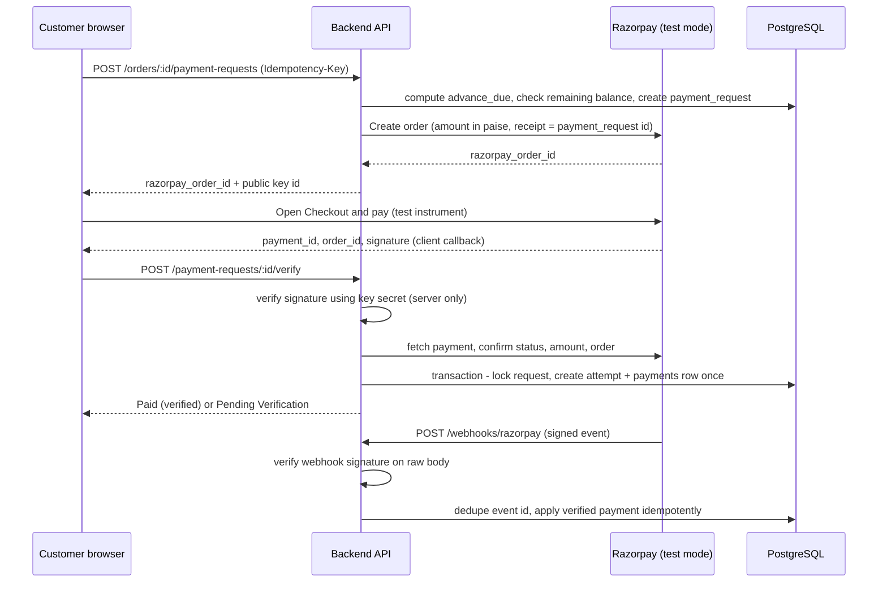

# Solar Business Management & Intelligence Platform

### Implementation-Ready Specification for **SunPower Solutions** (fictional case-study company)

> **Demo notice.** SunPower Solutions is a fictional rooftop-solar company used for a hackathon case study. This project is **not affiliated with, endorsed by, or connected to** any real SunPower company. All names, customers, prices, and figures shown in demos are sample data and must be labeled as such in the UI.

| Field | Value |
|---|---|
| Document | `SOLAR_MANAGEMENT_SYSTEM.md` |
| Companion file | `README.md` |
| Version | 0.1 — draft for team review |
| Date | 2026-10-31 |
| Source basis | Limited to the supplied master prompt — read [§1.6](#16-source-basis-and-limitations) first |

---

## Table of Contents

1. [Project Overview and Objectives](#1-project-overview-and-objectives)
2. [Source-Grounded Problem Analysis](#2-source-grounded-problem-analysis)
3. [Eight Main Business Problems and Module Mapping](#3-eight-main-business-problems-and-module-mapping)
4. [Scope](#4-scope)
5. [Real-World SunPower Context](#5-real-world-sunpower-context)
6. [Roles and Permissions](#6-roles-and-permissions)
7. [Seven Core Modules](#7-seven-core-modules)
8. [AI Assistance Layer](#8-ai-assistance-layer)
9. [AI-First Customer Support and Issue Escalation](#9-ai-first-customer-support-and-issue-escalation)
10. [End-to-End Workflow and Exception Paths](#10-end-to-end-workflow-and-exception-paths)
11. [Website Sitemap and Page Requirements](#11-website-sitemap-and-page-requirements)
12. [SunPower-Inspired Visual Design](#12-sunpower-inspired-visual-design)
13. [Dashboards and Analytics](#13-dashboards-and-analytics)
14. [Recommended Technical Architecture](#14-recommended-technical-architecture)
15. [Database Schema and Relationships](#15-database-schema-and-relationships)
16. [API Outline and Backend Business Rules](#16-api-outline-and-backend-business-rules)
17. [Razorpay Payment Integration](#17-razorpay-payment-integration)
18. [Automation and Notifications](#18-automation-and-notifications)
19. [Security and Privacy](#19-security-and-privacy)
20. [Testing and Acceptance Criteria](#20-testing-and-acceptance-criteria)
21. [Hackathon Demo Script and Judge Q&A](#21-hackathon-demo-script-and-judge-qa)
22. [Phased Implementation Plan](#22-phased-implementation-plan)
23. [Open Questions and Needs Confirmation](#23-open-questions-and-needs-confirmation)
24. [Final Completeness Checklist](#24-final-completeness-checklist)

---

## 1. Project Overview and Objectives

### 1.1 Purpose

Build an **End-to-End Solar Business Management & Intelligence Platform** for SunPower Solutions — not merely a solar booking website and not a standalone chatbot. The platform connects the whole business lifecycle and keeps every record traceable:

```
Customer enquiry → Site survey and approval → Quotation → Order and payment
→ Bill of Materials → Inventory dispatch and serial scanning → Technician assignment
→ Installation and testing → Customer signature → Warranty activation
→ Service and maintenance → Financial reporting
```

Traceable links must exist between: **customers, enquiries, surveys, quotations, orders, payments, materials, serial numbers, dispatches, installations, warranties, service tickets, and financial reports.**

### 1.2 Objectives

1. Centralize customer, enquiry, and communication history (replace WhatsApp/phone/paper silos).
2. Make quotations survey-driven and generate the Bill of Materials automatically.
3. Give real-time stock visibility and serial-number traceability from warehouse to customer roof.
4. Organize technician scheduling, installation records, testing, and handover.
5. Track warranties per product/serial and distinguish manufacturer from installer/service warranty.
6. Track service tickets from complaint to customer-confirmed resolution, with warranty checks before charges.
7. Verify advance/balance payments on the backend through **Razorpay (test mode for the hackathon)** and give project-wise financial visibility.
8. Provide a lightweight partner/installation-provider coordination capability inside the existing architecture.
9. Add AI as a **supporting intelligence layer** (summaries, missing-information checks, grounded explanations, AI-first support triage) without bypassing workflow, permissions, approvals, or deterministic rules.

### 1.3 Design Principles

| # | Principle | Consequence |
|---|---|---|
| P1 | **One record, many views** | Every fact has one authoritative table (§15.3); screens and AI read from it. |
| P2 | **Rules live in backend code** | Payment verification, stock availability, permissions, warranty eligibility, and financial math are never delegated to a model or the frontend. |
| P3 | **Humans approve consequential actions** | Approvals, money, stock, warranty/coverage decisions, customer commitments, and outbound messages need an authorized person. |
| P4 | **AI is optional, labeled, and grounded** | Every AI output is labeled, cites records, and has a non-AI fallback. |
| P5 | **Everything important is auditable** | Status changes, approvals, payments, stock/serial changes, warranty decisions, closures, and AI-assisted actions write audit entries. |
| P6 | **Do not invent business policy** | Unconfirmed rules are configurable and marked **Needs confirmation**. |
| P7 | **Hackathon-achievable** | Modular monolith, one database, minimal external services, mock/fallback for anything unavailable. |

### 1.4 Preserved Architecture

Seven core modules (kept intact): **(1) Customer and Enquiry, (2) Site Survey and Quotation, (3) Inventory and Warehouse, (4) Installation and Technician, (5) Warranty, (6) Service and Maintenance, (7) Finance and Analytics.** Razorpay payments (§17), the AI layer (§8), and the AI-first support chain (§9) are **integrated into** these modules, not added as separate products.

### 1.5 Conventions

| Tag | Meaning |
|---|---|
| **[SRC]** | Source-stated mandatory requirement (stated in the supplied master prompt, which relays the problem statement, booklet, and business requirements). |
| **[OPT]** | Optional enhancement. |
| **[REC]** | Recommendation of this specification (team may change). |
| **[NC]** | **Needs confirmation** — unresolved decision. Implement as configuration; do not hard-code. |
| **[CTX]** | Real-world context only; not a requirement of the fictional case study. |
| **[DEMO]** | Sample/demo value; must be labeled as demo data in the UI. |

ID prefixes **[REC]**: customer `CUS-000001`, enquiry `ENQ-…`, survey `SRV-…`, quotation `QUO-…`, order `ORD-…`, project `PRJ-…`, dispatch `DSP-…`, installation job `JOB-…`, warranty `WAR-…`, claim `CLM-…`, service ticket `TKT-…`, support case `CASE-…`, invoice `INV-…`, payment `PAY-…`. Generated from database sequences; immutable once issued.

### 1.6 Source Basis and Limitations

**Be explicit about what this document was built from.**

| Source mentioned in the master prompt | Available when this spec was written? | How handled |
|---|---|---|
| Master prompt (requirements, roles, modules, workflow, rules, examples) | **Yes** | Treated as the authoritative statement of the requirements it relays. |
| Original solar installation problem statement | Not supplied separately | Facts as relayed in the prompt (§2.1) are used; nothing else assumed. |
| Hackathon booklet and technology list | Not supplied separately | Technology list as relayed in the prompt (§14.1). |
| Prior conversation (business requirements) | Not supplied separately | Only requirements restated in the prompt are used. |
| Two SunPower-inspired UI screenshots | **Not viewable in this session** | Visual direction (§12) is derived from the prompt's written description only. **Team must compare §12 with the screenshots before finalizing the design.** |
| Additional SunPower business-challenge material | Not supplied separately | Treated as context only (§5). |
| Existing project specification | None supplied | This document defines the architecture; no existing requirements were removed. |

> **Action for the team:** before build, cross-check §24 against the original problem statement, booklet, and screenshots. Anything found there but missing here should be **added** (never replace existing content).

### 1.7 Glossary

| Term | Meaning |
|---|---|
| **On-Grid / Off-Grid** | System types sold (1–5 kW). Technical specifics are configured per package, not hard-coded. |
| **Bill of Materials (BOM)** | List of products and quantities generated from the selected package and capacity. |
| **Serialized item** | Product tracked per unit by serial number (e.g., inverter, battery, panel — which categories are serialized is configurable **[NC]**). |
| **Project** | The delivery record created from a confirmed order; all materials, jobs, warranties, and costs attach to it. |
| **Support case** | Customer-visible issue record carrying triage, escalation, and the case status machine (§9). |
| **Service ticket** | Formal service work/billing record (coverage decision, charges, parts, work logs) created from a case when service action is needed. |
| **Verified payment** | A payment confirmed by backend signature verification and/or verified webhook (or recorded by Admin as manual with evidence). Only verified payments affect balances and reports. |

---

## 2. Source-Grounded Problem Analysis

### 2.1 Company Facts [SRC]

| Fact | Value |
|---|---|
| Company | SunPower Solutions (fictional) |
| Volume | Approximately **40 rooftop solar installations per month** |
| Workforce | **15 technicians** |
| Customers | Residential customers and small factories |
| Products | Solar systems from **1 kW to 5 kW** |
| System types | **On-Grid** and **Off-Grid** |
| Current tools | WhatsApp, phone calls, paper registers, manual quotations |

### 2.2 Current-State Problems → Target State

| Current problem [SRC] | Business impact | Addressed by |
|---|---|---|
| Scattered enquiries (WhatsApp/phone/web) | Lost leads, duplicate work, no history | Module 1 — single enquiry/customer record |
| Manual quotations | Delays, inconsistent pricing | Module 2 — survey-gated, template-driven quotations |
| Incorrect material selection | Wrong or missing components on site | Module 2/3 — package-driven BOM + compatibility checks |
| Paper-based serial-number records | Untraceable equipment, warranty disputes | Module 3 — scanned serial capture linked to project |
| Unclear stock availability | Over-promising, delays | Module 3 — on-hand/reserved/available ledger |
| Disorganized technician schedules | Conflicts, idle time | Module 4 — scheduling with conflict checks |
| Scattered installation records | No proof of work | Module 4 — photos, tests, hours, signature |
| Difficult warranty tracking | Eligibility confusion | Module 5 — warranty records by serial |
| Untracked service complaints | Unresolved issues | Module 6 + §9 — tickets, cases, escalation chain |
| Limited financial visibility | Unknown profitability | Module 7 + §17 — verified payments, project P/L |

### 2.3 Sizing Implications [REC]

- ~40 installs/month ≈ roughly 2 per working day (working-day calendar **[NC]**) across 15 technicians (≈ 2–3 jobs per technician per month on average). Data volumes are small: a single PostgreSQL instance is sufficient.
- Photos and signatures dominate storage. Assuming roughly 10 photos per installation plus survey photos, expect on the order of hundreds to ~1,000 files per month — **check the storage plan limits** of the chosen file service.
- Concurrency risk is low but real at the warehouse (two people scanning the same serial) and at payment time (frontend callback racing a webhook). Both are handled by database constraints and idempotent processing (§15, §17).

---

## 3. Eight Main Business Problems and Module Mapping

| # | Problem | Existing module(s) | Minimal extension required | How demonstrated (§21 step) |
|---|---|---|---|---|
| 1 | **Customer management and disconnected communication** — centralize details, enquiries, history, project status, support interactions | Module 1; Module 6 (support history) | Unified customer timeline across all linked records; customer portal for status and cases | Step 1 |
| 2 | **Manual quotations and material calculation** — approved-survey quotation + automatic BOM | Module 2 (+ Module 3 for material data) | Package → BOM template engine with compatibility rules | Steps 2–4 |
| 3 | **Inventory visibility and equipment tracking** — stock, dispatch, serials, optional QR/barcode | Module 3 | Optional camera scanning; serial trace page | Step 8 |
| 4 | **Installation management and project visibility** — scheduling, assignment, records, handover, status | Module 4 | Customer-facing project status tracker | Steps 9–10 |
| 5 | **Warranty complexity and eligibility confusion** — by product, serial, dates, terms; manufacturer vs installer | Module 5 | Warranty party field (manufacturer/installer); eligibility lookup page; AI plain-language explanation | Step 11 |
| 6 | **After-sales service and maintenance** — tickets, warranty checks, assignments, repairs, confirmation | Module 6 (+ §9 chain) | AI-first triage, Support → Admin → Technician chain | Steps 12–14 |
| 7 | **Financial transparency and project profitability** — payments, expenses, costs, balances, project P/L | Module 7 (+ §17) | Razorpay test-mode payments; project profitability view | Steps 5–7, 15 |
| 8 | **Partner and installation-provider coordination** — handovers, status, capacity, responsibilities | Modules 4 and 6 (projects, scheduling, roles, audit) | **Optional** Partner role + `partners`/`partner_assignments` tables; no separate partner platform | Step 16 (**only if implemented**) |

Problem 8 reuses existing projects, jobs, roles, and audit records. It does **not** assume a nationwide partner network **[NC]**.

---

## 4. Scope

### 4.1 Mandatory [SRC]

| ID | Item |
|---|---|
| M-01 | Customer and Enquiry Management (Module 1) |
| M-02 | Site Survey and Quotation (Module 2) — **quotation only after survey approval** |
| M-03 | Automatic Bill of Materials from the selected package |
| M-04 | Inventory and Warehouse (Module 3): stock, reservation, dispatch, serial scanning, serial-to-project linking, dispatch prevention rules, returns/damage/corrections |
| M-05 | Installation and Technician Management (Module 4), including customer digital signature |
| M-06 | Warranty Management (Module 5) with configurable durations/start event |
| M-07 | Service and Maintenance (Module 6) with warranty check before charges |
| M-08 | Finance and Analytics (Module 7) |
| M-09 | Role-based access control with at least Admin/Owner, Sales, Warehouse, Technician, Support |
| M-10 | End-to-end workflow with exception paths (§10) |
| M-11 | Razorpay **test-mode** advance/balance payments with backend verification and webhooks (§17) |
| M-12 | AI-first support and escalation chain (§9) |
| M-13 | AI MVP: summaries, missing-information checks, grounded explanations — with labeling, permission-awareness, and non-AI fallback (§8) |
| M-14 | Role-aware dashboards (§13) |
| M-15 | Audit logging (§19) |
| M-16 | SunPower-inspired, original, responsive, accessible UI (§12) |
| M-17 | Hackathon demo (§21) |

### 4.2 Optional [OPT]

QR/barcode camera scanning; maps (Leaflet/Google Maps); WhatsApp/SMS/email delivery; GPS tracking; predictive maintenance; QR warranty lookup; AI features beyond the MVP (§8.4); lightweight partner coordination (Problem 8); refund workflow; CSV/PDF exports; offline technician mode; customer OTP login; customer-facing live chat beyond guided triage.

### 4.3 Out of Scope

| ID | Item |
|---|---|
| X-01 | Separate partner platform or nationwide partner network |
| X-02 | Live (non-test) Razorpay payments for the hackathon |
| X-03 | Tax/GST computation rules, statutory filing, subsidy eligibility determination, statutory payroll compliance (rules not provided — **[NC]**) |
| X-04 | Claims of legal/regulatory compliance |
| X-05 | Native mobile apps (responsive web only) |
| X-06 | IoT inverter monitoring / live generation data |
| X-07 | AI making warranty, payment, stock, approval, or closure decisions |
| X-08 | Sending customer/financial/signature/private-photo data to an external AI provider without a documented privacy decision |
| X-09 | ERP / external accounting integration |

---

## 5. Real-World SunPower Context

> **[CTX] only.** The additional material discusses public company and industry context. It is **inspiration, not requirements** of the fictional SunPower Solutions case study. This document has **not independently verified** these points.

| Context item (as described in supplied material) | How it informs the design | What it is **not** |
|---|---|---|
| Financial instability; the former SunPower Corporation's 2024 Chapter 11 filing | Motivates durable warranty records, exportable data, and clear financial visibility | Not a claim about the fictional company; not a requirement |
| Customer warranty and support complications | Motivates Problems 5 and 6 | Not evidence of SunPower Solutions' own failures |
| Complex installation coordination | Motivates Problem 4 | — |
| Dealer / installation-partner coordination | Motivates Problem 8 (lightweight only) | Does not require a partner network |
| Market pressures (financing costs, demand, policy, operating expenses, financial-reporting difficulties) | Motivates Problem 7 | No financing or policy logic is modeled |

**Guardrails:**
- Do not claim the real US SunPower company confirmed the fictional company's operational problems.
- Do not present the former SunPower Corporation and current SunPower Inc. as the same legal entity, and do not claim every listed issue applies to the current company.
- Do not turn unsupported real-world claims into product requirements.
- Use own placeholder identity and original/licensed assets (§12). Do not imply affiliation. Consider whether the display name could confuse judges **[NC]**.

---

## 6. Roles and Permissions

### 6.1 Roles

| Role | Type | Summary |
|---|---|---|
| **Admin / Owner** | Internal [SRC] | Full operational oversight; approvals; settings; finance |
| **Sales** | Internal [SRC] | Enquiries, customers, surveys (scheduling), quotations, orders |
| **Warehouse** | Internal [SRC] | Stock, purchases/receipts, reservations, scanning, dispatch, returns |
| **Technician** | Internal [SRC] | Assigned surveys/jobs, installation and service work |
| **Support** | Internal [SRC] | Customer issues, cases, tickets, warranty lookup, resolution review |
| **Customer** | External portal user | Own enquiries, quotations, payments, warranties, cases |
| **Partner** | External, **[OPT]** | Only if Problem 8 is implemented; see §6.5 |

Authorization is **permission-based**: roles map to permission strings (e.g., `survey.approve`, `dispatch.scan`) stored in the database; row-level scopes (own records, assigned jobs) are enforced on the server. The frontend only hides what the server would reject.

### 6.2 Permission Matrix

Legend: **C** create · **R** read · **U** update · **A** approve · **—** no access · *(own)* only the user's own records · *(assigned)* only records assigned to the user · *(ltd)* limited fields.

| Resource | Admin | Sales | Warehouse | Technician | Support | Customer | Partner [OPT] |
|---|---|---|---|---|---|---|---|
| Customers and enquiries | C R U A (merge) | C R U | R (ltd: name, site, contact for dispatch) | R (assigned, ltd) | C R U | C enquiry; R U (own profile) | R (assigned handovers, ltd) |
| Surveys | C R U A | C R U (schedule, record) | — | C R U (assigned; submit) | R | R (own: schedule/status) | — |
| Survey approval / rejection | **A** | — **[NC]** | — | — | — | — | — |
| Quotations | C R U A (discount over threshold **[NC]**) | C R U (issue) | R (BOM only) | — | R | R (own); accept/decline | — |
| Orders / projects | C R U A | C R U | R | R (assigned, ltd) | R | R (own) | R (assigned) |
| Payments (view / pay / record) | R; record manual; **A** reconcile | R (status) | R (gate status only) | — | R (status) | R (own); pay | — |
| Inventory and stock | C R U A | R (availability) | C R U | — | R (ltd) | — | — |
| Stock purchases and receipts | C R U A | — | C R U | — | — | — | — |
| Serial scanning and dispatch | R A (exception) | R | C R U | R U (assigned: confirm receipt) | R | — | — |
| Returns, damage, corrections | A (approve write-off) | — | C (request) R | C (report from site) | — | — | — |
| Technician profiles and schedule | C R U A | R | R | R (own); U availability (own) | R (+ propose service visit) | R (own visit date) | R U (assigned) |
| Installation jobs and records | C R U A (review/reopen) | R | R | C R U (assigned) | R | R (own); sign | R U (assigned) |
| Warranty records | C R U A (void) | R | R | R (assigned serials) | R | R (own) | — |
| Warranty claims / coverage decisions | A (exceptions) | R | R | R (assigned) | C R U (propose decision) | R (own) | — |
| Service tickets / support cases | C R U A | R | R (parts requests) | R U (assigned) | C R U | C R (own); confirm/dispute | R U (assigned) |
| Invoices and finance records | C R U A | R (own orders' invoices) | — | — | R (service invoice status) | R (own) | — |
| Expenses, payroll tracking | C R U A | — | — | R (own hours) | — | — | — |
| Subsidy paperwork | C R U A | R U | — | — | — | R (own status) | — |
| Settings (packages, warranty terms, payment rules) | C R U A | R (packages) | R (products) | — | R (help content) | — | — |
| Users and roles | C R U A | — | — | — | — | — | — |
| Audit logs | R | — | — | — | — | — | — |
| AI assistance | Scope = Admin data | Scope = Sales data | Scope = Warehouse data | Scope = assigned jobs | Scope = Support data | Triage on own data only | — |

> **[NC]** Who approves surveys (default Admin), whether Sales may approve under a threshold, and whether technicians perform surveys are not stated in the source; implement approver roles as configurable permissions.

### 6.3 Role Summary

| Role | Can view | Can create / update | Can approve | Cannot access or change |
|---|---|---|---|---|
| Admin / Owner | Everything, including audit logs | Everything via UI rules | Surveys, discounts over threshold, policy exceptions, write-offs, technician assignment (when required), warranty exceptions, manual payment reconciliation, timesheets, expenses | Cannot edit verified payment amounts or audit logs; cannot delete financial/audit records |
| Sales | Customers, enquiries, surveys, quotations, orders, availability, own-order invoices | Enquiries, customers, survey schedules, quotations, orders | None by default | Payments reconciliation, stock changes, finance, settings, audit logs |
| Warehouse | Stock, BOM per project, dispatch, minimal customer/site data | Receipts, reservations, scans, dispatches, return/damage requests | None (requests only) | Pricing, payments detail, customer history, finance, warranties (edit) |
| Technician | Assigned surveys/jobs/service work with needed customer/site/product/serial data | Survey submissions, job progress, photos, tests, time entries, work logs | None | Unassigned jobs, other customers, payments, pricing, finance, other technicians' pay |
| Support | Customers, cases, tickets, warranties, project/installation history, payment status | Cases, tickets, coverage proposals, triage corrections, internal notes | Resolution evidence (support review) | Finance records, stock changes, settings, payment changes, final closure of warranty exceptions |
| Customer | Own records only | Enquiry, profile, case messages, confirmations, payments | Own quotation acceptance; own resolution confirmation | Internal notes, other customers, costs/margins, audit data |

### 6.4 Actions Requiring Approval or an Audit Record

| Action | Approval required | Audit record |
|---|---|---|
| Survey approve / reject (with reason) | Admin | Yes |
| Quotation discount above threshold **[NC]** | Admin | Yes |
| Quotation acceptance recorded on customer's behalf | Evidence + Sales | Yes |
| Order created / cancelled | Cancel: Admin | Yes |
| Payment policy exception (dispatch/allocation before required payment) | Admin | Yes |
| Verified payment recorded (Razorpay) | Automatic after verification | Yes |
| Manual payment recorded / reconciled | Admin | Yes |
| Stock correction, write-off of damaged/missing items | Admin (threshold **[NC]**) | Yes |
| Serial assignment / unassignment / conflict override | Admin override only | Yes |
| Dispatch confirmed / delivery confirmed | Warehouse / assigned technician | Yes |
| Technician assignment (when configured) | Admin | Yes |
| Installation completion; reopen of completed job | Reopen: Admin | Yes |
| Warranty activation, void, claim decision, coverage exception | Admin for void/exception | Yes |
| Service charges applied; goodwill (free) repair | Admin for goodwill **[NC]** | Yes |
| Case escalation, Admin decision, reassignment, closure, reopening | Per §9 | Yes |
| AI-assisted action confirmed by a user | The confirming user | Yes (AI request metadata + user action) |
| Settings change (warranty terms, payment rules, packages) | Admin | Yes (old/new values) |
| Role/user change | Admin | Yes |

### 6.5 Partner Role (Optional, Minimum Permissions) [OPT]

Add **only** if Problem 8 is implemented. A Partner user belongs to one `partners` record and sees **only** `partner_assignments` addressed to that partner:

- **View:** assigned project reference, customer name and site address needed for the job, scope of work, schedule, required status updates.
- **Update:** assignment status (accepted / in progress / handed back / completed), notes, photos for assigned work.
- **Cannot:** see other customers, quotation prices, payments, financial records, internal notes, stock, other partners' data, or audit logs.
- Handover, capacity, and responsibility fields are stored on the assignment; changes are audited.

### 6.6 AI and Permissions

AI runs **as the logged-in user**: its retrieval layer calls the same service functions and permission checks as the REST API. It can never see records the user could not open, and it must refuse (with a neutral message) when asked about unauthorized records. Details: §8.3.
---

## 7. Seven Core Modules

**Record conventions (all modules) [REC]:** every table has an internal primary key, a human-readable code where listed, `created_at`, `updated_at`, `created_by`, and a `version` integer for optimistic locking. Financial, audit, serial, and warranty records are **never hard-deleted**. Status changes are written to a status-history table with actor, timestamp, and reason. Money is stored as integer minor units (paise) plus currency `INR`.

---

### 7.1 Module 1 — Customer and Enquiry Management

**Purpose.** One place for customer identity, enquiries from every channel, and the full history across surveys, quotations, orders, installations, warranties, and service.

**Users.** Sales (primary), Support, Admin; Customer (public form and portal).

**Screens.** Public enquiry form; enquiry list/detail; staff "log enquiry" form (phone/WhatsApp); customer list/detail with timeline; duplicate-review/merge screen (§11: P-02, S-10–S-15).

**Actions.** Register enquiry (website/phone/WhatsApp); create or link customer; update requirements; change enquiry status; mark lost/duplicate; merge customers (Admin); view unified timeline; start survey; AI summary and follow-up draft (§8).

**Customer fields.**

| Field | Rule |
|---|---|
| `customer_code` | Unique, system-generated, immutable (`CUS-…`) |
| `full_name` | Required, 2–120 chars |
| `phone` | Required; normalized to E.164; unique-ish key for duplicate detection (not strictly unique — families share numbers) |
| `alt_phone`, `email` | Optional; email format validated |
| `customer_type` | Residential / Small Factory [SRC] |
| `address` (lines, city, state, PIN), `geo` (optional lat/lng) | Address required before survey is scheduled |
| `preferred_contact` | Phone / WhatsApp / Email (optional) |

**Enquiry fields.**

| Field | Rule |
|---|---|
| `enquiry_code`, `customer_id`, `channel` | Channel ∈ Website / Phone / WhatsApp [SRC] |
| `requested_capacity_kw` | Number; 1–5 kW expected [SRC]. Outside range → warning and Admin note (policy **[NC]**), not silent rejection |
| `system_type` | On-Grid / Off-Grid / Undecided [SRC] |
| `monthly_bill_amount` (INR) and optional `monthly_units` | ≥ 0 [SRC: monthly electricity bill] |
| `roof_info` | Roof type, approximate area, floor/access notes [SRC: basic roof information] |
| `requirements_notes`, `preferred_visit_window` | Free text, max length enforced |
| `source_reference` | e.g., WhatsApp message link or call note |
| `status`, `lost_reason`, `assigned_to` | See statuses |

**Enquiry statuses.** `New → Contacted → Survey Scheduled → Survey Under Review → Survey Approved → Quotation Issued → Converted to Order`; exceptions `On Hold`, `Lost` (reason required), `Duplicate` (merged-into link). Not every enquiry reaches every status.

**Validations and business rules.**
1. Phone required for staff-created enquiries; public form requires phone **or** email, plus name and address area.
2. **Duplicate detection** runs on create: normalized phone, email, and address similarity. On a match, staff see "possible existing customer" and must **link to existing**, or **create new with a reason**. Public submissions never reveal existing customer data; they are created and flagged for staff review.
3. **Repeated enquiry:** a new enquiry from an existing customer within N days (default 30, configurable **[NC]**) is flagged "repeat" and linked to the earlier enquiry.
4. Customer merge is Admin-only, soft (source marked merged, all links re-pointed, audit entry); never deletes records.
5. Public form is rate-limited, validated server-side, and anti-spam protected **[REC]**; it returns an enquiry reference.
6. A customer can have many enquiries/projects; each enquiry may produce at most one *active* converted order.

**Related records.** Surveys, quotations, orders/projects, installations, warranties, service tickets/cases, payments, invoices, notifications.

**Edge cases.** Wrong/duplicate phone; shared family phone; WhatsApp enquiry missing address (create with "incomplete" flag); out-of-area site (service area **[NC]**); customer requests > 5 kW or a non-standard system; enquiry reopened after "Lost".

**AI assistance (§8.A).** Enquiry/history summary, missing-information check (roof details, monthly bill, address), follow-up draft for staff review.

---

### 7.2 Module 2 — Site Survey and Quotation

**Purpose.** Gate quotations behind an approved site survey and turn the approved findings into a template-based quotation with an automatic Bill of Materials.

**Users.** Sales, Technician (surveyor, **[NC]** who surveys), Admin (approval), Customer (view/accept).

**Screens.** Survey schedule calendar; survey form (mobile-first); survey approval queue; quotation create/review/detail; BOM review; acceptance (§11: S-20–S-33).

#### Survey

**Actions.** Schedule/assign; reschedule; record findings and photos; submit; approve/reject; rework and resubmit.

| Field | Rule |
|---|---|
| `scheduled_at`, `assigned_to` | Assignee availability checked (no overlap) |
| `roof_area_sqm` | > 0 [SRC] |
| `roof_direction` | N / NE / E / SE / S / SW / W / NW / Flat [SRC] |
| `tilt_degrees` | 0–90 [SRC] |
| `shadow_free_area_sqm` | > 0 and ≤ `roof_area_sqm` [SRC] |
| `cable_distance_m` | ≥ 0 [SRC]; optional split DC/AC |
| `grid_suitability` | Suitable / Needs Review / Not Suitable + notes [SRC]; required for On-Grid |
| `roof_type`, `structure_notes`, `access_notes` | Text/enums |
| `photos` | Minimum count and categories configurable (default: roof overview, shade source, meter/DB, cable route) **[REC]** |
| `recommended_capacity_kw`, `recommended_system_type` | Surveyor's findings summary |

**Survey statuses.** `Scheduled → In Progress → Submitted → Approved` · `Submitted → Rejected → Rework Required → Resubmitted (→ Submitted) → Approved` · `Cancelled`, `Rescheduled` (logged).

**Rules.**
1. Submission is blocked until required fields and minimum photos exist (response lists what is missing).
2. **Rejection requires a reason** (code + comment, ≥ 10 chars) which is shown to the surveyor and drives rework. Each resubmission creates a new revision; prior revisions stay readable.
3. Approved surveys are locked. Changes need Admin "reopen survey" with reason; reopening flags any Draft quotations for review.
4. Separation of duties (approver ≠ surveyor) is recommended **[REC / NC]**.

#### Quotation **[SRC: only after survey approval]**

**Statuses.** `Draft → In Review → Issued → Accepted` · `Issued → Declined` · `Issued → Expired` · `Superseded` (new version). Accepted quotations are immutable.

| Field | Rule |
|---|---|
| `quotation_code`, `version`, `survey_id` | `survey_id` must reference an **Approved** survey (backend guard) |
| `package_id`, `system_type`, `capacity_kw` | From configured packages; capacity must be allowed by the package |
| `line_items` | Generated from BOM (below); unit prices from the configured price list |
| `discount`, `tax_lines`, `total` | Tax and discount rules **[NC]** — configurable, never invented |
| `validity_days`, `terms_template`, `payment_terms` | Template-driven; defaults **[NC]** |
| `customer_acceptance` | Method (portal e-accept / staff-recorded with evidence), timestamp, actor |

**Rules.**
1. **Backend rejects quotation creation unless the enquiry's latest survey is Approved.** A newer rejected/reopened survey blocks new quotations.
2. Quotation uses a template (header, scope, BOM table, payment terms, warranty summary pulled from warranty terms, T&Cs).
3. Accepting a quotation creates the **order** and **project** and freezes a BOM snapshot (§7.3).
4. Decline stores a reason; the enquiry may go to `Lost` or re-quote (new version).

#### Bill of Materials generation [SRC]

- Each package has `package_bom_items`: product (or category), quantity rule, and optional alternatives. Quantity rule types **[REC]**: `FIXED`, `PER_KW`, `PER_PANEL`, `CEIL_DIV_KW` (e.g., panels = ⌈capacity_W ÷ panel_wattage⌉).
- **Compatibility rules** (configurable, **[NC]** until confirmed): e.g., an On-Grid package must not include battery lines; an Off-Grid package requires battery and a charge controller or hybrid inverter; inverter capacity must cover the system capacity. Violations block issuing and show the rule.
- Staff may adjust lines with a mandatory reason; the system shows variance from the template. Quantities/prices in seed data are **[DEMO]** values — e.g., a 3 kW demo package with a *demo* 540 W panel gives ⌈3000 ÷ 540⌉ = 6 panels. These are examples, not company rules.

**Related records.** Enquiry, customer, package, products, price list, order, project, BOM snapshot, warranty summary.

**Edge cases.** Survey approved but customer changes capacity (new survey or Admin-approved variation); quotation expiry; customer accepts after expiry (re-validate prices); package discontinued after quote; survey rejected repeatedly (escalate to Admin).

**AI assistance (§8.B).** Summarize survey findings, flag missing/inconsistent fields, compare entered requirements against configured packages, explain why a BOM needs review. AI never approves surveys or issues binding quotations.

---

### 7.3 Module 3 — Inventory and Warehouse Management

**Purpose.** Know exactly what is in stock, what is reserved for which project, and which serial number went to which customer.

**Users.** Warehouse (primary), Admin, Sales (availability), Technician (delivery confirmation/returns).

**Screens.** Stock overview; product detail with movements; goods receipt with serial capture; project BOM readiness; dispatch list; **scan-and-dispatch**; returns/damaged/missing; serial trace (§11: S-50–S-57).

**Products.** Category (Panel, Inverter, Battery, Charge Controller, Mounting, Cable, Protection, Earthing, Other [SRC lists panels, inverters, batteries, charge controllers, and other components]), `is_serialized`, SKU, unit, `reorder_level`, optional supplier, `standard_cost`.

**Stock model.**
- `on_hand` = receipts − dispatches ± returns/adjustments (ledger-derived, maintained transactionally).
- `reserved` = open reservations for confirmed projects.
- `available` = `on_hand − reserved`; DB check prevents negative values.
- **Movement types:** `PURCHASE_RECEIPT`, `RESERVE`, `RELEASE`, `DISPATCH`, `RETURN`, `DAMAGED`, `MISSING`, `ADJUSTMENT_IN`, `ADJUSTMENT_OUT`. Every movement records product, quantity, serials (if any), project/order, user, timestamp, reason.

**Serial items.** One row per physical serialized unit: `serial_number`, product, status (`IN_STOCK`, `RESERVED`, `DISPATCHED`, `DELIVERED`, `INSTALLED`, `RETURNED_QC`, `DAMAGED`, `MISSING`, `REPLACED`), purchase receipt and unit cost, current project/customer. Unique on `(product_id, serial_number)`.

**Actions and rules.**

| Step | Rule |
|---|---|
| Generate material list | From project BOM snapshot (created at order creation) |
| Reserve / allocate | Triggered when the configured payment gate is satisfied, or by an approved policy exception (§17.10). Each BOM line reserves min(required, available); shortages are flagged "Short" with quantity missing, and Admin/Warehouse are notified. Partial reservation is allowed; **dispatch is not** beyond reserved quantity |
| Create dispatch | Dispatch note per project from reserved lines; statuses `Draft → Picking → Scanning → Ready → Dispatched → Delivered`; `Cancelled`; `Partially Dispatched` |
| **Scan serials** | For each serialized line, the number of scanned serials must equal the dispatch quantity. Each scan is validated: serial exists; product matches the BOM line; status `IN_STOCK`/`RESERVED` for this project; not assigned elsewhere; not damaged/quarantined. Failures return a specific message |
| Link to project | On dispatch confirmation, `serial_items` get project/customer/dispatch links and status `DISPATCHED`; movements written; warranty records created `Pending Activation` (§7.5) |
| Delivery confirmation | `Delivered` is set when the technician/warehouse confirms receipt at site (`delivered_at`). This is the default warranty start event **[SRC]** |
| Prevent errors | Backend blocks: dispatch above available/reserved; unscanned serialized lines; serial already on another project; wrong product; unpaid gate without exception |
| Returns | Return from site: serial → `RETURNED_QC`; after QC → `IN_STOCK` or `DAMAGED`; unlink from project with audit; warranty record flagged for review |
| Damaged / missing | Record with reason, photo, location; Admin approves write-off; cost recorded for finance (accounting treatment **[NC]**) |
| Corrections | Stocktake adjustments need a reason; large adjustments need Admin approval (threshold **[NC]**) |
| Goods receipt | Records supplier invoice, quantities, serials, unit cost; creates `PURCHASE_RECEIPT` movements; feeds finance "stock purchases" |

**Scanning methods.** Camera QR/barcode scan **[OPT]**; USB/Bluetooth scanner (acts as keyboard) and manual entry as fallback. Scan UI shows progress per line (e.g., "Inverter 1/1, Battery 2/4") and the last scanned serial.

**Edge cases.** Two people scan one serial simultaneously (DB constraint + row lock → second fails clearly); unknown serial (cannot be created at dispatch — register via goods-receipt correction with Admin approval); product substitution (approved alternative recorded against BOM line, customer-impact flag, Sales notified); partial dispatch across days; cancelled order with reserved stock (auto-release); returned unit with active warranty.

**AI assistance (§8.C).** Summarize material readiness, flag shortages/serial conflicts/missing dispatch data from records, suggest next steps. AI never reserves, dispatches, or alters stock.

---

### 7.4 Module 4 — Installation and Technician Management

**Purpose.** Schedule the right technicians, capture complete installation evidence, and hand over a tested system with the customer's signature.

**Users.** Admin (assignment), Technician (execution), Sales/Support (visibility), Customer (signature, status).

**Screens.** Technician list/profile; availability and schedule calendar; job list; job detail; mobile installation workflow; completion review (§11: S-60–S-65).

**Technician profile.** Employee code, linked user, skills/certifications (optional), service areas, working days/hours, status (`Active`, `On Leave`, `Inactive`), cost rate (visible to Admin only), max jobs per day (configurable).

**Availability.** Weekly pattern plus unavailable blocks (leave, training). The scheduler flags overlaps, leave conflicts, and daily-capacity breaches.

**Installation job.**

| Field | Rule |
|---|---|
| `job_code`, `project_id`, `type` (Survey / Installation / Rework / Service) | Installation jobs require the project to be in a state that allows scheduling per payment/dispatch gates **[NC]** |
| `scheduled_start/end`, assignments (`LEAD`, `HELPER`) | At least one lead; conflicts checked |
| `actual_start_at`, `actual_end_at` | Captured by the technician workflow |
| Time entries | Per technician clock-in/out → **working hours** [SRC] |
| `installed_capacity_kw`, system details | Panel count, inverter and battery serials (verified against project serials), mounting notes [SRC: capacity and system details] |
| Photos | Required categories configurable, e.g., roof before, panel layout, inverter, wiring, earthing, meter/grid, final **[REC]** |
| Test results | Checklist from a test template per system type (On-Grid/Off-Grid); each item pass/fail with measured value. Thresholds are configuration **[NC]** |
| Customer signature | Drawn on device; stored with signer name, timestamp, job reference |

**Job statuses.** `Pending Scheduling → Scheduled → In Progress → Testing → Pending Signature → Completed`; exceptions `On Hold`, `Rescheduled` (logged), `Rework Required`, `Incomplete`, `Cancelled`.

**Completion requires (backend check; response lists anything missing):** actual start/finish times; installed capacity and system details; all serialized items from the dispatch accounted for (installed or returned); required photos; test checklist complete and **passed**; customer signature. Admin override of the signature requirement is not allowed by default **[NC]**.

**Exception handling.**
- **Failed testing:** status `Rework Required`; failure and measurements recorded; revisit job scheduled; completion blocked until a passing test.
- **Incomplete installation:** `Incomplete` with reason code (weather, material shortage, customer unavailable, site issue); hours recorded; reschedule.
- **Rescheduling:** requires reason and requester (customer/company); notifies customer and technicians; keeps history.
- **Customer dispute / refusal to sign:** job stays `Pending Signature` with dispute notes; Admin and Support notified.
- **Material shortfall at site:** technician requests items; Warehouse issues a supplementary dispatch.

**Related records.** Project, dispatch/serials, customer, warranty activation trigger, finance (hours → labor cost), notifications.

**Edge cases.** Technician unavailable at short notice (reassign with audit); two jobs overlapping; geographic clustering **[OPT]**; technician paid hourly vs per job **[NC]**; poor connectivity during photo upload (retry queue; offline mode **[OPT]**).

**AI assistance (§8.D).** Summarize installation history and technician notes; no fault diagnosis or electrical-safety instructions.

---

### 7.5 Module 5 — Warranty Management

**Purpose.** Make warranty status for every serialized product — and for installer workmanship — a lookup, not an argument.

**Users.** Support (lookup, claims), Admin (terms, exceptions), Customer (own warranties), Technician (assigned serials), Sales/Warehouse (read).

**Screens.** Warranty search (by customer or serial); warranty detail with eligibility panel; claim list/detail; warranty terms settings (§11: S-70–S-72, S-102).

#### Configurable warranty terms

`warranty_terms`: product category or specific product, **party** (`MANUFACTURER` or `INSTALLER`), scope (`SERIAL` or `PROJECT`), `duration_months`, `start_event`, coverage text (inclusions/exclusions), coverage scope (`PARTS`, `LABOR`, `BOTH`), claim procedure/contact.

Source examples (configurable, **not** universal manufacturer promises) **[SRC]**:

| Product | Example duration |
|---|---|
| Inverter | **2 years** (24 months) |
| Battery | **2 years** (24 months) |
| Solar panels | **20 years** (240 months) |

**Start event.** Default per source: warranty **begins after delivery** — `start_date = delivery date` (`delivered_at` from the dispatch, §7.3) **[SRC]**. The setting `warranty_start_event` is an enum (`DELIVERY` default; alternatives `INSTALLATION_COMPLETION`, `COMMISSIONING`) — **alternate activation timing is [NC]**. Also **[NC]**: whether "delivery" means delivery of equipment to the site or handover of the installed system; this spec implements equipment delivery to site as the default.

**Installer/service warranty.** Duration, scope, and who bears repair cost are **[NC]**. The data model supports `INSTALLER` terms at project scope (e.g., workmanship) alongside serial-scope manufacturer terms. Manufacturer vs installer responsibility **[NC]** — the UI shows both separately with the `party` badge.

#### Warranty record

`warranty_records`: `warranty_code`, `serial_item_id` (nullable for project scope), `project_id`, `customer_id`, `product_id`, `term_id`, `party`, `start_date`, `end_date` (= start + duration, computed by backend), `status`, `activated_at`, `activation_event`, `replaced_by_serial_id`.

**Statuses.** `Pending Activation → Active → Expired` · `Active → Void` (Admin, reason) · `Active → Superseded` (replacement; remaining-term inheritance **[NC]**). *Expiring Soon* is derived (within N days, configurable) and drives reminders.

**Automatic activation.** Records are created `Pending Activation` when serials are linked at dispatch. When the configured start event occurs, the backend sets `start_date`, computes `end_date`, and sets `Active`. With the default `DELIVERY` event this occurs on delivery confirmation; workflow stage 20 (§10) then **verifies** every serialized item has an active record (and activates now under an installation-based rule). Legacy items without records can be backfilled by Admin with audit.

#### Eligibility lookup

Input: customer code/phone, or serial number, plus claim date (default today). The **backend** returns, per warranty record:

| Result | Meaning |
|---|---|
| `WITHIN_PERIOD` | Record `Active` and claim date between `start_date` and `end_date`; shows days/months remaining |
| `EXPIRED` | Claim date after `end_date` |
| `NOT_ACTIVE` | `Pending Activation` or start date in the future |
| `VOID` | Voided with reason |
| `NO_RECORD` | No warranty record for the serial/customer |

`WITHIN_PERIOD` means the **period** is valid. Whether a particular fault is **covered** (exclusions, misuse, scope) is a human **coverage decision** (Covered / Not Covered / Needs Review, with reason and terms reference) recorded by Support and, for exceptions, approved by Admin. The system never auto-denies a claim on fault type.

**Source example [SRC] — inverter fault at 18 months after installation.** Support searches by customer or serial → system finds the inverter's warranty record (inverter term example: 24 months) → backend returns `WITHIN_PERIOD` with the remaining period (≈ 6 months, adjusted for any gap between the start event and installation) → Support records the coverage decision → free covered repair/replacement proceeds (subject to terms) → tracked to customer-confirmed resolution (§7.6). If the same fault occurred at 30 months: `EXPIRED` → paid-repair path.

#### Claims

`warranty_claims`: `claim_code`, `warranty_id`, `ticket_id`, type (`REPAIR`/`REPLACEMENT`), `coverage_decision`, decision reason and approver, manufacturer RMA/reference (if applicable), replacement serial (links a new `serial_items` row and new/superseding warranty), status.

**Claim statuses.** `Submitted → Under Review → Approved | Not Covered → In Repair / Replacement Pending → Fulfilled → Closed`; `Cancelled`.

**Rules and edge cases.** Warranty dates are computed only by the backend; terms changes apply to **future** records only (existing records keep their term snapshot); replaced serial links old and new records; ownership transfer **[NC]**; partial coverage (parts but not labor); claim after expiry → `Not Covered` and paid-repair path; reminders at configurable thresholds (default 60/30/7 days **[REC]**).

**AI assistance (§8.E).** Plain-language explanation of recorded terms, dates, and the backend result, linking to the record and showing the rule; labeled as AI explanation distinct from the system result.

---

### 7.6 Module 6 — Service and Maintenance

**Purpose.** Register complaints, check warranty **before** applying any charge, assign and track repair work, and close only after the customer confirms.

**Users.** Support (owner), Admin (approval/assignment), Technician (execution), Customer (report/confirm), Warehouse (parts).

**Screens.** Ticket list/create/detail; case queue and timeline; coverage and charges panel; assignment; technician job; resolution review (§11: S-80–S-89). The customer-facing chain is in §9.

**Relationship between case and ticket [REC].** A **support case** (`CASE-…`) is the customer-visible issue record and owns the **status machine** (§9). A **service ticket** (`TKT-…`) is the work/billing record created by Support when service action is needed (coverage decision, charges, assigned work, parts, work logs). A case may exist without a ticket (basic issue resolved by AI guidance). A ticket always has exactly one case; staff-registered complaints auto-create the case. Ticket state is `Open / Closed / Cancelled` and follows the case — the ticket cannot be closed unless the case is `Closed`.

**Ticket fields.** `ticket_code`; customer; project/installation; product; **serial number**; warranty record; source (Website, Phone, WhatsApp, AI case, Staff); category; description; priority and `safety_flag`; `coverage_decision` (`PENDING`, `COVERED_WARRANTY`, `NOT_COVERED_PAID`, `GOODWILL` **[NC]**); charges; assignment and schedule; work logs; parts used; resolution notes; customer confirmation.

**Rules.**
1. **Lookup** by customer code/phone/serial shows the customer, project, installation date, products, and warranty records.
2. **Warranty eligibility check precedes charges:** the backend refuses to add charges while `coverage_decision = PENDING`.
3. **Covered:** free repair/replacement subject to applicable terms [SRC]. **Not covered / invalid warranty:** paid repair [SRC].
4. **Charges** (configurable **[NC]**): lines of type `PART`, `LABOR`, `VISIT`, `OTHER` using a configured service rate card and product prices; no rates are hard-coded. Paid repairs require customer approval of the estimate before work **[REC]**; payment through the same Razorpay flow with `purpose = SERVICE_CHARGE` **[OPT]**.
5. **Goodwill/free exception** on an uncovered case needs Admin approval and reason **[NC]**.
6. **Assignment** follows §9 (Admin approval/assignment) and Module 4 conflict checks; technician sees only assigned work.
7. **Repair progress** is tracked via technician work logs: status updates, findings, parts used (with serials, issued by Warehouse as a service dispatch), photos/test results, resolved yes/no.
8. **Closure requires:** technician work complete; Support evidence review; customer confirmation; charges finalized; paid-repair payment verified or Admin waiver. Technician completion alone never closes a ticket.
9. **Escalation:** unassigned beyond configured time, safety flag, unresolved technician visit, or customer request → escalate (§9). SLA durations **[NC]**.
10. **Repeat complaints:** same customer + serial (or project) within N days sets `repeat_count` and raises priority; shown to Support/Admin.
11. **Unresolved repairs:** technician records reason and returns the case to Support/Admin; reassignment preserves history.
12. **Replacement tracking:** replacement part/unit serial recorded, linked to the old serial (`REPLACED`) and to a new/superseding warranty record.

**Edge cases.** Customer reports an issue for equipment with no warranty record (Support searches/backfills); wrong serial entered; customer disputes charges; part unavailable (`On Hold` with expected date); repeat failure after replacement; customer unreachable for confirmation (auto-closure is **not** allowed by default **[NC]**).

**AI assistance (§8.D, §8.E, §9).** Ticket summary, identification of relevant product/serial/warranty records, suggested troubleshooting *questions* (labeled suggestions), warranty explanation.

---

### 7.7 Module 7 — Finance and Analytics

**Purpose.** Show verified money in, recorded costs out, and what each installation really earned.

**Users.** Admin (full), Sales (own-order invoice view), Customer (own invoices/payments), Support (service invoice status).

**Screens.** Invoices; payments and Razorpay status; expenses and stock purchases; technician hours and pay records; subsidy tracker; project profitability; daily/weekly/monthly reports; analytics dashboards (§11: S-90–S-96, §13).

#### Payments

- Advance and full/balance payments are recorded from **verified Razorpay transactions** (§17) or as **manual payments** (cash, bank transfer, cheque) entered by Admin with reference, date, and proof — whether offline payments are accepted is **[NC]**.
- Order amounts: `order_total`, `advance_due` (from configured policy **[NC]**), `verified_paid`, `outstanding = order_total − verified_paid` (if the result is negative, the UI shows "Overpaid — review required" instead of a negative balance).
- Payment history lists every attempt and its outcome; only verified payments affect balances, invoices, and reports.

#### Invoices

`invoices` (+ items): generated from the accepted quotation after order confirmation (type, numbering, and tax presentation **[NC]**); statuses `Draft → Issued → Partially Paid → Paid` and `Void`; payment allocations link verified payments to invoices; receipts for each verified payment.

#### Costs and project profit/loss

| Component | Definition | Included by default? |
|---|---|---|
| **Contract revenue** | Accepted order total excluding pass-through taxes (tax treatment **[NC]**) | Yes |
| **Material cost** | Σ unit cost of dispatched items − returned items; serialized items at actual receipt cost, non-serialized at weighted-average cost (costing method **[NC]**) | Yes |
| **Labor cost** | Σ approved technician hours × technician cost rate, for installation and rework jobs | Yes |
| **Other direct costs** | Project expenses: transport, permits, consumables | Yes |
| **Service/warranty cost** | Parts and labor on tickets linked to the project that are not billed to the customer (covered/goodwill repairs); open repairs shown as **estimated** until closed | Yes (labeled actual vs estimated) |
| **Damaged/missing write-offs** | Costs attributable to the project | Yes, if linked **[NC]** |
| **Overheads** (rent, admin salaries, marketing) | General business costs | **No** by default **[NC]** |
| **Subsidy** | Receivable amount as entered; counted as income only when marked `Disbursed` **[NC]** | Configurable |

```
Project profit (to date) = Contract revenue − (Material + Labor + Other direct + Service/warranty costs)
Margin %                 = Project profit ÷ Contract revenue
Cash view                = Verified payments received − costs paid
```

Estimated values (BOM standard costs at quotation time) are always labeled **Estimate**; recorded values are labeled **Actual**. Never mix them in one unlabeled number.

#### Other finance records

- **Stock purchases:** supplier, invoice number, items, amounts, payment status; linked to goods receipts (Module 3).
- **Technician hours and payments / payroll-related tracking [SRC]:** approved timesheets, pay period, rate, gross amount, paid/unpaid status. Statutory payroll compliance is out of scope **[NC]**.
- **Subsidy paperwork tracking [SRC]:** per project checklist and status `Not Applicable → Documents Pending → Submitted → Under Review → Approved/Rejected → Disbursed`, document uploads, dates, receivable amount. **No eligibility rules are implemented** **[NC]**.
- **Open repairs and financial impact:** open tickets with estimated cost, billed amount, and project link.
- **Reports:** daily, weekly, monthly summaries (§13); filters by date range, system type, capacity band, technician, status, customer type; drill-down from every figure to underlying records; CSV export **[OPT]**.

**Rules and edge cases.** Financial totals are computed server-side from ledger tables; verified payments are immutable (corrections are reversing entries by Admin); partial payments; overpayment; order cancelled after advance (refund policy **[NC]**; refund workflow is future scope); payment verified after order was cancelled → flagged for Admin; expense approval before it counts toward profit.

**AI assistance (§8.F).** Summaries and explanations of recorded figures; flags unusual or incomplete records. AI never calculates the official figures, presents estimates as actuals, or makes accounting decisions.

---

## 8. AI Assistance Layer

AI is a **supporting intelligence layer** inside the existing modules. Core operations (enquiries, surveys, quotations, payments, stock, installation, warranty, service, finance) work with AI switched off.

### 8.1 Principles and Boundaries [SRC]

- Use only data the **current user** is authorized to access; ground every answer in application records and show the source records.
- If data is missing, stale, or contradictory, **say so** instead of guessing.
- **Deterministic rules stay in backend code:** payment verification, stock availability, permissions, warranty eligibility, financial calculations.
- **Human confirmation** is required for anything that changes records, sends messages, approves work, affects money, or changes customer commitments.
- AI **cannot**: bypass approvals; create or verify payments; change stock; make warranty/coverage decisions; approve surveys; issue binding quotations; assign technicians; close cases; provide hazardous electrical instructions; claim a definitive fault diagnosis.
- Every AI output is **labeled "AI-generated"** and visually separated from verified system data (§12.7). Mock/demo output is labeled **"Demo AI output (rule-based template)"**.
- Do **not** claim a model, RAG system, or provider is in use unless implemented. The MVP uses structured record retrieval (no vector search). If approved help articles are searched, use plain PostgreSQL full-text search.
- No customer data, financial records, signatures, or private photos go to an external AI provider without an explicit, documented privacy decision **[NC]**. Default provider mode is `mock`.
- A non-AI fallback exists for every feature.

### 8.2 Feature Specifications

#### AI-A — Enquiry Summarization and Follow-Up Assistance

| Attribute | Specification |
|---|---|
| User problem / user | Sales and Support lose time reading scattered notes; need next steps |
| Workflow location | Enquiry detail and customer detail pages (buttons "Summarize this record", "Check missing info", "Draft follow-up") |
| Inputs / permissions | Enquiry, customer profile, linked surveys/quotations/cases the user may read (`customer.read`, `enquiry.read`) |
| Output / display | Summary card + missing-fields list + draft message; side panel labeled AI-generated with source links |
| Type | **Hybrid**: missing-field detection is deterministic (required-field rules); summary/draft wording is AI-generated or template |
| Validation / review / fallback | Missing-field list always computed by rules; draft is editable text, **never auto-sent**; sending requires an authorized user click and a configured integration. Fallback: template summary ("Customer, channel, capacity, bill, missing: …") |
| Privacy | Phone/address masked from the model context unless essential **[REC]**; no external provider by default |
| Test / demo | Enquiry with no roof info → missing-info list shows roof area and bill; summary cites ENQ/CUS records (§21 step 4) |
| Scope | Summary + missing-info: **MVP**. Follow-up draft: **Optional** |

#### AI-B — Survey and Quotation Assistance

| Attribute | Specification |
|---|---|
| User problem / user | Admin/Sales must spot inconsistent surveys and mismatched packages |
| Location | Survey detail, approval queue, quotation review |
| Inputs / permissions | Survey fields/photos metadata, requirements, configured packages, BOM, compatibility rule results (`survey.read`, `quotation.read`) |
| Output | Findings summary; flagged inconsistencies (e.g., shadow-free area larger than roof area — blocked by validation, so flagged only for contradictions between fields and recommended capacity); explanation of rule violations produced by the rule engine |
| Type | **Hybrid** — checks and package comparison are deterministic; wording is AI/template |
| Review / fallback | Advisory only; approval and issuing stay with authorized users and existing rules. Fallback: rule-violation list without narrative |
| Privacy | Photos are **not** sent to a model (metadata only) |
| Test / demo | Survey with 5 kW recommendation but small shadow-free area → flag shown with source fields |
| Scope | **Optional** (rule-based checks are part of core Module 2) |

#### AI-C — Inventory and Project Coordination Assistance

| Attribute | Specification |
|---|---|
| User problem / user | Warehouse/Admin need a quick "is this project ready to dispatch?" |
| Location | Project BOM readiness page |
| Inputs / permissions | Project BOM, stock levels, reservations, serial assignments, payment-gate status (`inventory.read`, `project.read`) |
| Output | Readiness summary: shortages, conflicting serials, missing scans, payment-gate blocks, suggested next steps (suggestions only) |
| Type | **Hybrid** — readiness table is deterministic; narrative is AI/template |
| Review / fallback | Cannot reserve/dispatch; buttons call normal endpoints under the user's permission. Fallback: the deterministic readiness table |
| Test / demo | Project short of one battery → summary lists shortage with product and quantity |
| Scope | **Optional** |

#### AI-D — Installation and Service Assistance

| Attribute | Specification |
|---|---|
| User problem / user | Support needs case/ticket summaries; Admin needs installation history |
| Location | Case detail, ticket detail, job detail |
| Inputs / permissions | Case messages, ticket, linked product/serial/warranty, job notes visible to the user (`case.read`, `job.read`) |
| Output | Summary; relevant product/serial/warranty records; suggested **clarifying questions** and next steps, labeled suggestions |
| Type | AI-generated with deterministic record linking |
| Safety | Never definitive diagnosis; never electrical work instructions; safety signals force escalation (§9.3). Technical/safety-sensitive issues → qualified personnel |
| Fallback | Template summary + linked records |
| Test / demo | Case with "burning smell" → AI does not guide; case flagged P1 and routed to Support |
| Scope | Case summary for Support: **MVP** (part of the §9 chain). Installation-history summary: **Optional** |

#### AI-E — Warranty Explanation Assistance

| Attribute | Specification |
|---|---|
| User problem / user | Support and customers don't understand terms and eligibility |
| Location | Warranty detail ("Explain this warranty"), customer portal warranty page |
| Inputs / permissions | One warranty record, its term, backend eligibility result, claim history (`warranty.read`) — customers only own records |
| Output | Two clearly separate panels: **(1) System result** (backend eligibility, dates, rule/term used, record link) and **(2) AI explanation** in plain language |
| Type | **Hybrid** — result deterministic; explanation AI/template |
| Review / fallback | AI text must not contradict the result; output validator checks every date/duration/result against the record and replaces the text with the template if mismatched. Fallback: template sentence from the record |
| Test / demo | 18-month inverter case: panel 1 `WITHIN_PERIOD`; panel 2 explains remaining period and says coverage depends on the terms and Support's decision (§21 step 11) |
| Scope | **MVP** |

#### AI-F — Financial and Operational Insight Assistance

| Attribute | Specification |
|---|---|
| User problem / user | Owner wants a plain-language readout of dashboards |
| Location | Admin dashboard "Summarize" panel; project profitability page |
| Inputs / permissions | Verified aggregates and records the user may read (`finance.read`) — Admin only |
| Output | Summary of verified figures with links; flags for unusual/incomplete records (e.g., project with hours but no cost rate) for human review |
| Type | **Hybrid** — all numbers come from SQL calculations injected into the text; AI never computes figures |
| Validation | Any number in the output must exist in the provided data payload; otherwise fallback template |
| Fallback | Static KPI summary |
| Scope | **Optional** |

#### AI-G — Customer Issue Triage and Guidance

Specified in §9.2 (MVP, required by the escalation chain).

### 8.3 Minimal Implementation Architecture [REC]

An `ai` module **inside the existing Express app** (no new microservice):

| Component | Responsibility |
|---|---|
| **Context builder** | Calls existing service-layer functions **with the caller's identity**, so permission checks and row scopes are identical to REST; trims to needed fields; masks sensitive fields; enforces input size limits |
| **Prompt templates** | Versioned templates per feature; instruct "use only provided records; say 'not available' if missing; never invent numbers" |
| **Provider adapter** | `mock` (deterministic templates, default), `disabled`, `external` (only when a documented privacy decision exists; `AI_EXTERNAL_ALLOWED=true`). Provider/model names are configuration, never claimed unless used |
| **Output validator** | JSON-schema validation; every cited record ID must have been in the context; numbers/dates cross-checked against context; unsafe-content filter; on failure → fallback |
| **Safety layer** | Keyword/pattern safety screening applied **before** the model on customer text; safety hits bypass the model and escalate |
| **Audit** | `ai_requests` row: user, feature, record references, provider/mode, status, latency, input/output hashes; raw prompts/outputs are **not** stored by default (short-retention debug option **[NC]**) |
| **Rate limits** | Per user/feature; max input and output lengths |
| **Fallback** | Any timeout/error/unavailable provider returns the deterministic template and a notice "AI assistance unavailable — showing system summary" |

**AI-suggested actions** are returned as `proposed_actions` (e.g., "Open survey SRV-… for missing roof area"). The UI renders them as buttons that call the normal API under the user's own permissions and validation; the AI never calls mutating endpoints itself. Drafted messages are saved as drafts only.

### 8.4 AI Feature Matrix

| ID | Feature | Module | Scope | Data inputs | Human review | Demo method |
|---|---|---|---|---|---|---|
| AI-A1 | Enquiry/customer summary | 1 | **MVP** | Enquiry, customer, linked records | Read-only output | Enquiry detail → "Summarize" |
| AI-A2 | Missing-information check | 1 | **MVP** | Required-field rules + enquiry | Staff acts on list | Enquiry without roof info |
| AI-A3 | Follow-up message draft | 1 | Optional | Enquiry + missing list | Staff edits and sends | Draft shown, "not sent" |
| AI-B1 | Survey consistency review | 2 | Optional | Survey fields, packages | Admin decides | Flag on odd survey |
| AI-B2 | Package/BOM review explanation | 2 | Optional | BOM, compatibility results | Sales decides | Rule violation explained |
| AI-C1 | Project material readiness | 3 | Optional | BOM, stock, serials, payment gate | Warehouse acts | Short-stock project |
| AI-D1 | Case/ticket summary + linked records | 6 | **MVP** | Case, ticket, serial, warranty | Support reviews | Case detail |
| AI-D2 | Suggested clarifying questions | 6 | **MVP** (within triage) | Case text | Labeled suggestion | Customer issue form |
| AI-D3 | Installation history summary | 4 | Optional | Job notes, tests | Read-only | Job detail |
| AI-E1 | Warranty explanation | 5 | **MVP** | Warranty + backend result | Read-only; result separate | Warranty page |
| AI-F1 | Dashboard/profit summary | 7 | Optional | Verified aggregates | Admin reviews | Admin dashboard |
| AI-G1 | Customer triage + approved-content guidance | 6/§9 | **MVP** | Customer text, own records, approved help articles | Support can override | Customer issue report |
| AI-X | WhatsApp auto-replies, predictive maintenance, photo analysis, anomaly detection | — | **Future** | — | — | Not demonstrated |

**MVP summary:** summaries, missing-information checks, grounded warranty explanations, and AI-first case triage with approved-content guidance.

---

## 9. AI-First Customer Support and Issue Escalation

### 9.1 Responsibility Chain [SRC]

```
Customer → AI assistance → Support → Admin → Technician
        → Support/customer verification → Case closure
```



Customers can request Support **at any time** from any step.

### 9.2 Stage Requirements

#### Customer reports an issue
- Via website/portal (or staff logging a phone/WhatsApp complaint). The case links to the customer and, when available, project, installation, product, and serial number (customer picks from "my equipment" list; otherwise Support completes it).
- Customer immediately sees the **case reference** (`CASE-…`) and current status.

#### AI initial triage (AI-G1)
1. **Safety screen first** (deterministic patterns before any model call, §9.3).
2. AI gathers details through short guided questions (what happened, when, error text/indicator shown, since when, photos optional) and classifies: **Basic**, **Major**, **Safety-related**, **Unclear/Unresolved**.
3. **Basic, low-risk** → may offer guidance **only from approved help articles** (`help_articles.status = Approved`, admin-curated) combined with authorized records; allowed guidance is non-hazardous (e.g., "note the status display and share a photo", "check whether the household supply is available", "how to find your serial number").
4. **Major / unclear / safety / unresolved** → route to Support immediately.
5. AI **must not**: give hazardous electrical instructions; approve warranty claims; promise free repairs; assign technicians; change financial records; close cases.
6. All AI messages are labeled **AI-generated**; the triage summary and classification are stored with the case and visible to Support.

#### Support review
- Support sees the AI summary, full conversation, linked customer/project/product/serial/warranty, and payment status.
- Support **confirms or corrects** category, urgency/priority, and missing information (override of AI classification is recorded: AI value, Support value, user, time).
- Support creates/updates the **service ticket**, runs the warranty check (Module 5/6), proposes coverage, and **escalates major issues to Admin** with a summary and proposed action.

#### Admin review and assignment
- Admin reviews issue, priority, coverage, and operational impact (open jobs, technician capacity).
- Admin **approves**, **rejects**, **requests more information**, or **returns to Support**. If technician work is needed, Admin **assigns** (or authorizes assignment to) an appropriate technician with schedule.
- Each decision records responsible user, timestamp, and reason. Whether Admin approval is required for **every** assignment or only selected cases is configurable **[NC]** (`require_admin_approval_for_assignment`: `ALWAYS`, `MAJOR_ONLY`, `NEVER`).

#### Technician work
- Technician sees **only** the assigned job: customer name/contact/address needed for the visit, issue summary, priority, product/serial info, and **approved work instructions** (entered/approved by Support or Admin). No financial data, no internal notes, no unrelated history.
- Technician updates status and records: work performed, parts used (with serials), findings, photos/test results where required, and **resolved yes/no**.
- If unresolved: records the reason and escalates back to Support/Admin for reassignment or further action.

#### Support and customer verification
- After technician completion the case goes to **Awaiting Support Review**. Support checks evidence, parts, charges, and test results, then asks the customer to confirm (portal button, link, or recorded confirmation).
- **Close only after** required checks **and** customer confirmation. If the issue remains, the customer disputes and the case is **Reopened** and returned to the appropriate stage.
- **Technician completion alone never closes a case.**

### 9.3 Priority, Safety, and Escalation Rules **[REC]** (definitions and response times **[NC]**)

| Priority | Definition (examples) | Routing |
|---|---|---|
| **P1 Critical / Safety** | Smoke, burning smell, fire, sparking, shock or exposed live wiring, swollen/leaking/hot battery, water ingress in electrical equipment, melted cables | Immediate human alert to Support lead **and** Admin; bypasses AI guidance; customer shown a safety notice |
| **P2 High** | No power/generation across the whole system, repeat failure, equipment fault under warranty with business impact | Support within target time; Admin approval path |
| **P3 Normal** | Single-component fault with system working, performance question | Standard queue |
| **P4 Low** | How-to, documentation, information requests | AI guidance or standard queue |

- **Customer safety notice (fixed text, not model-generated):** keep away from the equipment; if there is fire, smoke, or risk of shock, move to a safe place and contact local emergency services; the Support team has been alerted. It contains **no** instructions to touch, switch, or open equipment.
- Safety screening uses patterns over customer text and attached labels; any hit sets `safety_flag = true`, priority P1, and routes to Support. **AI cannot downgrade P1**; only Support/Admin can, with a reason.
- Escalation timers (unassigned, unacknowledged, awaiting customer too long) notify the next role; durations **[NC]**.
- Repeat/reopened cases raise priority one level and show repeat history.

### 9.4 Case Statuses

Main path: `New → AI Triage → Awaiting Customer Details → AI Guidance Provided → Escalated to Support → Support Review → Awaiting Admin Approval → Approved for Technician → Assigned → In Progress → Technician Work Complete → Awaiting Support Review → Awaiting Customer Confirmation → Resolved → Closed`.

Exception statuses: `Rejected`, `More Information Required`, `On Hold`, `Reassigned`, `Reopened`, `Cancelled`.

**Not every case passes through every status.** Examples: a basic question: `New → AI Triage → AI Guidance Provided → Resolved → Closed`. A phone complaint logged by Support: `New → Escalated to Support → Support Review → …`. A remote fix: `Support Review → Awaiting Customer Confirmation → Resolved → Closed`.

### 9.5 Valid Transitions and Role Permissions

Transitions are data (`case_transitions`: from, to, allowed roles, guard) enforced in one `CaseService.transition()` function; every call writes status history and an audit entry. Any pair not listed is rejected.

| # | From → To | Allowed actor | Guard / notes |
|---|---|---|---|
| 1 | New → AI Triage | System | Case created; safety screen runs first |
| 2 | AI Triage → Awaiting Customer Details | System/AI | Key details missing |
| 3 | Awaiting Customer Details → AI Triage | Customer | Details supplied |
| 4 | AI Triage → AI Guidance Provided | System/AI | Category Basic, no safety flag, matching approved article |
| 5 | AI Triage → Escalated to Support | System/AI, Customer | Major/unclear/safety, AI failure, or customer request |
| 6 | AI Guidance Provided → Resolved | Customer | Customer confirms fixed (customer confirmation recorded) |
| 7 | AI Guidance Provided → Escalated to Support | Customer, System | "Not solved"/"Talk to Support", or no response after configured time **[NC]** |
| 8 | Awaiting Customer Details / AI Guidance Provided → Escalated to Support | Customer | Customer can request Support at any time |
| 9 | Escalated to Support → Support Review | Support | Support picks up the case |
| 10 | Support Review → More Information Required | Support | Records who owes info; stores `resume_status` |
| 11 | More Information Required → previous status | Support, Customer | Info provided |
| 12 | Support Review → Awaiting Admin Approval | Support | Category, priority, coverage proposal, and summary required |
| 13 | Support Review → Awaiting Customer Confirmation | Support | No field work needed (remote resolution recorded) |
| 14 | Support Review → Cancelled | Support | Duplicate/invalid/customer withdrew; reason required |
| 15 | Awaiting Admin Approval → Approved for Technician | Admin | Decision, reason, responsible user recorded |
| 16 | Awaiting Admin Approval → Rejected | Admin | Reason required; Support informs customer |
| 17 | Awaiting Admin Approval → More Information Required / Support Review | Admin | Return to Support with reason |
| 18 | Rejected → Support Review / Closed | Support | Re-propose or close with explanation |
| 19 | Approved for Technician → Assigned | Admin (or authorized scheduler) | Technician available; conflict check passes |
| 20 | Assigned/In Progress → Reassigned → Assigned | Admin | Reason; new technician; history preserved |
| 21 | Assigned → In Progress | Assigned technician | Start time recorded |
| 22 | In Progress → Technician Work Complete | Assigned technician | Work, parts, findings, required evidence submitted |
| 23 | In Progress → Escalated to Support | Assigned technician | Unresolved: reason required |
| 24 | Technician Work Complete → Awaiting Support Review | System | Automatic on submission |
| 25 | Awaiting Support Review → Awaiting Customer Confirmation | Support | Evidence accepted |
| 26 | Awaiting Support Review → In Progress / Awaiting Admin Approval | Support | Rework (same technician) or revisit (new approval) |
| 27 | Awaiting Customer Confirmation → Resolved | Customer (or Support on customer's behalf with evidence if allowed **[NC]**) | Confirmation record |
| 28 | Awaiting Customer Confirmation → Reopened | Customer | Dispute with reason |
| 29 | Resolved → Closed | Support (Admin may) | **Closure checks pass** (below) |
| 30 | Resolved/Closed → Reopened | Customer (within reopen window **[NC]**), Support, Admin | Reason; repeat flag |
| 31 | Reopened → Support Review | System | Priority raised |
| 32 | Any non-terminal → On Hold → previous status | Support, Admin | Reason and expected resume date |
| 33 | Pre-work statuses → Cancelled | Customer (own), Support, Admin | Reason |

**Closure checks (backend):** work complete (if a ticket exists); Support evidence review recorded; **customer confirmation recorded**; charges finalized and any paid-repair payment verified or waived by Admin; no open child jobs. Terminal statuses: `Closed`, `Cancelled`.

### 9.6 Data Maintained per Case

Customer and linked project/installation/product/serial (when known) · original issue description · AI triage summary and classification · AI guidance (labeled) · Support review/classification and overrides · Admin decision and assignment · technician updates and evidence · warranty and payment checks · Support review and customer confirmation · full status history with timestamps, responsible users, and escalation reasons. **Internal notes** are stored with `visibility = INTERNAL` and are excluded from every customer-facing API response.

### 9.7 UI Requirements

Screens (page IDs in §11): customer issue reporting and AI assistance (P-15); contact Support/escalate (button on every customer case screen); Support queue and case detail (S-83, S-84); Admin review and technician assignment (S-85, S-86); technician assigned-job list and detail (S-87); technician completion submission (S-88); Support resolution review and customer confirmation request (S-89); **case timeline** on every case view. Every case view must show **current status, responsible person/team, next action, and escalation history**; internal notes are hidden from customers.

---

## 10. End-to-End Workflow and Exception Paths

### 10.1 Entity Status Summary

| Entity | Statuses |
|---|---|
| Enquiry | New, Contacted, Survey Scheduled, Survey Under Review, Survey Approved, Quotation Issued, Converted to Order, On Hold, Lost, Duplicate |
| Survey | Scheduled, In Progress, Submitted, Approved, Rejected, Rework Required, Resubmitted, Cancelled |
| Quotation | Draft, In Review, Issued, Accepted, Declined, Expired, Superseded |
| Order | Created, Awaiting Payment, Confirmed, In Fulfilment, Installed, Completed, On Hold, Cancelled |
| Order payment status (derived) | Unpaid, Partially Paid, Paid, Verification Pending, Overpaid (review) |
| Payment request | Created, Initiated, Pending Verification, Paid, Failed, Cancelled, Expired, Mismatch (review) |
| Dispatch | Draft, Picking, Scanning, Ready, Dispatched, Delivered, Partially Dispatched, Cancelled |
| Installation job | Pending Scheduling, Scheduled, In Progress, Testing, Pending Signature, Completed, On Hold, Rework Required, Incomplete, Cancelled |
| Warranty | Pending Activation, Active, Expired, Void, Superseded |
| Case | See §9.4 |

### 10.2 Workflow Stages

| # | Stage | Entry condition | Role | Actions and validations | Resulting status | Next |
|---|---|---|---|---|---|---|
| 1 | Register enquiry, assign customer ID | Contact via website/phone/WhatsApp | Sales (or customer via form) | Duplicate check; required fields; create/link customer (`CUS-`) and enquiry | Enquiry: New | 2 |
| 2 | Schedule and complete site survey | Enquiry New/Contacted; address present | Sales/Admin schedule; surveyor | Assignee availability; visit | Survey: Scheduled → In Progress; Enquiry: Survey Scheduled | 3 |
| 3 | Record survey details and photos | Survey In Progress | Surveyor | Required fields; min photos; roof area/direction/tilt/shade/cable/grid | Survey: Submitted; Enquiry: Survey Under Review | 4 |
| 4 | Approve or reject survey | Survey Submitted | Admin | Rejection needs reason | Survey: Approved / Rejected | 6 or 5 |
| 5 | Correct and resubmit rejected survey | Survey Rejected | Surveyor | Fix per reason; new revision | Survey: Rework Required → Resubmitted → Submitted | 4 |
| 6 | Generate quotation | Survey **Approved** (backend guard) | Sales | Select package, type, capacity | Quotation: Draft; Enquiry: Survey Approved | 7 |
| 7 | Generate BOM | Quotation draft with package | System, Sales review | Quantity rules, compatibility checks, price list | Quotation: In Review → Issued; Enquiry: Quotation Issued | 8 |
| 8 | Record customer acceptance | Quotation Issued, not expired | Customer / Sales (with evidence) | Acceptance method, timestamp | Quotation: Accepted | 9 |
| 9 | Create order, record payment terms | Quotation Accepted | System/Sales | Create order + project; freeze BOM snapshot; snapshot payment policy | Order: Created → Awaiting Payment; Enquiry: Converted to Order | 10 |
| 10 | Request advance/full payment (Razorpay) | Order Awaiting Payment | Customer (system creates request) | Server computes amount; idempotency; test-mode label | Payment request: Created → Initiated | 11 |
| 11 | Verify payment on backend | Checkout callback / webhook | System | Signature verification; amount/order match; server fetch | Payment request: Paid; ledger entry (verified) | 12 |
| 12 | Update order status and balance | Verified payment | System | Apply configured policy **[NC]**; recompute outstanding; invoice allocation | Order: Confirmed (if gate met); payment status updated | 13 |
| 13 | Check and allocate inventory | Order Confirmed (or approved exception) | Warehouse/system | Reserve per BOM; flag shortages | BOM lines: Reserved / Short | 14 |
| 14 | Scan serialized components before dispatch | Dispatch Picking | Warehouse | Scan validations; counts match | Dispatch: Scanning → Ready | 15 |
| 15 | Link dispatch and serials to project | Dispatch Ready | Warehouse; technician/warehouse confirms delivery | Confirm dispatch; movements; serial links; delivery confirmation | Dispatch: Dispatched → Delivered; warranty records created (activate on `DELIVERY` rule) | 16 |
| 16 | Assign technicians, schedule installation | Materials dispatched/ready (gate **[NC]**) | Admin | Availability, conflicts, capacity | Job: Scheduled; Order: In Fulfilment | 17 |
| 17 | Record timing, photos, capacity, testing | Job Scheduled | Technician | Start/finish, hours, system details, photos, test checklist | Job: In Progress → Testing | 18 |
| 18 | Capture customer digital signature | Tests passed | Technician with customer | Signature capture | Job: Pending Signature | 19 |
| 19 | Complete installation after required checks | Signature captured | Technician/system | Completion checks (§7.4) | Job: Completed; Order: Installed | 20 |
| 20 | Activate warranty records per rule | Start event reached | System | Verify all serialized items have active records; activate under installation-based rules | Warranty: Active; Order: Completed when fully paid **[NC]** | 21 |
| 21 | Create service ticket | Issue reported | Support/customer | Link customer, project, product, serial | Case: New…; Ticket: Open | 22 |
| 22 | Check warranty eligibility before charges | Ticket open | System + Support | Backend eligibility; coverage decision | Coverage: Covered / Not Covered | 23 |
| 23 | Track repair/replacement to customer confirmation | Coverage decided | Support, Admin, Technician, Customer | §9 transitions | Case: … → Resolved → Closed | 24 |
| 24 | Update financial records and dashboards | Any verified payment/cost | System | Ledger-derived totals; reconciliation panel | Reports updated | — |
| 25 | AI assistance at appropriate steps | Any | Authorized users | Steps 1, 3, 4, 7, 13, 21–23 (§8) — no status changes by AI | — | — |
| 26 | Major/unresolved issue chain | Case classified Major/Unclear/Unresolved/Safety | AI → Support → Admin → Technician → Support/customer | §9 | Case statuses | Closure |

### 10.3 Exception Paths

| Exception | Trigger | Handling | Resulting state | Actors |
|---|---|---|---|---|
| Rejected survey | Admin rejects | Reason recorded; surveyor reworks; resubmission creates revision | Survey Rejected → Rework Required | Admin, surveyor |
| Declined quotation | Customer declines/expires | Reason recorded; re-quote (new version) or mark lost | Quotation Declined/Expired; Enquiry On Hold/Lost | Sales |
| Payment pending | Callback delayed/no webhook yet | "Verification pending" shown; polling + scheduled reconciliation job | Request Pending Verification | System |
| Payment failed | Razorpay failure | Failure recorded (sanitized reason); customer can retry; no ledger entry | Request Failed | System, customer |
| Payment cancelled | Checkout dismissed | Cancel recorded unless a payment event later arrives (verified events win) | Request Cancelled | Customer |
| Payment verification failure | Invalid signature / amount or order mismatch | No ledger entry; alert Admin; security log | Request Mismatch (review) | System, Admin |
| Duplicate webhook | Same event delivered again | Deduplicated by event ID; no second ledger entry; 200 returned | Unchanged | System |
| Insufficient stock | Available < required | Partial reserve; shortage flagged; purchase/receipt needed; dispatch blocked | BOM line Short | Warehouse, Admin |
| Damaged/missing component | Found at warehouse/site | Record with reason/photo; Admin approves write-off; replacement allocated | Serial Damaged/Missing | Warehouse, Admin |
| Conflicting serial number | Serial on another project/unknown/wrong product | Scan rejected with reason; Admin override only with audit | No change | Warehouse |
| Installation rescheduling | Weather, customer, material | Reason/requester logged; new slot; notifications | Job Rescheduled → Scheduled | Admin |
| Failed testing | Checklist item fails | Failure recorded; rework visit; completion blocked | Job Rework Required | Technician, Admin |
| Warranty expiry | Claim date after end date | Backend returns `EXPIRED`; paid-repair path; Admin may approve goodwill **[NC]** | Coverage Not Covered | Support, Admin |
| Claim not covered | Fault excluded by terms | Decision with reason and terms reference; customer informed | Claim Not Covered | Support |
| Customer dispute | Disagreement on charges/resolution/signature | Case On Hold or Reopened; Admin review; notes recorded | On Hold/Reopened | Support, Admin |
| Unresolved repair | Technician cannot fix | Reason recorded; back to Support/Admin; reassign or replace | Escalated to Support | Technician |
| Reopened support case | Customer disputes or issue recurs | Reopened with reason; priority raised; returns to Support Review | Reopened | Customer, Support |

---

## 11. Website Sitemap and Page Requirements

### 11.1 Sitemap

```
Public
├─ /                      Landing page (P-01)
├─ /enquiry               Enquiry form (P-02)
├─ /login, /forgot-password (P-03, P-04)
Customer portal (/portal)
├─ /portal                Home: projects, balance, cases (P-10)
├─ /portal/projects/:id   Project status and documents (P-11)
├─ /portal/quotations/:id Quotation view/accept (P-12)
├─ /portal/payments/...   Pay and status (P-13)
├─ /portal/warranties     Warranties (P-14)
├─ /portal/support/new    Report issue + AI assistance (P-15)
└─ /portal/support/:ref   Case detail and timeline (P-16)
Staff app (/app) — role-aware navigation
├─ dashboard              (S-01)
├─ customers, enquiries   (S-10…S-15)
├─ surveys                (S-20…S-23)
├─ quotations             (S-30…S-33)
├─ orders and payments    (S-40…S-44)
├─ inventory              (S-50…S-57)
├─ technicians and jobs   (S-60…S-65)
├─ warranty               (S-70…S-72)
├─ service and support    (S-80…S-89)
├─ finance and reports    (S-90…S-96)
├─ settings               (S-100…S-109)
└─ partners [OPT]         (S-110)
```

### 11.2 Standard State Patterns (apply to every page unless noted)

| State | Behavior |
|---|---|
| **Loading** | Skeleton placeholders matching layout; no layout shift; spinner only on buttons; long actions show progress text |
| **Empty** | Explains what belongs here, shows the primary action if permitted (e.g., "No enquiries yet — Log enquiry"); filtered-empty offers "Clear filters" |
| **Error** | Plain-language message, request reference, Retry; field-level errors inline with `aria-describedby`; 403 shows "You don't have access" without revealing record existence; 404 neutral |
| **Success** | Toast + persistent status update (e.g., status badge changes); destructive/consequential actions show confirmation dialogs |
| **Validation** | Server-side rules mirrored client-side; errors list all problems at once |
| **Permissions** | Server enforces; UI hides unavailable actions and shows disabled state with tooltip where useful |
| **AI** | AI content in a distinct "AI-generated" panel with source links, "Regenerate", and unavailable-state fallback (§12.7) |
| **Demo** | Global banner when seeded demo data is present: "Demo data — fictional"; Razorpay pages show "TEST MODE — no real money" |

### 11.3 Public and Customer Pages

| ID / Route | Purpose | Roles | Components and data | Primary actions | Notes (validation, special states, AI) |
|---|---|---|---|---|---|
| **P-01** `/` | Landing page: trust, offer, enquiry entry | Public | Hero with original/licensed rooftop imagery, dark overlay, large light headline, how-it-works, On-Grid/Off-Grid explainer (1–5 kW), FAQ, footer demo notice | "Request a quote", Login | No AI chatbot required; static content; fast load |
| **P-02** `/enquiry` | Enquiry form (website channel) | Public | Name, phone, email, address/PIN, customer type, capacity/type, monthly bill, roof info, notes, consent checkbox | Submit enquiry | Server validation; anti-spam; rate limit; success shows `ENQ` reference; duplicates never revealed publicly |
| **P-03** `/login` | Sign in | All | Email, password, error states, lockout message | Login, Forgot password | Redirect by role; generic errors (no account enumeration) |
| **P-04** `/forgot-password` | Reset | All | Email entry → reset form | Request/reset | Rate-limited; token expiry; fallback email outbox in demo |
| **P-10** `/portal` | Customer home | Customer | My projects with stage tracker, outstanding balance, pay button, upcoming visits, warranties, open cases | Pay, Report issue, view project | Own data only |
| **P-11** `/portal/projects/:id` | Project status | Customer | Timeline (survey → quotation → payment → dispatch → install → warranty), documents (quotation, invoice, receipts, signed completion) | Download documents | Hides costs/margins/internal notes |
| **P-12** `/portal/quotations/:id` | Review and accept | Customer | Quotation summary, BOM list, terms, total, validity | Accept / Decline (reason) | Accept creates order; expired disabled |
| **P-13** `/portal/payments/:orderId` + `/status/:requestId` | Advance/balance payment | Customer | Total, advance due, paid, remaining; test-mode banner; Razorpay Checkout launcher; status page with states (Initiated, Pending Verification, Paid, Failed, Cancelled) | Pay now, Retry, Refresh status | Amount comes from server only; success page shows **verified** status (polls until backend confirms); pending state explains delay |
| **P-14** `/portal/warranties` | Own warranties | Customer | List/detail: product, serial, party badge, dates, remaining time, claim button | Explain this warranty (AI-E), Report issue | System result panel + AI panel |
| **P-15** `/portal/support/new` | Report issue with AI assistance | Customer | Guided form/chat: equipment picker, description, optional photo; AI follow-up questions; AI guidance (labeled); safety notice; **Talk to Support** always visible | Submit, Talk to Support | Safety screening before AI; shows case reference immediately; AI failure → goes to Support |
| **P-16** `/portal/support/:ref` | Case detail | Customer | Status, responsible team, next action, customer-visible timeline, messages, attachments | Add details, Confirm resolved, Dispute, Request Support | Internal notes never returned |

### 11.4 Staff Pages — Customers, Surveys, Quotations, Orders

| ID / Route | Purpose | Roles | Components and data | Primary actions | Notes |
|---|---|---|---|---|---|
| **S-01** `/app/dashboard` | Role-aware dashboard | All staff | Role widgets (§13), date filters, drill-downs, AI summary panel (Admin, **[OPT]**) | Filter, drill down | Demo-data labeling; AI optional |
| **S-10** customers | List/search | Admin, Sales, Support | Search by name/phone/code; filters | New customer, open | Pagination; masks phone for roles lacking need |
| **S-11** customers/new | Create | Sales, Support, Admin | Customer form; duplicate warning | Save | Duplicate: link or create-with-reason |
| **S-12** customers/:id | Customer detail + timeline | Admin, Sales, Support | Profile, unified timeline (enquiries → surveys → quotes → orders → installs → warranties → cases → payments), AI summary | Edit, log enquiry, summarize (AI-A1) | Role-filtered timeline |
| **S-13** enquiries | List | Admin, Sales, Support | Status/channel/assignee filters | Log enquiry, assign | Repeat flags |
| **S-14** enquiries/:id | Detail | Admin, Sales, Support | Requirements, status, linked survey/quote, notes | Change status, schedule survey, Check missing info, Draft follow-up (AI) | Missing-info list from rules |
| **S-15** customers/duplicates | Duplicate review/merge | Admin | Side-by-side candidates | Merge, dismiss | Audit entry; soft merge |
| **S-20** surveys | List | Admin, Sales, Technician (assigned) | Status filter, assignee | Schedule | — |
| **S-21** surveys/schedule | Calendar | Admin, Sales | Availability, conflicts | Assign, reschedule | Conflict warnings |
| **S-22** surveys/:id | Survey detail/form (mobile-first) | Technician, Sales, Admin | Findings fields, photo upload, location link (map **[OPT]**), revisions | Save draft, Submit | Required-field and photo-count validation |
| **S-23** surveys/approvals | Approval queue/review | Admin | Findings, photos, AI-B1 review, prior revisions | Approve, Reject (reason) | Reason mandatory; quotation blocked until approval |
| **S-30** quotations | List | Admin, Sales, Support (read) | Status filters | New quotation | — |
| **S-31** quotations/new | Create | Sales | Pick **approved** survey, package, type, capacity | Generate | Disabled with explanation if no approved survey |
| **S-32** quotations/:id/bom | BOM review/edit | Sales, Admin | Generated lines, compatibility results, price list, variance | Adjust (reason), Submit for review | Rule violations block issue |
| **S-33** quotations/:id | Detail | Sales, Admin | Template preview, status, acceptance record | Issue, record acceptance, convert | PDF preview **[OPT]** |
| **S-40** orders | List | Admin, Sales, Warehouse, Support | Payment status, order status | Open | — |
| **S-41** orders/:id | Order detail | Admin, Sales, Warehouse (limited), Support | Totals, advance due, paid, outstanding, payment policy gate status, linked docs | Request payment link, request policy exception | Balances from ledger only |
| **S-42** payments | Payments list | Admin | Filters: status, date, source | Open | Test-mode label |
| **S-43** payments/:id | Payment detail | Admin | Razorpay order/payment references, verification flags, webhook events, reconciliation history | Reconcile (reason) | Mismatch review |
| **S-44** policy-exceptions | Exception requests | Admin | Requests, reasons | Approve/reject | Audited |

### 11.5 Staff Pages — Inventory, Technicians, Warranty, Service

| ID / Route | Purpose | Roles | Components and data | Primary actions | Notes |
|---|---|---|---|---|---|
| **S-50** inventory | Stock overview | Admin, Warehouse, Sales (availability) | On-hand/reserved/available, low-stock alerts, filters | Open product | Alert thresholds |
| **S-51** inventory/products/:id | Product + movements | Admin, Warehouse | Movement ledger, serial list | Adjust (reason) | Adjustments audited |
| **S-52** inventory/receipts/new | Goods receipt | Warehouse, Admin | Supplier, invoice, items, serial capture | Save receipt | Duplicate serial blocked |
| **S-53** projects/:id/materials | BOM readiness | Warehouse, Admin | BOM lines, reserved/short, payment gate, AI-C1 summary | Reserve, create dispatch | Gate blocks with reason |
| **S-54** dispatches | List | Warehouse, Admin | Status filters | Open | — |
| **S-55** dispatches/:id | **Serial scanning and dispatch** | Warehouse | Per-line progress, scan field/camera **[OPT]**, last scan result, mismatch errors | Scan, Unscan, Confirm dispatch, Confirm delivery | Specific error per scan failure; counts must match |
| **S-56** inventory/exceptions | Returns, damaged, missing, corrections | Warehouse, Admin | Forms with photo, reason | Submit, Approve (Admin) | Approval for write-offs |
| **S-57** serials/:serial | Serial trace | Admin, Warehouse, Support | Product, receipt, project, customer, dispatch, installation, warranty, tickets | — | Search by serial |
| **S-60** technicians | List/profile | Admin, Sales/Warehouse (read) | Skills, areas, status, cost rate (Admin only) | Edit profile | — |
| **S-61** schedule | Availability and scheduler | Admin | Calendar, conflicts, capacity, leave blocks | Assign, reschedule | Conflict prevention |
| **S-62** jobs | Job list (technician: assigned only) | Technician, Admin | Today/upcoming, status | Open | Assigned-only enforced server-side |
| **S-63** jobs/:id | Job detail | Technician, Admin, Support (read) | Customer/site, BOM and serials, notes, history, map link **[OPT]** | Start, Update | AI-D3 summary **[OPT]** |
| **S-64** jobs/:id/work | Mobile installation workflow | Technician | Steps: start → photos → system details → tests → signature → complete | Next, Save, Complete | Missing-requirements list; retry queue for uploads |
| **S-65** jobs/:id/review | Completion review | Admin | Evidence, hours, tests, signature | Accept, Reopen (reason) | — |
| **S-70** warranty | Search | Support, Admin, Sales | Search by customer/serial | Open | — |
| **S-71** warranty/:id | Detail and eligibility | Support, Admin, Technician (assigned) | Terms, party badge, dates, **system eligibility result**, claims, AI-E panel | Check eligibility, Start claim, Explain | System result vs AI panel |
| **S-72** warranty/claims | Claims list/detail | Support, Admin | Status, decision, RMA, replacement serial | Decide, Update | Exception approval |
| **S-80** service/tickets | Ticket list | Support, Admin | Filters, priority, SLA | New ticket | — |
| **S-81** service/tickets/new | Create (lookup) | Support | Customer/serial lookup, linked warranty | Create | Auto-creates case |
| **S-82** service/tickets/:id | Ticket detail | Support, Admin, Technician (assigned) | Coverage, charges, parts, work logs, timeline | Decide coverage, add charges, assign | Charges blocked until coverage decided |
| **S-83** support/queue | Case queue | Support | Priority, status, SLA timers, AI classification vs confirmed | Pick up | P1 pinned |
| **S-84** support/cases/:id | Case detail + timeline | Support, Admin | AI summary/guidance (labeled), conversation, internal notes, linked records, status history | Correct classification, escalate to Admin, request more info | Override logged |
| **S-85** admin/approvals | Admin approval queue | Admin | Proposed action, coverage, operational impact | Approve, Reject, Return | Reason required |
| **S-86** admin/assign | Technician assignment | Admin | Available technicians, conflicts, schedule | Assign, Reassign | — |
| **S-87** my-jobs (service) | Technician assigned jobs/detail | Technician | Only assigned: customer/address, issue summary, priority, product/serial, approved instructions | Start, Update | No financial/internal data |
| **S-88** my-jobs/:id/complete | Completion submission | Technician | Work performed, parts, findings, photos/tests, resolved? | Submit, Escalate (unresolved) | Does not close case |
| **S-89** support/cases/:id/resolution | Resolution review | Support | Evidence checklist, closure checks, customer confirmation request/status | Accept evidence, Request confirmation, Close | Closure blocked until checks pass |

### 11.6 Staff Pages — Finance, Settings, Partner

| ID / Route | Purpose | Roles | Components and data | Primary actions | Notes |
|---|---|---|---|---|---|
| **S-90** invoices | Invoices/receipts | Admin, Sales (own), Support (status) | List, detail, payment allocations | Issue, Void (reason) | Totals from ledger |
| **S-91** finance/expenses | Expenses and stock purchases | Admin | Categories, project links, approvals | Add, Approve | Counts after approval |
| **S-92** finance/technician-pay | Hours and pay records | Admin | Time entries, rates, pay periods | Approve, Mark paid | Cost rates restricted |
| **S-93** finance/subsidy | Subsidy paperwork tracker | Admin, Sales (update docs) | Checklist, status, documents | Update status | No eligibility logic |
| **S-94** finance/projects | Project profitability | Admin | Revenue, cost components, profit, margin, actual vs estimate labels, drill-down | Filter, drill down | AI-F1 panel **[OPT]** |
| **S-95** reports | Daily/weekly/monthly | Admin | Report picker, filters | View, export CSV **[OPT]** | Totals reconcile |
| **S-96** analytics | Charts (Recharts) | Admin | Trends, funnel, technician utilization | Filter | No fabricated data |
| **S-100** settings/packages | Packages and BOM templates | Admin | Package list, BOM rules, compatibility | Edit (audited) | Versioned |
| **S-101** settings/products | Products, categories, price list | Admin | Serialized flag, reorder level, prices | Edit | — |
| **S-102** settings/warranty | Warranty terms | Admin | Duration, party, start event, coverage | Edit | Applies to future records |
| **S-103** settings/payments | Payment rules | Admin | Advance rule, gates, full-payment toggle | Edit | **[NC]** values; mode banner |
| **S-104** settings/business | Business settings | Admin | Thresholds, SLA, service area, reminders | Edit | **[NC]** values |
| **S-105** settings/users | Users and roles | Admin | Users, role assignment, status | Create, Deactivate | — |
| **S-106** settings/help | Approved help articles | Admin, Support | Article editor, status Draft/Approved | Approve | Feeds AI guidance |
| **S-107** settings/ai | AI settings | Admin | Provider mode (mock/disabled/external), feature toggles, privacy notice | Toggle | External disabled unless privacy decision recorded |
| **S-108** audit | Audit log viewer | Admin | Filters by user/entity/action | Export **[OPT]** | Read-only |
| **S-109** notifications/outbox | Notification outbox | Admin | Simulated/sent messages and status | Resend | Demo fallback visible |
| **S-110** partners **[OPT]** | Partner handovers | Admin, Partner (assigned) | Assignments, capacity, status | Assign, Update | Minimum permissions §6.5 |

### 11.7 Contextual AI Actions

Buttons appear only where the user has permission: **Summarize this record** (enquiry, customer, case), **Check missing info** (enquiry), **Draft follow-up** (enquiry **[OPT]**), **Explain this warranty** (warranty), **Review survey** (survey **[OPT]**), **Material readiness** (project **[OPT]**), **Summarize dashboard** (Admin **[OPT]**). Each opens the labeled AI panel (§12.7) with sources and a fallback.

---

## 12. SunPower-Inspired Visual Design

### 12.1 Reference Basis

> The two reference screenshots were **not viewable** when this specification was written. The direction below follows the **written description** in the project brief. **Review this section against the screenshots before design sign-off** and record differences.

The goal is an **original** design *inspired by* the public-facing aesthetic of the real SunPower brand — not a pixel-perfect copy, and **no reuse of its logo, text, imagery, or other proprietary assets**. The project must not imply it is, or is affiliated with, the real company.

### 12.2 What is Inspired and How It Is Adapted

| Inspired by the references | Original adaptation |
|---|---|
| Clean, premium solar-energy feel | Generous whitespace, calm layouts, restrained decoration |
| Palette of deep black/charcoal, white, soft gray, solar-blue accents | Own token set (§12.3) |
| Large, elegant, lightweight headlines with generous spacing | Light-weight display type, large sizes on public pages |
| Wide hero sections with rooftop-solar/clean-energy imagery | Original or properly licensed images (record license source for each); no hotlinking |
| Dark overlays for readable text | Gradient overlay with checked contrast |
| Simple navigation, prominent blue primary action | Minimal top nav; one blue primary button per view |
| Strong image/content contrast | Alternating dark/light bands |
| Clear form labels, comfortable spacing, simple inputs | Visible labels (no placeholder-only), 44 px minimum touch targets |
| Professional, trustworthy tone | Plain, factual copy; no unverified claims |

### 12.3 Design Tokens **[REC]**

| Token | Value | Use |
|---|---|---|
| `--color-ink` | `#0B0D10` | Deep black text/hero backgrounds |
| `--color-charcoal` | `#1A1D23` | Dark panels, nav on dark |
| `--color-white` | `#FFFFFF` | Page and card backgrounds |
| `--color-gray-50/100/200` | `#F7F8FA / #EEF0F3 / #DDE1E7` | Surfaces, borders |
| `--color-gray-600` | `#5B6472` | Secondary text |
| `--color-solar-blue` | `#1D6FE0` | Primary actions, links, focus accents |
| `--color-solar-blue-dark` | `#1859B8` | Hover/pressed |
| `--color-success / warning / danger / info` | `#1E8E3E / #B26A00 / #C5221F / #1D6FE0` | Status badges (always paired with icon + text) |
| `--color-ai` | `#5B4BC4` (purple tint panel) | AI-generated panels only |

White text on `#1D6FE0` is roughly 4.8:1 by calculation — **re-verify every token pairing with a contrast tool**; target WCAG 2.1 AA but do not claim compliance without testing.

**Typography [REC]:** one open-licensed sans family (e.g., Inter or Manrope — verify license and self-host or load via an approved font service); display headlines weight 300–400 at large sizes with generous line-height; body 16 px; tables 14 px. Fallback stack required.

### 12.4 Public vs Internal Design

| Aspect | Public and customer pages | Internal dashboards |
|---|---|---|
| Layout | Wide hero, big headlines, imagery, spacious sections | Dense but readable tables, filters, side panels |
| Imagery | Hero and section photography | Minimal; icons and charts |
| Priority | Trust and conversion (enquiry, payment, support) | Task completion and speed |
| Type scale | Large display + comfortable body | Compact scale, tabular figures for numbers |
| Mobile | Fully responsive | Technician/Warehouse workflows **mobile-first** (scan, photos, signature) |
| Shared | Same palette, typography, button/input styles, status colors | — |

### 12.5 Components and Interaction States

Primary/secondary/tertiary buttons; inputs with visible labels, helper text, and inline errors; selects, date/time pickers; data tables (sort, filter, sticky header, horizontal scroll on small screens); status badges (color + icon + text); stage tracker; timeline; stepper (installation workflow); modal confirmations; toasts; skeletons; empty states; signature pad; photo uploader with progress and retry; scan input.

Every interactive element needs **hover, focus-visible (2 px blue outline with offset), active, disabled, loading, error, and success** states. Motion is subtle and respects `prefers-reduced-motion`.

### 12.6 Accessibility and Responsiveness

Semantic landmarks and headings; keyboard-operable everything; visible focus; labels associated to inputs; error messages announced (`aria-live`); alt text for informative images; color never the only signal; minimum touch targets 44×44 px; responsive breakpoints for phone/tablet/desktop; test with keyboard-only and a screen reader on key flows.

### 12.7 Distinguishing AI Content from Verified Data

| Element | Treatment |
|---|---|
| Verified system data | Standard surfaces, solid borders, no special tint; may show "Verified" or record links |
| AI-generated content | Tinted panel, "AI-generated" badge with icon, "Sources" list (record links), timestamp, "Regenerate" and "Report a problem"; demo mode shows "Demo AI output (rule-based template)" |
| AI suggestions | Labeled "Suggestion"; action buttons are ordinary controls requiring user click and permission |
| AI unavailable | Banner "AI assistance unavailable — showing system summary" |

### 12.8 Assets and Branding

Placeholder SunPower Solutions wordmark and sun glyph created by the team; imagery from team photography or properly licensed sources with license notes in the repository; a persistent footer notice: "Hackathon demo — fictional company, not affiliated with any real SunPower company."

---

## 13. Dashboards and Analytics

### 13.1 Rules

- Every figure is computed **server-side** from underlying records and links to a **drill-down list** of those records.
- **Payment totals reconcile** with verified payment records; a reconciliation widget shows `dashboard total − Σ verified payments = 0`.
- Seeded data is labeled as **demo data**; no fabricated metrics are shown as real.
- AI summaries read the same verified aggregates, are labeled, and never replace calculations.
- Global filters: date range, system type, capacity band, technician, status, customer type, payment status.

### 13.2 Owner / Admin Metrics

| Metric | Definition / calculation | Drill-down |
|---|---|---|
| New enquiries | Count of enquiries created in range (excl. `Duplicate`) | Enquiry list |
| Pending enquiries | Status `New` or `Contacted` | Enquiry list |
| Surveys awaiting approval | Survey status `Submitted` (age shown) | Approval queue |
| Quotations awaiting action | Internal: `Draft`/`In Review`; Customer: `Issued` and not expired | Quotation list |
| Orders awaiting payment | Order `Awaiting Payment` | Order list |
| Advance payments (verified) | Σ verified payments with purpose `ADVANCE` in range | Payment list |
| Total verified payments | Σ verified `payments` in range | Payment list |
| Pending / failed payments | Payment requests in `Pending Verification` / `Failed` / `Mismatch` | Payment list |
| Outstanding balances | Σ (`order_total − verified_paid`) over non-cancelled orders where > 0 | Order list |
| Inventory levels and alerts | `available` per product; alert if `available < reorder_level` or project BOM shortage | Stock list |
| Technician assignments and hours | Jobs scheduled per technician; Σ **approved** time-entry hours | Schedule / timesheets |
| Installation status and completion | Jobs by status; completed in range; completion rate = completed ÷ scheduled in range | Job list |
| Overdue jobs | Scheduled end < now and status not `Completed`/`Cancelled` | Job list |
| Open warranty claims | Claims not `Closed`/`Cancelled` | Claim list |
| Open service repairs | Tickets `Open` with age and estimated cost | Ticket list |
| Installation-wise profitability | Per project formula in §7.7 (actual vs estimate labeled) | Project finance detail |
| Stock purchases | Σ purchases in range | Purchase list |
| Invoices | Issued / paid / unpaid counts and totals | Invoice list |
| Subsidy paperwork | Count by stage | Subsidy tracker |
| Payroll-related records | Pending approvals; approved totals (no statutory logic) | Pay records |
| Escalated support cases | Cases in `Escalated to Support` | Support queue |
| Pending admin approvals | Cases `Awaiting Admin Approval` | Approval queue |
| Technician workload | Open assigned jobs per technician | Schedule |
| Cases awaiting customer confirmation | Status `Awaiting Customer Confirmation` (age) | Case list |
| Reopened / overdue cases | Status `Reopened`; SLA breached **[NC]** | Case list |
| Daily / weekly / monthly summary | Counts and verified totals for the period | Report |
| AI summary [OPT] | Plain-language readout of the verified metrics above, with source links and AI label | — |

### 13.3 Other Role Dashboards

| Role | Widgets |
|---|---|
| Sales | My enquiries by status, follow-ups due, surveys scheduled, quotations awaiting customer, orders awaiting payment |
| Warehouse | Projects ready to reserve/dispatch, shortages, low-stock alerts, scans pending, returns/damage to process |
| Technician | Today's and upcoming assigned jobs, hours logged this period, jobs with missing completion items |
| Support | My open cases, P1 pinned, unassigned queue, awaiting customer details, awaiting my review, warranty expiries upcoming |
| Customer | Project stage, outstanding balance and pay action, upcoming visit, warranties, open cases |

---

## 14. Recommended Technical Architecture

### 14.1 Required Capabilities vs Technology Choices

The booklet's technology list (as relayed in the brief) is adopted unchanged. Capabilities are listed separately so the team can swap a technology without losing a requirement.

| Required capability | Technology choice (from booklet) | Why / notes |
|---|---|---|
| Responsive web UI | **React + Tailwind CSS** | Component reuse for public and staff apps; build tool **[REC]** Vite |
| API and business rules | **Node.js + Express** | Single modular monolith; fastest path for a hackathon team |
| Relational data with constraints | **PostgreSQL** | Transactions, unique/partial indexes, row locks, JSONB for webhook payloads |
| Authentication | **JWT** | Short-lived access token + rotating refresh token **[REC]** |
| Charts | **Recharts** | React-native charting for dashboards |
| File storage | **Cloudinary** | Photos and signatures; signed/authenticated delivery **[REC]** |
| QR/barcode scanning | A browser scanning library **[OPT]** (e.g., html5-qrcode or @zxing/browser — verify maintenance and license) | Manual/USB-scanner fallback always available |
| Maps | **Leaflet** (OpenStreetMap tiles, with required attribution) or Google Maps **[OPT]** | Site/job location view only |
| Payments | **Razorpay** (test mode) | §17 |
| Deployment | **Vercel** (frontend) + **Render** (API and PostgreSQL) | Verify plan limits, cold starts, and database backup features |
| Background jobs | `pg-boss` or `node-cron` inside the API **[REC]** | No Redis required; reminders, reconciliation, expiry |
| Validation | Zod or Joi **[REC]** | Shared schemas for request validation |
| AI | Internal `ai` module with `mock` default provider | §8.3; no provider claimed |

No new microservice architecture is required or justified at ~40 installs/month.

### 14.2 High-Level Architecture



### 14.3 Component Responsibilities

| Component | Responsibility |
|---|---|
| React SPA | Rendering, client-side validation (mirrored, never trusted), JWT handling, Razorpay Checkout launch, scan/camera/signature capture |
| Auth/RBAC middleware | Verify JWT; load permissions from DB; apply row scopes (own, assigned); reject with 401/403 |
| Domain modules | One folder per module: routes → controllers → services → repositories; all rules live in services |
| Case service | `transition()` with `case_transitions` table; writes history + audit atomically |
| Payments service | Create Razorpay orders, verify signatures, process webhooks, apply verified payments idempotently |
| AI module | §8.3; uses services with caller identity |
| Jobs | Reminders (warranty expiry, overdue jobs), payment reconciliation for stuck requests, escalation timers |
| Audit logger | Append-only writes for important actions (§19) |

### 14.4 Frontend/Backend Communication

REST over HTTPS, JSON, base path `/api/v1`. Standard error envelope `{ "error": { "code", "message", "details", "requestId" } }`. Pagination (`page`, `pageSize`) and filters on list endpoints. Optimistic locking via `version` (409 on conflict). Mutating payment endpoints require an `Idempotency-Key` header. File uploads go directly to the file service using **server-signed parameters**; the API stores only the returned identifiers and metadata after validating them.

### 14.5 Authentication and Authorization

- Staff and customers sign in with email + password (hashed with a modern password hash such as Argon2id or bcrypt **[REC]**); customer OTP login is **[OPT]**.
- Access token (short-lived, e.g., 15 min **[REC]**) + refresh token (rotating, stored hashed server-side, `httpOnly`/`Secure`/`SameSite` cookie **[REC]**); logout and password change revoke refresh tokens.
- The token carries user ID and role only; **permissions are looked up server-side** per request so role changes apply immediately.
- Account lockout/backoff on repeated failures; generic login errors.

### 14.6 Validation, Errors, and Audit

Validate all inputs at the API boundary (type, length, enum, range, cross-field); return all validation errors at once. Use database constraints (unique, check, foreign key) as a second line of defense. Business-rule errors use stable codes (e.g., `SURVEY_NOT_APPROVED`, `SERIAL_ALREADY_ASSIGNED`, `INSUFFICIENT_STOCK`, `PAYMENT_SIGNATURE_INVALID`, `CASE_TRANSITION_NOT_ALLOWED`). Audit logging details: §19.

### 14.7 Backup, Recovery, and Reliability

Automated daily database backups using the hosting provider's feature if available (verify) plus periodic `pg_dump` exports **[REC]**; documented restore procedure tested once before the demo; file-service assets retained by identifier in the database; webhook handlers are idempotent so provider retries after downtime are safe. Free-tier cold starts can delay webhooks — rely on the reconciliation job and keep the API warm for the demo **[REC]**.

### 14.8 Environment Variables (names only)

| Variable | Used by | Notes |
|---|---|---|
| `NODE_ENV`, `PORT`, `APP_BASE_URL`, `CORS_ORIGINS` | API | |
| `DATABASE_URL` | API | PostgreSQL connection string |
| `JWT_ACCESS_SECRET`, `JWT_REFRESH_SECRET`, `JWT_ACCESS_TTL`, `JWT_REFRESH_TTL` | API | Never committed |
| `RAZORPAY_KEY_ID` | API (and public key id for the frontend) | Test-mode key id |
| `RAZORPAY_KEY_SECRET` | API **only** | Never in frontend |
| `RAZORPAY_WEBHOOK_SECRET` | API **only** | Distinct from key secret |
| `RAZORPAY_MODE` | API | `test` for the hackathon |
| `CLOUDINARY_CLOUD_NAME`, `CLOUDINARY_API_KEY`, `CLOUDINARY_API_SECRET` | API | Secret server-side only |
| `AI_PROVIDER` | API | `mock` (default), `disabled`, `external` |
| `AI_EXTERNAL_ALLOWED`, `AI_API_KEY`, `AI_MODEL` | API | Only after a documented privacy decision **[NC]** |
| `SMTP_*` | API | Optional email |
| `SEED_DEMO_DATA` | API | Enables labeled demo seed |
| `VITE_API_BASE_URL`, `VITE_RAZORPAY_KEY_ID` | Frontend | Public values only (prefix depends on the chosen build tool) |

### 14.9 Deployment

Frontend on Vercel; API and PostgreSQL on Render **[SRC list]**; secrets set in each platform's environment settings; webhook URL registered in the Razorpay test dashboard pointing to the deployed API; for local development, use a tunnel to receive webhooks or rely on the reconciliation job and manual "Refresh status" **[REC]**.

---

## 15. Database Schema and Relationships

### 15.1 Entity Overview



### 15.2 Tables

Types: `id` = bigint or UUID primary key; money in integer paise; timestamps `timestamptz`. Standard columns (`created_at`, `updated_at`, `created_by`, `version`) omitted below. **FK** = foreign key.

#### Identity and platform

| Table | Key columns | Constraints / indexes |
|---|---|---|
| `users` | id, email, password_hash, full_name, phone, role_id (FK), customer_id (FK, nullable), status, last_login_at | unique(email); index(role_id) |
| `roles`, `permissions`, `role_permissions` | role: id, name; permission: id, code | unique(code); PK(role_id, permission_id) |
| `refresh_tokens` | id, user_id (FK), token_hash, expires_at, revoked_at | index(user_id) |
| `files` | id, provider_public_id, resource_type, purpose (SURVEY_PHOTO, JOB_PHOTO, SIGNATURE, SUBSIDY_DOC, CASE_ATTACHMENT, …), owner_entity_type/id, uploaded_by, bytes, mime | index(owner_entity_type, owner_entity_id) — **no public URLs stored** |
| `system_settings` | key, value_json, updated_by | PK(key); changes audited |
| `notifications` | id, user_id (FK), type, entity_ref, payload, channel, status, read_at | index(user_id, read_at) |
| `notification_outbox` | id, channel, recipient, template, payload, status, simulated bool, sent_at | index(status) |
| `audit_logs` | id, at, actor_user_id, actor_role, action, entity_type, entity_id, old_value, new_value, reason, request_id, ip | **Append-only** (no UPDATE/DELETE grants); index(entity_type, entity_id), index(at) |
| `status_history` | id, entity_type, entity_id, from_status, to_status, actor_user_id, reason, at | index(entity_type, entity_id) |
| `idempotency_keys` | key, scope, request_hash, response_ref, created_at | unique(scope, key) |
| `ai_requests` | id, user_id, feature, entity_refs, provider_mode, status, latency_ms, input_hash, output_hash, fallback_used | index(user_id, at); no raw prompts by default |

#### Customers, surveys, quotations

| Table | Key columns | Constraints / indexes |
|---|---|---|
| `customers` | id, customer_code, full_name, phone, phone_norm, alt_phone, email, customer_type, address fields, lat, lng, merged_into_id | unique(customer_code); index(phone_norm), index(email) |
| `enquiries` | id, enquiry_code, customer_id (FK), channel, requested_capacity_kw, system_type, monthly_bill_paise, monthly_units, roof_info, notes, status, lost_reason, assigned_to (FK), repeat_of_id | unique(enquiry_code); index(customer_id, status) |
| `surveys` | id, survey_code, enquiry_id (FK), assigned_to (FK), scheduled_at, status, roof_area_sqm, roof_direction, tilt_degrees, shadow_free_area_sqm, cable_distance_m, grid_suitability, notes, recommended_capacity_kw, recommended_system_type, revision_no, approved_by, approved_at | check(shadow_free ≤ roof_area); index(enquiry_id) |
| `survey_reviews` | id, survey_id (FK), revision_no, decision, reason_code, comment, reviewer_id | index(survey_id) |
| `survey_revisions` | id, survey_id, revision_no, snapshot_json | unique(survey_id, revision_no) |
| `solar_packages` | id, name, system_type, min_kw, max_kw, active | |
| `package_bom_items` | id, package_id, product_id or category, qty_rule_type, qty_value, alternative_group | |
| `package_compat_rules` | id, package_id/system_type, rule_code, params_json, message | |
| `products` | id, sku, name, category_id, is_serialized, unit, reorder_level, standard_cost_paise, active | unique(sku) |
| `price_list_items` | id, product_id, price_paise, effective_from, effective_to | index(product_id, effective_from) |
| `quotations` | id, quotation_code, version, enquiry_id, survey_id (FK), package_id, system_type, capacity_kw, subtotal_paise, discount_paise, tax_paise, total_paise, status, valid_until, accepted_at, accepted_by, acceptance_method | **check via trigger/service**: survey.status = 'Approved'; unique(enquiry_id, version) |
| `quotation_items` | id, quotation_id, product_id, description, qty, unit_price_paise, line_total_paise | |

#### Orders, payments, finance

| Table | Key columns | Constraints / indexes |
|---|---|---|
| `orders` | id, order_code, customer_id, quotation_id (unique), total_paise, status, payment_status, policy_snapshot_json | unique(quotation_id) |
| `projects` | id, project_code, order_id (unique FK), customer_id, site address snapshot, status | unique(order_id) |
| `payment_requests` | id, order_id, purpose (ADVANCE, BALANCE, FULL, SERVICE_CHARGE), amount_paise, currency, status, razorpay_order_id, idempotency_key, is_test, expires_at | unique(razorpay_order_id); unique(order_id, purpose, idempotency_key) |
| `payment_attempts` | id, payment_request_id (FK), razorpay_payment_id, status, method_type, error_code, error_message_sanitized, amount_paise, signature_verified bool, verified_via (CALLBACK/WEBHOOK/FETCH), verified_at | unique(razorpay_payment_id) |
| `payments` | id, payment_code, order_id, invoice_id, payment_request_id, attempt_id, source (RAZORPAY, MANUAL), amount_paise, status (VERIFIED, REVERSED), received_at, reference, proof_file_id, recorded_by, is_test | **unique(attempt_id)**; index(order_id) |
| `razorpay_webhook_events` | id, provider_event_id, event_type, payload_allowlisted_json, signature_valid, processing_status, received_at, processed_at, error | **unique(provider_event_id)** |
| `payment_reconciliations` | id, payment_request_id, action, reason, actor_id, at | |
| `policy_exceptions` | id, order_id (FK), gate, reason, requested_by, status, decided_by, decided_at | index(order_id, status) |
| `invoices` / `invoice_items` | invoice_code, order_id, status, totals, issued_at / line fields | unique(invoice_code) |
| `expenses` / `expense_categories` | project_id (nullable), category_id, amount_paise, status, approved_by, incurred_at | index(project_id) |
| `stock_purchases` / `stock_purchase_items` | supplier_id, invoice_no, total_paise, payment_status / product_id, qty, unit_cost | |
| `suppliers` | id, name, contact | |
| `technician_pay_records` | id, technician_id, period_start/end, approved_hours, rate_paise, gross_paise, status | |
| `subsidy_applications` | id, project_id, status, receivable_paise, submitted_at, decided_at, notes | |

#### Inventory

| Table | Key columns | Constraints / indexes |
|---|---|---|
| `stock_levels` | product_id, location_id, on_hand, reserved | PK(product_id, location_id); **check(on_hand ≥ 0 and reserved ≥ 0 and reserved ≤ on_hand)** |
| `stock_movements` | id, product_id, type, quantity, project_id, dispatch_id, serial_ids, reason, actor_id, at | index(product_id, at) |
| `serial_items` | id, product_id, serial_number, status, receipt_id, unit_cost_paise, project_id, customer_id, current_dispatch_id, installed_at | **unique(product_id, serial_number)**; index(project_id) |
| `project_bom_items` | id, project_id, product_id, qty_required, qty_reserved, qty_dispatched, status, source_line_id | |
| `stock_reservations` | id, project_bom_item_id, qty, status, created_by | |
| `dispatches` | id, dispatch_code, project_id, status, confirmed_by, dispatched_at, delivered_at | |
| `dispatch_items` | id, dispatch_id, project_bom_item_id, qty | |
| `dispatch_serials` | id, dispatch_id, serial_item_id, scanned_by, scanned_at, released_at | **partial unique(serial_item_id) WHERE released_at IS NULL** |
| `stock_exceptions` | id, type (RETURN, DAMAGED, MISSING, CORRECTION), product_id, serial_item_id, qty, reason, photo_file_id, status, approved_by | |

#### Installation and technicians

| Table | Key columns |
|---|---|
| `technicians` | id, user_id, employee_code, skills, areas, status, cost_rate_paise, max_jobs_per_day |
| `technician_unavailability` | technician_id, start_at, end_at, reason |
| `installation_jobs` | id, job_code, project_id, type, status, scheduled_start/end, actual_start/end, installed_capacity_kw, system_details_json, case_id/ticket_id (nullable), reschedule_count |
| `job_assignments` | job_id, technician_id, role (LEAD/HELPER) |
| `job_time_entries` | job_id, technician_id, clock_in, clock_out, approved_by |
| `job_photos` | job_id, file_id, category |
| `test_templates` / `test_results` | template items; job_id, item_code, value, passed |
| `signatures` | id, job_id/case_id, file_id, signer_name, signed_at, device_info |
| `job_reschedules` | job_id, old_start, new_start, reason, requested_by |

#### Warranty, service, support

| Table | Key columns / constraints |
|---|---|
| `warranty_terms` | id, product_or_category, party, scope, duration_months, start_event, coverage_text, coverage_scope, active |
| `warranty_records` | id, warranty_code, serial_item_id, project_id, customer_id, product_id, term_snapshot_json, party, start_date, end_date, status, activated_at, replaced_by_id — index(serial_item_id) |
| `warranty_claims` | id, claim_code, warranty_id, ticket_id, type, coverage_decision, decision_reason, decided_by, rma_ref, replacement_serial_id, status |
| `support_cases` | id, case_code, customer_id, project_id, product_id, serial_item_id, source, category_ai, category_confirmed, priority, safety_flag, status, awaiting_from, resume_status, owner_user_id, repeat_count — index(status, priority) |
| `case_messages` | id, case_id, author_type (CUSTOMER, AI, SUPPORT, ADMIN, TECHNICIAN, SYSTEM), body, **visibility (CUSTOMER/INTERNAL)**, ai_generated bool |
| `ai_triage_results` | case_id, category, safety_flag, summary, confidence_note, overridden_by, override_value |
| `case_escalations` | case_id, from_role, to_role, reason, at |
| `case_approvals` | case_id, decision, reason, decided_by, assigned_technician_id, at |
| `case_transitions` | from_status, to_status, allowed_roles, guard_code |
| `service_tickets` | id, ticket_code, case_id (unique), warranty_id, coverage_decision, state, resolution_notes |
| `service_charges` | ticket_id, type, description, amount_paise, approved_by_customer_at |
| `service_parts_used` | ticket_id, product_id, serial_item_id, qty |
| `service_work_logs` | ticket_id/job_id, technician_id, note, resolved bool, at |
| `customer_confirmations` | case_id, result (CONFIRMED/DISPUTED), comment, method, recorded_by, at |
| `help_articles` | id, title, body, status (Draft/Approved), approved_by |

#### Optional partner extension [OPT]

`partners` (id, name, contact, capacity_notes, active); `partner_assignments` (id, partner_id, project_id/job_id, scope, status, handover_notes). Partner users link via `users.partner_id`.

### 15.3 Authoritative Record for Each Important Fact

| Fact | Authoritative record |
|---|---|
| Customer identity and contact | `customers` |
| Survey findings and approval | `surveys` (+ `survey_reviews`) |
| Price and BOM offered | `quotations` + `quotation_items` (frozen on acceptance) |
| Materials required for delivery | `project_bom_items` (snapshot at order) |
| Money actually received | `payments` where `status = VERIFIED` |
| Payment attempt outcome | `payment_attempts` |
| Outstanding balance | Derived: `orders.total_paise − Σ verified payments` |
| Stock quantity | `stock_levels` (maintained with `stock_movements`) |
| Which unit went to which customer | `serial_items` + `dispatch_serials` |
| Installation proof | `installation_jobs`, `job_photos`, `test_results`, `signatures` |
| Warranty period | `warranty_records` (term snapshot) |
| Case status | `support_cases.status` + `status_history` |
| Costs and profit | Computed from `serial_items` cost, `job_time_entries`, `expenses`, `service_*` — never stored as editable totals |
| Who did what | `audit_logs` |

### 15.4 Data Protection Rules

Never store card numbers, CVVs, UPI PINs, Razorpay key secrets, or webhook secrets in any table. Webhook payloads are stored **allow-listed** (IDs, status, amount, currency, timestamps) rather than raw. Files are referenced by provider identifier, not public URL. `ai_requests` stores metadata and hashes, not raw prompts.

---

## 16. API Outline and Backend Business Rules

### 16.1 Conventions

Base path `/api/v1`; JSON; auth via `Authorization: Bearer <access token>` (except public and webhook routes). Permission codes follow `resource.action`. Common errors: `400 VALIDATION_ERROR`, `401`, `403 FORBIDDEN`, `404`, `409 VERSION_CONFLICT` or rule-specific conflicts, `422` for business-rule violations with a stable `code`, `429`. List endpoints accept `page`, `pageSize`, `q`, filters.

Role abbreviations: **Ad** Admin, **Sa** Sales, **Wh** Warehouse, **Te** Technician, **Su** Support, **Cu** Customer.

### 16.2 Auth, Users, Settings

| Method and route | Purpose | Roles | Key request fields | Result / errors |
|---|---|---|---|---|
| `POST /auth/login` | Sign in | Public | email, password | Tokens; 401 generic; lockout 429 |
| `POST /auth/refresh`, `POST /auth/logout` | Rotate/revoke tokens | Any | refresh cookie | New access token; 401 if revoked |
| `POST /auth/forgot-password`, `POST /auth/reset-password` | Reset | Public | email / token, password | Always 202 on request |
| `GET /me` | Current user, permissions | Any | — | Profile + permission list |
| `GET/POST/PATCH /users` | Manage users | Ad | email, role | Audited; cannot demote last Admin |
| `GET/PATCH /settings/:group` | Packages, products, warranty terms, payment rules, business settings | Ad (read: per matrix) | group-specific | Versioned; old/new values audited |

### 16.3 Module 1 — Customers and Enquiries

| Method and route | Purpose | Roles | Key fields / rules | Result / errors |
|---|---|---|---|---|
| `POST /public/enquiries` | Website enquiry | Public (rate-limited) | name, phone or email, address, capacity, type, bill, roof info | Creates/links customer + enquiry; returns `ENQ` code; flags duplicates internally |
| `GET /customers`, `GET /customers/:id` | Search / detail | Ad, Sa, Su | q, filters | Role-masked fields |
| `POST /customers` | Create | Ad, Sa, Su | profile; `duplicateDecision` when matches exist | 409 `DUPLICATE_CANDIDATE` unless link/create-with-reason chosen |
| `PATCH /customers/:id` | Update | Ad, Sa, Su | profile fields + version | 409 on version conflict |
| `GET /customers/:id/timeline` | Unified history | Ad, Sa, Su | — | Role-filtered events |
| `POST /customers/:id/merge` | Merge duplicates | Ad | targetId, reason | Soft merge; links re-pointed; audit |
| `POST /enquiries`, `GET /enquiries`, `PATCH /enquiries/:id` | Staff-logged enquiry, list, update | Ad, Sa, Su | channel, requirements | Validations per §7.1 |
| `POST /enquiries/:id/status` | Change status | Ad, Sa | status, reason (for Lost/Hold) | Valid transitions only |

### 16.4 Module 2 — Surveys and Quotations

| Method and route | Purpose | Roles | Key fields / rules | Result / errors |
|---|---|---|---|---|
| `POST /surveys` | Schedule survey | Ad, Sa | enquiryId, assigneeId, scheduledAt | 409 if assignee conflict |
| `PATCH /surveys/:id` | Save findings | Te (assigned), Sa, Ad | findings fields | Draft allowed; field validations |
| `POST /surveys/:id/photos/sign` | Signed upload params | Te, Sa | category | Returns signed params; file record on confirm |
| `POST /surveys/:id/submit` | Submit | Te (assigned), Sa | — | 422 `SURVEY_INCOMPLETE` lists missing fields/photos → `Submitted` |
| `POST /surveys/:id/approve` | Approve | Ad | comment | `Approved`; enquiry → Survey Approved; audit |
| `POST /surveys/:id/reject` | Reject | Ad | reasonCode, comment (≥ 10 chars) | `Rejected`; notify surveyor |
| `POST /surveys/:id/resubmit` | Resubmit after rework | Te, Sa | — | New revision → `Submitted` |
| `POST /quotations` | Create draft | Sa, Ad | enquiryId, surveyId, packageId, systemType, capacityKw | **422 `SURVEY_NOT_APPROVED`** unless survey approved and latest; generates BOM |
| `GET /quotations/:id`, `PATCH /quotations/:id` | Read / edit draft | Sa, Ad (read: Su, Cu own) | discount, terms | Discount over threshold needs Admin |
| `POST /quotations/:id/bom/regenerate` | Rebuild BOM | Sa, Ad | — | Runs quantity and compatibility rules |
| `PATCH /quotations/:id/items/:itemId` | Adjust line | Sa, Ad | qty, reason | Variance recorded; compat re-check |
| `POST /quotations/:id/issue` | Issue to customer | Sa, Ad | — | 422 on rule violations → `Issued` |
| `POST /quotations/:id/accept`, `POST /quotations/:id/decline` | Customer decision | Cu (own), Sa (with evidence) | method, evidence / reason | Accept creates order + project + BOM snapshot atomically |

### 16.5 Orders, Payments, Finance

| Method and route | Purpose | Roles | Key fields / rules | Result / errors |
|---|---|---|---|---|
| `GET /orders`, `GET /orders/:id` | List / detail incl. balances | Ad, Sa, Wh (ltd), Su, Cu own | — | Balances from ledger |
| `POST /orders/:id/cancel` | Cancel | Ad | reason | Releases reservations; refund policy **[NC]** |
| `POST /orders/:id/policy-exceptions` | Request exception to payment gate | Sa, Wh | gate, reason | Pending Admin |
| `POST /policy-exceptions/:id/approve` (`/reject`) | Decide | Ad | reason | Audited |
| `POST /orders/:id/payment-requests` | Create Razorpay order | Cu (own), Sa, Ad | purpose; **header `Idempotency-Key`**; **no amount from client** | Server computes amount; returns `razorpayOrderId`, public key id; repeated key returns same request |
| `GET /payment-requests/:id` | Status polling | Cu own, Ad, Sa | — | Customer-facing status |
| `POST /payment-requests/:id/verify` | Frontend callback verification | Cu own | razorpay_payment_id, razorpay_order_id, razorpay_signature | Verifies signature (+ server fetch) → `Paid` or `Pending Verification`/`Failed`; **never trusts client success alone** |
| `POST /payment-requests/:id/cancel` | Record checkout dismissal | Cu own | — | Cancels only if no payment event exists |
| `POST /webhooks/razorpay` | Webhook receiver | Public (signature-verified) | raw body, signature header | 200 after safe processing; 400 invalid signature; duplicates are no-ops |
| `POST /payments/manual` | Record offline payment | Ad | orderId, amount, method, reference, proof | `VERIFIED` manual entry; audited |
| `POST /payment-requests/:id/reconcile` | Resolve mismatch/stuck | Ad | action, reason | Fetches provider status; audited |
| `GET /payments`, `GET /payments/:id` | Ledger | Ad | filters | Test flag shown |
| `POST /invoices` (`from order`), `GET /invoices`, `POST /invoices/:id/void` | Invoicing | Ad (read Sa own) | orderId / reason | Totals from ledger |
| `POST /expenses`, `POST /expenses/:id/approve` | Expenses | Ad | project, category, amount | Counts after approval |
| `POST /stock-purchases` | Record purchase + receipt | Wh, Ad | supplier, items, serials, cost | Creates movements; see §16.6 |
| `POST /timesheets/:id/approve`, `GET /pay-records` | Hours and pay | Ad | — | Locks hours |
| `GET/PATCH /subsidy/:projectId` | Subsidy tracker | Ad, Sa (docs) | status, docs | No eligibility logic |
| `GET /projects/:id/profitability` | Project P/L | Ad | — | Components labeled actual/estimate |
| `GET /reports/:type` (`daily`, `weekly`, `monthly`) | Reports | Ad | range, filters | Drill-down links |
| `GET /dashboard/:role` | Role dashboard | Role-specific | filters | Server-computed metrics |

### 16.6 Module 3 — Inventory

| Method and route | Purpose | Roles | Key fields / rules | Result / errors |
|---|---|---|---|---|
| `GET/POST/PATCH /products` | Catalog | Ad (read: Wh, Sa) | serialized flag, reorder level | — |
| `GET /stock`, `GET /stock/movements` | Levels and ledger | Ad, Wh, Sa (availability) | filters | on-hand/reserved/available |
| `POST /projects/:id/allocate` | Reserve BOM | Wh, Ad | — | **422 `PAYMENT_GATE_NOT_MET`** unless gate/exception; partial reserve with shortage list |
| `POST /projects/:id/reservations/release` | Release | Wh, Ad | reason | Movements written |
| `POST /dispatches` | Create dispatch | Wh | projectId, lines | Qty ≤ reserved; **422 `INSUFFICIENT_STOCK`** |
| `POST /dispatches/:id/scan` | Scan serial | Wh | serialNumber, productId | **422** `SERIAL_UNKNOWN`, `SERIAL_ALREADY_ASSIGNED`, `SERIAL_WRONG_PRODUCT`, `SERIAL_NOT_AVAILABLE`; locks row; unique constraint backstop |
| `DELETE /dispatches/:id/scan/:serial` | Unscan before confirm | Wh | reason | Releases serial |
| `POST /dispatches/:id/confirm` | Confirm dispatch | Wh | — | 422 `SCAN_COUNT_MISMATCH`; links serials to project/customer; creates warranty records `Pending Activation`; movements |
| `POST /dispatches/:id/deliver` | Confirm delivery | Wh, Te (assigned) | deliveredAt | Sets `delivered_at`; activates warranties under `DELIVERY` rule |
| `POST /stock-exceptions` | Return / damaged / missing / correction | Wh, Te (site returns) | type, serial/qty, reason, photo | Pending approval where required |
| `POST /stock-exceptions/:id/approve` | Approve write-off/correction | Ad | reason | Movements + cost entry |
| `GET /serials/:serial/trace` | Serial trace | Ad, Wh, Su | — | Full chain of links |

### 16.7 Module 4 — Installation

| Method and route | Purpose | Roles | Key fields / rules | Result / errors |
|---|---|---|---|---|
| `GET /technicians`, `PATCH /technicians/:id` | Profiles | Ad (read others) | — | Cost rate Admin only |
| `GET/POST /technicians/:id/unavailability` | Availability | Ad, Te (own) | range, reason | — |
| `GET /schedule` | Calendar view | Ad, Sa, Wh | range | Conflicts flagged |
| `POST /jobs` | Create job | Ad | projectId, type | Gate checks **[NC]** |
| `POST /jobs/:id/assign` | Assign / reassign | Ad | technicianIds, start, end | **409 conflicts**; capacity check |
| `POST /jobs/:id/reschedule` | Reschedule | Ad | newStart, reason, requestedBy | History + notifications |
| `GET /my/jobs`, `GET /jobs/:id` | Assigned jobs | Te (assigned only), Ad | — | **403/404 for unassigned** |
| `POST /jobs/:id/start`, `POST /jobs/:id/time-entries` | Start; hours | Te (assigned) | timestamps | Actual start recorded |
| `POST /jobs/:id/photos/sign` | Signed upload | Te | category | — |
| `PUT /jobs/:id/system-details`, `PUT /jobs/:id/tests` | Capacity, serial verification, tests | Te | values, pass/fail | Failed test → `Rework Required` |
| `POST /jobs/:id/signature` | Customer signature | Te | image data, signerName | Stored as file; timestamp |
| `POST /jobs/:id/complete` | Complete | Te, Ad | — | **422 `COMPLETION_INCOMPLETE`** with missing list → `Completed`; order → Installed |
| `POST /jobs/:id/report-incomplete` | Incomplete | Te | reasonCode, notes | Reschedule path |
| `POST /jobs/:id/reopen` | Reopen | Ad | reason | Audited |

### 16.8 Module 5 — Warranty

| Method and route | Purpose | Roles | Key fields / rules | Result / errors |
|---|---|---|---|---|
| `GET /warranties` | Search by customer/serial | Ad, Su, Sa, Cu own | q | Records with status |
| `GET /warranties/:id` | Detail | Ad, Su, Te (assigned), Cu own | — | Term snapshot |
| `POST /warranties/eligibility` | Eligibility lookup | Ad, Su, Cu own | serial or customer, claimDate | Backend result codes (§7.5) with rule/term reference |
| `POST /warranties/:id/void` | Void | Ad | reason | Audited |
| `POST /warranty-claims` | Start claim | Su, Ad | warrantyId, ticketId, type | Linked to ticket |
| `POST /warranty-claims/:id/decision` | Coverage decision | Su (propose), Ad (exceptions) | decision, reason, termsRef | Audited; sets ticket coverage |

### 16.9 Module 6 and §9 — Cases, Tickets, Support Chain

| Method and route | Purpose | Roles | Key fields / rules | Result / errors |
|---|---|---|---|---|
| `POST /cases` | Report issue | Cu (own), Su | description, equipment refs | Creates case; safety screen; starts triage; returns `CASE` code |
| `GET /cases`, `GET /cases/:id` | List/detail | Su, Ad; Cu own; Te assigned | filters | **Customer view excludes INTERNAL notes** |
| `POST /cases/:id/messages` | Add message | Cu own, Su, Ad, Te (assigned) | body, visibility | Internal visibility staff-only |
| `POST /cases/:id/triage` | Run AI/system triage | System, Su | — | Category, safety flag, summary; failure → escalate |
| `POST /cases/:id/request-support` | Customer asks for Support | Cu own | — | → Escalated to Support |
| `POST /cases/:id/pickup` | Support picks up | Su | — | → Support Review |
| `POST /cases/:id/classification` | Confirm/correct category, priority | Su, Ad | category, priority, reason | Override logged |
| `POST /service-tickets` | Create ticket from case | Su | caseId, equipment refs | Ticket `Open` |
| `PATCH /service-tickets/:id/coverage` | Coverage decision | Su (propose), Ad | decision, reason | Required before charges |
| `POST /service-tickets/:id/charges` | Add charges | Su, Ad | type, amount | **422 `COVERAGE_PENDING`** until decided |
| `POST /cases/:id/escalate-admin` | Send for approval | Su | summary, proposed action | → Awaiting Admin Approval |
| `POST /cases/:id/admin-decision` | Approve/reject/return | Ad | decision, reason | → Approved for Technician / Rejected / returned |
| `POST /cases/:id/assign` | Assign technician | Ad (or authorized) | technicianId, schedule | Conflict check → Assigned |
| `POST /cases/:id/technician-updates` | Progress update | Te (assigned) | note, parts, photos | In Progress |
| `POST /cases/:id/technician-complete` | Submit completion | Te (assigned) | work, parts, findings, resolved | → Technician Work Complete → Awaiting Support Review; **unresolved → Escalated to Support**; never closes |
| `POST /cases/:id/support-review` | Evidence decision | Su | accept / rework, notes | → Awaiting Customer Confirmation or rework |
| `POST /cases/:id/customer-confirmation` | Confirm/dispute | Cu own (Su on behalf if allowed **[NC]**) | result, comment | → Resolved or Reopened |
| `POST /cases/:id/reopen` | Reopen | Cu (window), Su, Ad | reason | → Reopened |
| `POST /cases/:id/close` | Close | Su, Ad | — | **422 `CLOSURE_CHECKS_FAILED`** with failing checks → Closed (ticket closes) |
| `POST /cases/:id/hold`, `/cancel` | Exceptions | Su, Ad | reason | Valid transitions only |
| `GET /cases/:id/timeline` | Status/escalation history | Role-scoped | — | Customer view filtered |

### 16.10 AI Endpoints

All AI routes: authenticated; run as the caller; enforce permission on every referenced record; max input size (e.g., 4,000 characters of free text); response schema `{ "label": "AI-generated" | "Demo AI output", "content", "sources": [{type, id, link}], "missing": [], "proposed_actions": [], "fallbackUsed": bool }`; on failure return the deterministic fallback with `fallbackUsed: true`; no mutating side effects; confirmation is a separate normal endpoint call.

| Route | Feature | Roles | Notes |
|---|---|---|---|
| `POST /ai/enquiries/:id/summary` | AI-A1 | Ad, Sa, Su | Sources: enquiry, customer, linked records |
| `POST /ai/enquiries/:id/missing-info` | AI-A2 | Ad, Sa, Su | Missing list from rules; wording AI/template |
| `POST /ai/enquiries/:id/followup-draft` | AI-A3 **[OPT]** | Ad, Sa | Saves a draft only; sending is a separate endpoint |
| `POST /ai/surveys/:id/review` | AI-B1 **[OPT]** | Ad, Sa | — |
| `POST /ai/projects/:id/readiness` | AI-C1 **[OPT]** | Ad, Wh | — |
| `POST /ai/cases/:id/summary` | AI-D1 | Su, Ad | Includes linked product/serial/warranty |
| `POST /ai/cases/:id/triage` | AI-G1 | System, Cu own | Safety screen precedes model |
| `POST /ai/warranties/:id/explain` | AI-E1 | Ad, Su, Cu own | Returns separate `systemResult` and `explanation` |
| `POST /ai/dashboard/summary` | AI-F1 **[OPT]** | Ad | Uses verified aggregates only |

### 16.11 Notifications and Audit

| Method and route | Purpose | Roles |
|---|---|---|
| `GET /notifications`, `PATCH /notifications/:id/read` | In-app notifications | Any (own) |
| `GET /audit-logs` | Audit viewer | Ad |

### 16.12 Critical Backend Rules and Enforcement

| Rule | Enforced by |
|---|---|
| No quotation before survey approval | Service guard + DB trigger/check on `quotations.survey_id` status |
| Dispatch cannot exceed available/reserved stock | Transactional service check + `stock_levels` CHECK constraint |
| Serialized components cannot conflict across projects | Row lock on `serial_items` + partial unique index on active `dispatch_serials` |
| Installation completion requires required records | `completeJob()` validator returning the missing list |
| Warranty and service eligibility by backend | `WarrantyService.eligibility()`; charges blocked while coverage pending |
| Financial totals consistent and protected | Computed from ledger; no editable totals; verified payments immutable (reversal entries only) |
| Payments update only after trusted verification | `applyVerifiedPayment()` called only from verified paths |
| No duplicate financial entries | Idempotency keys + `unique(attempt_id)` + `unique(provider_event_id)` + transaction with row lock |
| AI cannot override permissions/approvals/payments/inventory/warranty/finance | AI module has no write access; uses caller's permissions; actions are normal endpoint calls |
| AI-suggested changes need authorized confirmation + backend validation | Proposed actions are links/buttons to standard endpoints |
| Technicians update only assigned jobs | Row-scope middleware on job/case routes |
| Case closure needs required checks + customer confirmation | `CaseService.close()` check list |
| Internal notes hidden from customers | Serializer excludes `INTERNAL` visibility; tested |
| Status changes valid and audited | `CaseService.transition()` + `status_history` + audit |

---

## 17. Razorpay Payment Integration

> **Verify against the official Razorpay documentation** (Orders API, Checkout, payment signature verification, webhooks, test mode) before implementing. Exact header names, event names, capture settings, and test credentials/instruments must be taken from the official docs; this section defines the **required behavior**, not a replacement for those docs. **Test mode only** for the hackathon; never describe a test transaction as a live payment.

### 17.1 Amounts and Balances

| Quantity | Definition |
|---|---|
| `order_total` | From the accepted quotation (`orders.total_paise`) |
| `advance_due` | Computed by the backend from the configured payment policy **[NC]** (percent or fixed or none) |
| `amount_paid` | Σ `payments` with `status = VERIFIED` for the order |
| `remaining_balance` | `order_total − amount_paid` (negative → "Overpaid — review required") |
| Payment purposes | `ADVANCE`, `BALANCE` (any remaining amount ≤ remaining balance), `FULL` (only if the policy allows full payment up front **[NC]**), `SERVICE_CHARGE` **[OPT]** |

Amounts are integers in paise; the **client never supplies the amount** — the backend derives it from the order and policy and rejects any request above the remaining balance.

### 17.2 States

| Internal state (payment request) | Customer-facing label | Meaning |
|---|---|---|
| `Created` | Ready to pay | Razorpay order created, checkout not opened |
| `Initiated` | Payment started | Checkout opened / attempt in progress |
| `Pending Verification` | Verifying your payment | Provider reported something but the backend has not yet verified (delayed callback/webhook) |
| `Paid` | Payment successful | **Verified** by backend; ledger entry exists |
| `Failed` | Payment failed | Provider reported failure; retry allowed |
| `Cancelled` | Payment cancelled | Customer dismissed checkout with no payment event |
| `Expired` | Request expired | No payment within the configured window |
| `Mismatch (review)` | Under review | Signature/amount/order mismatch or unexpected payment; Admin reconciliation required |

### 17.3 Sequence



### 17.4 Requirements

1. **Backend-created order** using the official Orders flow; frontend receives only the order ID and the **public** key ID. `RAZORPAY_KEY_SECRET` and `RAZORPAY_WEBHOOK_SECRET` exist only in server environment variables.
2. **Callback verification:** the backend verifies the payment signature (HMAC of the order and payment identifiers with the key secret per Razorpay docs) before marking anything paid. A "success" callback without a valid signature never changes state. **[REC]** also fetch the payment server-side and check status, amount, currency, and order ID.
3. **Webhook verification:** verify the signature against the **raw** request body with the webhook secret **before** parsing; reject invalid signatures (400) and log a security event. Subscribe only to events needed (e.g., payment captured/failed and order paid — confirm names in the docs).
4. **Duplicate-safe processing:** store each webhook event with its provider event ID (unique); if already processed → return 200 and do nothing. If the event ID is unavailable, fall back to a unique key of event type + payment ID.
5. **Idempotent creation:** `Idempotency-Key` on payment-request creation; the same key returns the same request; a still-open request for the same purpose/amount is reused rather than duplicated.
6. **Single application path:** both callback and webhook call `applyVerifiedPayment(attempt)`, which runs in one database transaction with a row lock on the payment request and relies on `unique(attempt_id)` to guarantee exactly one `payments` row.
7. **Never trust the frontend alone** for payment confirmation. The success page polls the backend and shows the verified state.
8. **Stored data:** Razorpay order/payment/refund references, amount, currency, status, timestamps, error code and sanitized message, verification method, and links to customer/order/payment request. **Never store** card numbers, CVVs, UPI PINs, or other credentials; payloads are allow-listed (§15.4).
9. **Test-mode labeling:** UI banner "TEST MODE — no real money moves"; `is_test = true` on every record; reports can filter test data; demo script never claims a live payment.

### 17.5 Failure and Edge Cases

| Case | Handling |
|---|---|
| **Failed** | Record attempt `Failed` with sanitized reason; no ledger entry; customer may retry (new attempt on same or new request per provider rules) |
| **Cancelled** | Mark `Cancelled` only if no payment event has arrived; a later verified event overrides (money received wins) and notifies Admin |
| **Delayed** | State `Pending Verification`; customer sees explanation; scheduled job fetches provider status for requests stuck beyond N minutes **[REC]**; manual "Refresh status" for customers/Admin |
| **Duplicated** (two successful payments for one request/order) | Each real payment is recorded once; excess over remaining balance flagged **Overpaid — review required**; Admin decides credit/refund (refund workflow is future scope) |
| **Mismatched** (amount, currency, or order ID differs) | No ledger entry; state `Mismatch (review)`; Admin alert; reconciliation required |
| **Unverified** | Remains `Pending Verification`; excluded from balances, invoices, and dashboards until verified |
| **Webhook arrives before callback** | Webhook applies the payment; the callback then sees it already applied (idempotent) |
| **Webhook for unknown order** | Stored with `processing_status = IGNORED/FAILED`; Admin alert |
| **Payment after order cancelled** | Recorded as verified money; flagged for Admin (refund policy **[NC]**) |

### 17.6 Authorized Reconciliation

Admin-only `POST /payment-requests/:id/reconcile`: fetch provider status; mark verified/failed with reason; link or reverse entries via a **reversing record** (never edit a verified payment). Every action is audited with actor, reason, and provider references.

### 17.7 Effects of a Verified Payment

1. Insert `payments` row (verified, source `RAZORPAY`, `is_test` flag).
2. Recompute order `payment_status` and `remaining_balance`.
3. Allocate to the invoice and generate a receipt record.
4. Update order status per the configured policy **[NC]**: e.g., `Awaiting Payment → Confirmed` when the advance gate is met.
5. If the gate is met, make inventory allocation available (Warehouse notified) — **allocation/dispatch policy is configurable and [NC]**: minimum advance, full payment, or owner-approved exception.
6. Notify customer and Sales/Admin; update dashboards and reports; write audit entries.

**Configurable policy [NC] (do not invent values):** `order_confirmation_requires`, `allocation_requires`, `dispatch_requires` ∈ {`ORDER_CONFIRMED`, `ADVANCE_VERIFIED`, `FULL_PAYMENT`, `ADMIN_EXCEPTION`}; `advance_rule` (percent/fixed/none + value); `allow_full_payment_upfront`; `balance_due_event`. Demo seed values are labeled **[DEMO]**.

### 17.8 Refunds

Refund workflow is **future scope**. For the hackathon, refunds (if needed) are done in the Razorpay test dashboard; the system can record a reversing entry through Admin reconciliation. Do not claim automated refunds.

### 17.9 Endpoints, Fields, and Security Checks

Endpoints: §16.5. Fields: §15.2 (`payment_requests`, `payment_attempts`, `payments`, `razorpay_webhook_events`, `payment_reconciliations`). Security checks: server-side amount, ownership of order, rate limiting, signature verification (callback and webhook), raw-body webhook parser, constant-time signature comparison, idempotency, secrets only in server env, no secrets in logs, HTTPS only.

### 17.10 Policy Exceptions

If the payment gate is not met, Warehouse/Sales may request an **owner-approved exception** (`policy_exceptions`: gate, reason, requested by, decision by Admin, timestamp). Approval permits allocation or dispatch for that order only and is audited.

### 17.11 Server Environment and Test Mode

Variables: `RAZORPAY_KEY_ID`, `RAZORPAY_KEY_SECRET`, `RAZORPAY_WEBHOOK_SECRET`, `RAZORPAY_MODE=test` (§14.8). Obtain test-mode keys and the webhook secret from the Razorpay dashboard; use the official docs for test payment instruments. **Do not** commit keys, paste them into frontend code, or print them in logs.

---

## 18. Automation and Notifications

**Channels.** In-app notifications (default, always on) and an **outbox** that records every message that would be sent. Email (SMTP) is **[OPT]**; WhatsApp, SMS, GPS tracking, predictive maintenance, and QR warranty lookup are **[OPT]** and not required. **Demo fallback:** the outbox screen (S-109) shows messages as "Simulated — not sent" so the demo never depends on an external service.

| Trigger | Recipients | Content | Fallback |
|---|---|---|---|
| Enquiry created / status updated | Customer (receipt), Sales | Reference code, next step | In-app + outbox |
| Survey scheduled / approved / rejected | Customer, surveyor, Sales | Date, result, rejection reason (internal for surveyor) | In-app |
| Quotation issued / accepted / declined / expiring | Customer, Sales | Link, validity | In-app |
| Payment initiated / successful (verified) / failed / pending / mismatch | Customer; Admin on pending-too-long or mismatch | Amount, balance, status | In-app |
| Low stock / insufficient stock for a project | Warehouse, Admin | Product, quantity short, project | Dashboard alert |
| Dispatch confirmed / delivered | Customer, Sales, Admin | Date, items summary | In-app |
| Installation scheduled / rescheduled / started / completed | Customer, technicians, Admin | Date, team, status | In-app |
| Warranty activated | Customer | Product, dates, link | In-app |
| Warranty expiry reminders (default 60/30/7 days **[REC]**) | Customer, Support | Product, end date | Job + in-app |
| Case created / assigned / escalated / status changed | Customer, Support, Admin, Technician (as relevant) | Case reference, status, next action | In-app |
| P1 safety case | Support lead, Admin (immediate) | Case link, flag | In-app banner + outbox |
| Admin approval requested | Admin | Case/exception summary | Approval queue badge |
| Technician status updates | Support, Admin | Progress, unresolved reason | In-app |
| Customer resolution confirmation requested | Customer | Confirm/dispute link | In-app |
| Reopened / overdue cases | Support, Admin | Age, priority | Dashboard |
| Owner daily/weekly summary | Admin | Verified metrics (AI summary **[OPT]**, labeled) | Dashboard |

All notifications respect permissions (no internal notes or costs to customers), are idempotent per event, and are logged.

---

## 19. Security and Privacy

| Area | Requirement |
|---|---|
| **RBAC** | Server-side permission checks on every route; row-level scopes (own, assigned); deny by default; UI hiding is cosmetic |
| **Authentication/session** | Password hashing (Argon2id/bcrypt), lockout/backoff, short-lived access token, rotating refresh token in `httpOnly`/`Secure`/`SameSite` cookie, token revocation on logout/password change, generic login errors |
| **Input validation** | Schema validation on every endpoint; length/enum/range limits; parameterized queries only; output encoding to prevent XSS; CSRF protection for cookie-based refresh |
| **Safe file uploads** | Server-signed uploads; allow-listed MIME types and size limits; images re-validated; no executable content; private/authenticated delivery with short-lived signed URLs; files linked by owner entity and authorized on access |
| **Protected data** | Customer contact details, financial records, signatures, and photos are readable only by authorized roles; masked in lists where not needed; customers see only their own |
| **Audit logs** | Append-only entries for approvals, payments, stock changes, serial assignments, warranty decisions, ticket closure, settings changes, role changes, and AI-assisted actions (actor, role, entity, old/new, reason, request ID, time) |
| **Razorpay** | Server-only secrets; signature verification (callback and webhook); raw-body webhook parsing; idempotency; allow-listed stored payloads; test-mode flag; no sensitive credentials stored |
| **AI data minimization** | Context builder sends only fields needed; sensitive fields masked; default provider is `mock`; external provider disabled unless a documented privacy decision exists **[NC]**; no photos, signatures, or financial detail to external services; metadata-only audit |
| **AI access control** | Runs as the caller; refuses unauthorized records; grounded in retrieved records; fallback on failure |
| **Duplicate/inconsistent changes** | Optimistic locking, idempotency keys, transactional state machines, DB constraints |
| **Rate limiting** | Login, public enquiry, payment creation, AI endpoints |
| **Transport and config** | HTTPS; restricted CORS; security headers; secrets only in environment variables; `.env` ignored by version control; separate secrets per environment |
| **Backup and recovery** | §14.7; restore tested before demo |
| **Demo accounts and sample data** | Demo users with clearly labeled roles; demo data flagged `is_demo` and bannered; demo passwords never reused outside demo; disable or rotate demo accounts and secrets before any non-demo use |
| **Compliance** | No legal or standards compliance is claimed; privacy and retention requirements **[NC]** |

---

## 20. Testing and Acceptance Criteria

### 20.1 Test Matrix

| ID | Area | Scenario | Expected result |
|---|---|---|---|
| T-01 | RBAC | Each role calls routes it should not (all modules) | 403; UI hides actions; no data leaked |
| T-02 | Module 1 | Create enquiry with existing phone | Duplicate candidate shown; link or create-with-reason required |
| T-03 | Module 1 | Public form spam burst | Rate-limited; valid submissions get reference |
| T-04 | Journey | Full happy path (§10 steps 1–24) | Every stage reachable; links consistent; audit entries exist |
| T-05 | Survey | Reject without reason | Blocked |
| T-06 | Survey | Reject → rework → resubmit → approve | New revision; history kept |
| T-07 | Quotation | Create quotation before survey approval | 422 `SURVEY_NOT_APPROVED` (API and UI) |
| T-08 | BOM | Off-Grid package without battery | Issue blocked with rule message |
| T-09 | Stock | Dispatch qty > available/reserved | 422 `INSUFFICIENT_STOCK`; no movement |
| T-10 | Serial | Scan serial already on another project | Rejected; no change |
| T-11 | Serial | Two concurrent scans of one serial | Exactly one succeeds |
| T-12 | Serial | Unknown / wrong-product serial | Specific rejection |
| T-13 | Dispatch | Confirm with scan count mismatch | 422 `SCAN_COUNT_MISMATCH` |
| T-14 | Installation | Complete with missing photo/test/signature | 422 listing missing items |
| T-15 | Installation | Failed test | `Rework Required`; completion blocked |
| T-16 | Warranty | Active in-period / expired / not-active / no-record | Result codes `WITHIN_PERIOD` / `EXPIRED` / `NOT_ACTIVE` / `NO_RECORD` |
| T-17 | Warranty | Start event `DELIVERY` | Start date = delivery date; end = start + term |
| T-18 | Service | Add charges before coverage decision | 422 `COVERAGE_PENDING` |
| T-19 | Service | Covered vs not-covered claim | Free vs paid path |
| T-20 | Service | 18-month inverter example | Eligibility `WITHIN_PERIOD`; case tracked to closure |
| T-21 | Service | Close without customer confirmation | 422 `CLOSURE_CHECKS_FAILED` |
| T-22 | Finance | Payment/outstanding after advance + balance | Correct outstanding; matches ledger |
| T-23 | Finance | Project profit | Matches hand-calculated sample using §7.7 formula |
| T-24 | Dashboard | Totals vs underlying records | Equal; reconciliation widget = 0 |
| T-25 | Razorpay | Test-mode success | Server-verified `Paid`; one ledger row; balance updated |
| T-26 | Razorpay | Failure and cancellation | No ledger row; correct states |
| T-27 | Razorpay | Pending/delayed | `Pending Verification`; excluded from totals; later resolved |
| T-28 | Razorpay | Invalid callback signature | Rejected; state unchanged; security log |
| T-29 | Razorpay | Invalid webhook signature | 400; no processing |
| T-30 | Razorpay | Duplicate webhook delivery | 200; no second ledger row |
| T-31 | Razorpay | Amount/order mismatch | `Mismatch (review)`; no ledger row |
| T-32 | Razorpay | Repeat create with same Idempotency-Key | Same request returned |
| T-33 | Razorpay | Callback and webhook race | Exactly one ledger row |
| T-34 | Razorpay | Unverified payment | No effect on order status or totals |
| T-35 | AI | Output grounded in records | Every cited ID existed in context; numbers match |
| T-36 | AI | Missing/contradictory data | States uncertainty; no invention |
| T-37 | AI | Ask about unauthorized record | Neutral refusal; no leak |
| T-38 | AI | Provider unavailable/timeouts | Fallback shown with notice |
| T-39 | AI | Suggested action | Requires user click; backend validates; no auto change/send |
| T-40 | Support | Safety-related report ("burning smell") | P1; no AI guidance; Support and Admin alerted; fixed safety notice shown |
| T-41 | Support | Support corrects AI classification | Override stored; AI cannot downgrade P1 |
| T-42 | Support | Admin approval before assignment when configured | Assignment blocked until approved |
| T-43 | Support | Technician opens unassigned job/case | 403/404 |
| T-44 | Support | Technician completes work | Case → Awaiting Support Review, **not** closed |
| T-45 | Support | Customer disputes | Reopened, priority raised, returns to Support Review |
| T-46 | Support | Unresolved technician visit | Escalated to Support with reason; reassignment possible |
| T-47 | Support | Invalid transition attempt | `CASE_TRANSITION_NOT_ALLOWED`; no change |
| T-48 | Support | Customer API response | No INTERNAL notes |
| T-49 | Audit | Case lifecycle | Complete trail: status, owner, reason, time |
| T-50 | Partner **[OPT]** | Partner reads unrelated customer/finance | Denied |

### 20.2 Acceptance Criteria — Critical Workflows

**AC-1 Survey-gated quotation.** *Given* an enquiry with a survey that is not Approved, *when* Sales creates a quotation, *then* the API returns `SURVEY_NOT_APPROVED` and no quotation exists. *Given* an Approved survey, *then* a draft quotation and BOM are generated from the selected package.

**AC-2 Verified payment.** *Given* an order with an advance due, *when* the customer completes a test-mode Razorpay payment, *then* the order shows `Paid` only after the backend verifies the signature (and/or webhook), exactly one verified payment exists, outstanding balance equals total − verified payments, and the UI labels it test mode.

**AC-3 Serial traceability.** *Given* a reserved project BOM, *when* Warehouse scans serials and confirms dispatch, *then* each serial is linked to the project and customer, cannot be scanned elsewhere, appears in the serial trace, and has a warranty record.

**AC-4 Installation completion.** *Given* a job, *when* required photos, tests (passed), times, capacity, and signature are recorded, *then* completion succeeds, the order becomes Installed, and warranty activation follows the configured rule.

**AC-5 Warranty eligibility.** *Given* a serial, *when* Support runs eligibility, *then* the backend returns a result code with the term and dates; the AI explanation (if used) matches the result and is shown separately.

**AC-6 Service closure.** *Given* a ticket with technician work complete, *when* Support has accepted the evidence and the customer confirmed, *then* closure succeeds; *without* customer confirmation closure is rejected.

**AC-7 Escalation chain.** *Given* a major issue reported by a customer, *then* AI triage routes it to Support; Support escalates to Admin; Admin approves and assigns a technician; the technician records work; Support reviews; the customer confirms; the case closes — with every step audited and visible on the timeline (customer view excludes internal notes).

**AC-8 Safety.** *Given* a report containing safety signals, *then* priority is P1, AI provides no guidance beyond the fixed safety notice, and Support and Admin are alerted immediately.

**AC-9 Dashboard integrity.** *Given* seeded and live records, *then* every dashboard metric equals the sum/count of its drill-down records, and payment totals equal verified payments.

**AC-10 AI boundaries.** *Given* any AI feature, *then* it uses only authorized data, cites sources, labels its output, falls back when unavailable, and cannot change records without user confirmation.

**AC-11 Inventory protection.** *Given* insufficient stock or a payment gate not met without an exception, *then* dispatch is blocked with a specific reason.

**AC-12 Project profit.** *Given* recorded revenue and costs for a project, *then* profit and margin equal the §7.7 formula and actual vs estimate values are labeled.

---

## 21. Hackathon Demo Script and Judge Q&A

### 21.1 Demo Principles

- Use **labeled demo data** and the Razorpay **test mode** banner. Never call a test transaction a live payment.
- Show only what is **implemented**. Optional features that are planned or mocked must be described as such ("mock", "planned").
- Prepare a seeded database (`SEED_DEMO_DATA`) and a fallback recording/screenshots in case of network or provider issues.

### 21.2 Connected Demo (maps to the eight problems)

| # | Step | Role / screen | Evidence to show | Problem |
|---|---|---|---|---|
| 1 | Register a customer enquiry; show customer history | Sales — S-11/S-14/S-12 | `CUS-`/`ENQ-` IDs; timeline; duplicate check | 1 |
| 2 | Create a **3 kW** enquiry, schedule/complete survey, approve it | Sales, Technician, Admin — S-14, S-22, S-23 | Survey fields/photos; approval; try quotation **before** approval to show the block | 2 |
| 3 | Generate quotation and automatic material list | Sales — S-31/S-32 | BOM from package (demo quantities labeled); compatibility check | 2 |
| 4 | AI summary / missing-information check from saved records | Sales — S-14 | AI-labeled panel with source links; deterministic missing list; mock label if mock | 1, 2 |
| 5 | Confirm order; show advance amount due | Customer — P-12/P-13 | Total, advance due, paid, remaining | 7 |
| 6 | Pay advance in **Razorpay test mode** | Customer — P-13 | Test-mode banner; Checkout | 7 |
| 7 | Show server-verified payment and updated balance | Customer/Admin — P-13, S-43 | `Paid` after verification; one ledger row; outstanding updated; webhook event record | 7 |
| 8 | Scan inverter and battery serials; show traceability | Warehouse — S-55, S-57 | Scan progress; conflict rejection demo; serial trace to project/customer | 3 |
| 9 | Assign technicians; show installation progress | Admin, Technician — S-61, S-63 | Conflict check; status | 4 |
| 10 | Record installation details, photos, testing, signature | Technician — S-64 | Completion checks; signature; completion | 4 |
| 11 | Show warranty record and eligibility explanation | Support/Customer — S-71/P-14 | System result panel + AI explanation panel | 5 |
| 12 | Customer reports an issue; AI triage and basic guidance | Customer — P-15 | Case reference; AI-labeled guidance from approved article; safety example routes to Support | 6 |
| 13 | Escalate a major issue: Support → Admin → Technician | Support, Admin, Technician — S-84, S-85, S-86, S-87 | AI vs confirmed classification; Admin decision with reason; assignment | 6 |
| 14 | Technician update, Support review, customer confirmation, closure | S-88, S-89, P-16 | Timeline; closure checks; internal notes hidden from customer | 6 |
| 15 | Project-wise financial visibility | Admin — S-94 | Revenue, costs, profit with actual/estimate labels; drill-down; dashboard reconciliation | 7 |
| 16 | Partner handover/assignment | Admin/Partner — S-110 | **Only if implemented** | 8 |

### 21.3 Suggested Judge Q&A (answers grounded in this specification)

| Question | Answer |
|---|---|
| **What problem does the platform solve?** | SunPower Solutions (≈40 installs/month, 15 technicians) runs on WhatsApp, calls, paper, and manual quotes. The platform connects enquiry → survey → quotation → payment → inventory/serials → installation → warranty → service → finance in one traceable system (the eight problems in §3). |
| **Why is it more than a booking website?** | It enforces business rules end to end: survey-gated quotations, BOM generation, payment verification, stock and serial control, installation completion checks, warranty eligibility, a case escalation chain, and project profitability — with RBAC and audit. |
| **How does it prevent stock errors?** | Reservations and available-stock checks; dispatch cannot exceed reserved stock; serialized lines require scanned serials that are validated for product, availability, and project; unique constraints and row locks stop conflicts; every movement is ledgered. |
| **How are warranties and service eligibility tracked?** | Warranty records per serial with configurable terms (manufacturer vs installer) and a start event (default: after delivery). The backend returns eligibility codes; Support records the coverage decision; charges are blocked until coverage is decided. |
| **How are advance payments verified?** | The backend creates the Razorpay order, verifies the payment signature, verifies signed webhooks, and records a payment only once (idempotency and unique constraints). The frontend success screen alone never updates balances. Test mode only. |
| **How is project profitability calculated?** | Contract revenue minus material, labor, other direct, and service/warranty costs recorded in the system (§7.7); estimates and actuals are labeled; overheads excluded unless configured **[NC]**. |
| **What does AI do, and what stays deterministic or human-approved?** | AI summarizes, flags missing information, explains warranty results, and triages customer issues — labeled, grounded in authorized records, with fallbacks. Payments, stock, permissions, warranty eligibility, and finance are backend rules; approvals, assignments, closures, and customer commitments need people. |
| **How does a major issue move from customer to technician and back?** | AI triage → Support review/correction → Admin approval and assignment → technician work → Support evidence review → customer confirmation → closure, with a full timeline; technician completion alone never closes a case. |
| **How does it protect customer and financial data?** | Server-side RBAC and row scopes, hashed passwords, signed uploads with private delivery, server-only payment secrets, allow-listed payload storage, audit logs, AI data minimization with no external provider by default. No compliance claims are made. |
| **What differentiates the project?** | Traceability across the full lifecycle (customer → serial → warranty → service → profit), safe AI that cannot bypass rules, and a payment flow that is verified server-side and idempotent. |

> If asked about an optional feature that is not built (maps, QR camera scanning, WhatsApp, partner module, refunds, predictive maintenance), state clearly that it is planned/optional and not part of the demo.

---

## 22. Phased Implementation Plan

No team size, hackathon duration, or schedule was supplied **[NC]**; phases are in **dependency order** with no assumed durations. Assign responsibilities by skill area (frontend, backend, database, QA/demo) according to the actual team.

| Phase | Deliverables | Depends on | Suggested responsibility | Completion criteria | Risks / blockers |
|---|---|---|---|---|---|
| **0 — Foundation** | Repo structure, environments, PostgreSQL schema + migrations, seed script (labeled demo data), auth/JWT, RBAC with 5 roles, audit logger, design tokens/layout shell | — | Backend + DB lead; frontend lead for shell | Login per role; permission tests (T-01) pass; migrations run clean | Scope creep; unclear env setup |
| **1 — Core workflow (priority 1)** | Module 1 (customers/enquiries/duplicates, public form), Module 2 (surveys, approval/rejection/rework, quotation guard, BOM generation, acceptance → order/project) | 0 | Backend + frontend | AC-1; T-02–T-08 | Package/BOM rules unconfirmed — use labeled demo config |
| **2 — Inventory and installation (priority 2)** | Module 3 (stock ledger, receipts with serials, reservation, dispatch, serial scan, returns/damage), Module 4 (technicians, scheduling, jobs, photos, tests, signature, completion) | 1 | Backend, frontend, mobile UX | AC-3, AC-4, AC-11; T-09–T-15 | Concurrency bugs; photo/signature upload reliability; camera scanning optional |
| **3 — Razorpay test mode (priority 3)** | Payment requests, Checkout, callback + webhook verification, idempotency, reconciliation, balances, invoices, policy gate, exceptions | 1 (orders) | Backend lead; frontend for Checkout and status page | AC-2; T-25–T-34 | Webhook reachability (cold starts/tunnel); policy **[NC]** — use configurable demo values |
| **4 — Warranty and service (priority 4)** | Module 5 (terms, records, activation, eligibility, claims), Module 6 (tickets, coverage, charges, work logs) | 2 | Backend + frontend | AC-5, AC-6; T-16–T-21 | Start-event and responsibility rules **[NC]** |
| **5 — AI-first support chain (priority 5)** | Cases, case state machine, safety screen, triage (mock provider), approved help content, Support queue, Admin approval/assignment, technician job views, completion submission, resolution review, customer confirmation, timeline | 2, 4 | Backend (state machine), frontend, QA | AC-7, AC-8; T-40–T-49 | State-machine complexity; internal-note leakage; keep AI optional |
| **6 — Finance and dashboards (priority 6)** | Expenses, timesheets/pay records, subsidy tracker, project profitability, reports, role dashboards, reconciliation widget | 2, 3, 4 | Backend + frontend | AC-9, AC-12; T-22–T-24 | Cost data completeness; formulas **[NC]** |
| **7 — AI MVP (priority 7)** | AI module (context builder, mock adapter, validator, audit), enquiry summary, missing-info check, warranty explanation, case summary, labeled panels, fallback | 1, 4, 5 | Backend + frontend | AC-10; T-35–T-39 | Privacy decision for any external provider **[NC]**; do not claim a provider |
| **8 — Optional and polish (priority 8)** | Partner coordination, QR camera scanning, maps, email, CSV export, AI optional features, accessibility pass, demo rehearsal, README finalization | All | All | Demo script (§21) runs end to end on deployed environment | Time; do not claim unbuilt features |

**Mandatory for the demo:** Phases 0–7, minimum slices needed by demo steps 1–15. **Can be deferred:** Phase 8 items, optional AI features (AI-A3, B, C, D3, F), partner module, camera scanning, maps, notifications beyond in-app/outbox.

---

## 23. Open Questions and Needs Confirmation

Do **not** invent answers. Each item is implemented as configuration; the demo uses labeled **[DEMO]** values.

| ID | Question | Where it matters | Config / default for demo |
|---|---|---|---|
| NC-01 | Exact advance-payment rule (percent/fixed) and dispatch/allocation threshold (minimum advance, full payment, or owner exception) | §7.3, §17 | `advance_rule`, gates — demo values labeled |
| NC-02 | Warranty activation event (source default: after delivery) and meaning of "delivery" (equipment at site vs handover) | §7.5 | `warranty_start_event = DELIVERY` |
| NC-03 | Product-specific warranty terms (examples: inverter 2 yrs, battery 2 yrs, panels 20 yrs) | §7.5 | Seeded examples labeled |
| NC-04 | Manufacturer vs installer warranty responsibility, installer warranty duration/scope | §7.5, §7.6 | Both modeled; values unset |
| NC-05 | Pricing, taxes, labor rates, discount thresholds, cost accounting method | §7.2, §7.7 | Configurable; demo prices labeled |
| NC-06 | Subsidy requirements and eligibility | §7.7 | Tracker only; no eligibility logic |
| NC-07 | Payroll requirements for technicians (pay basis, deductions) | §7.7 | Hours × rate tracking only |
| NC-08 | Partner role, access scope, and whether Problem 8 is built | §6.5, §3 | Optional; minimum permissions defined |
| NC-09 | AI provider, model, data-retention policy, whether external AI is permitted | §8, §19 | `AI_PROVIDER=mock` |
| NC-10 | Whether AI features must work offline | §8 | Mock/template works without network |
| NC-11 | Support priority definitions, SLA targets, safety escalation policy | §9.3 | Proposed P1–P4; timers unset |
| NC-12 | Whether Admin approval is required for every technician assignment | §9 | `require_admin_approval_for_assignment` (setting) |
| NC-13 | Which notifications and external integrations are implemented (email, WhatsApp, SMS) | §18 | In-app + outbox |
| NC-14 | Who approves surveys; whether surveyors are technicians or Sales; separation of duties | §6, §7.2 | Admin approves; configurable |
| NC-15 | Service area and handling of capacities outside 1–5 kW | §7.1 | Warning only |
| NC-16 | Repeat-enquiry window (default 30 days) and reopen window | §7.1, §9 | Configurable |
| NC-17 | Which product categories are serialized | §7.3 | Inverter, battery, panel serialized in demo seed |
| NC-18 | Quotation validity, payment terms, invoice type/numbering | §7.2, §7.7 | Template defaults labeled |
| NC-19 | Whether customer confirmation can be recorded by Support on the customer's behalf; auto-closure policy | §9.5 | Not allowed by default |
| NC-20 | Replacement unit warranty (inherit remaining term vs restart); ownership transfer | §7.5 | Open |
| NC-21 | Refund and cancellation policy after advance payment | §17.8 | Future scope |
| NC-22 | Whether offline payments (cash/bank) are accepted | §7.7 | Admin manual entry available, off by default |
| NC-23 | Stock write-off treatment and approval thresholds; reservation expiry | §7.3 | Admin approval; no expiry |
| NC-24 | Completion gates (payment/dispatch required before scheduling installation) | §7.4 | Configurable |
| NC-25 | Overhead allocation in project profit; subsidy income recognition | §7.7 | Excluded by default |
| NC-26 | Hackathon duration, team size, and roles | §22 | Not assumed |
| NC-27 | Whether to use a distinct display name to avoid confusion with the real SunPower brand | §5, §12 | Demo notice shown |
| NC-28 | Customer authentication method (password vs OTP) | §14.5 | Password |

---

## 24. Final Completeness Checklist

### 24.1 Source Requirement → Document Mapping

| Source requirement | Where addressed |
|---|---|
| Company facts (40/month, 15 technicians, 1–5 kW, On/Off-Grid, WhatsApp/phone/paper) | §2.1 |
| Pain points (scattered enquiries … limited financial visibility) | §2.2 |
| Eight main problems + mapping table | §3 |
| Source-stated vs optional vs recommendation vs unconfirmed vs context | §1.5, §4, §5, §23 |
| Real-world SunPower context kept as context | §5 |
| Roles and permissions (5 roles, approvals, audit, Partner minimal, AI permissions) | §6 |
| Module 1 Customer and Enquiry | §7.1 |
| Module 2 Survey and Quotation (survey-gated; BOM) | §7.2 |
| Module 3 Inventory (stock, reservation, scanning, linking, returns) | §7.3 |
| Module 4 Installation and Technician (hours, photos, tests, signature) | §7.4 |
| Module 5 Warranty (examples 2/2/20 yrs; delivery start; manufacturer vs installer) | §7.5 |
| Module 6 Service (warranty check first; paid vs free; 18-month example) | §7.6, §7.5 |
| Module 7 Finance (payments, invoices, P/L, subsidy, payroll tracking, reports) | §7.7, §13 |
| AI layer A–F, matrix, boundaries, minimal architecture | §8 |
| AI-first support chain, statuses, transitions, priority/safety, UI | §9, §11 |
| Razorpay advance/balance integration | §17, §15, §16.5 |
| End-to-end workflow (26 stages) and exception paths | §10 |
| Website pages and navigation | §11 |
| Visual direction (screenshots limitation noted) | §12 |
| Dashboards and metric definitions | §13 |
| Technical architecture and booklet technologies | §14 |
| Database design and authoritative records | §15 |
| API outline and critical backend rules | §16 |
| Automation and notifications with fallback | §18 |
| Security, privacy, reliability | §19, §14.7 |
| Testing and acceptance criteria | §20 |
| Demo script and judge Q&A | §21 |
| Implementation plan | §22 |
| Open questions / Needs confirmation | §23 |
| README | `README.md` |

### 24.2 Audit Statement

- **Audited against:** the supplied master prompt only. All 24 required specification sections are present; the seven modules, eight problems, Razorpay workflow, AI assistance, escalation chain, and the source business rules (survey-gated quotation, dispatch limits, serial conflicts, warranty start after delivery, closure with customer confirmation) are present and consistent across sections.
- **Not auditable here:** the original problem statement, hackathon booklet, prior conversation, additional SunPower material, and **the two screenshots** were not available in this session (§1.6). The visual direction (§12) must be compared with the screenshots, and any source detail missing from this document must be **added** without removing existing content.
- **Not invented:** prices, taxes, warranty responsibility, payment thresholds, subsidy rules, payroll rules, SLA times, and the AI provider are left configurable or marked **Needs confirmation**.
- **Examples and demo values** (e.g., demo panel wattage, default reminder days) are labeled **[DEMO]** or **[REC]** and are not company rules.

### 24.3 Final Pre-Build Checklist

- [ ] Compare §12 with the screenshots; record differences.
- [ ] Cross-check §2, §7, §14 with the problem statement and booklet.
- [ ] Decide NC items that block the demo (NC-01, NC-02, NC-12, NC-14, NC-17).
- [ ] Record the AI privacy decision (NC-09) before enabling any external provider.
- [ ] Confirm the Razorpay test account, keys, and webhook URL are set via environment variables only.
- [ ] Prepare seeded demo data, labeled as demo.
