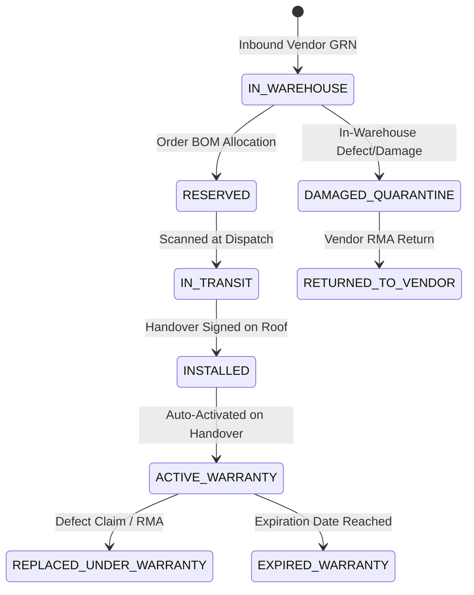
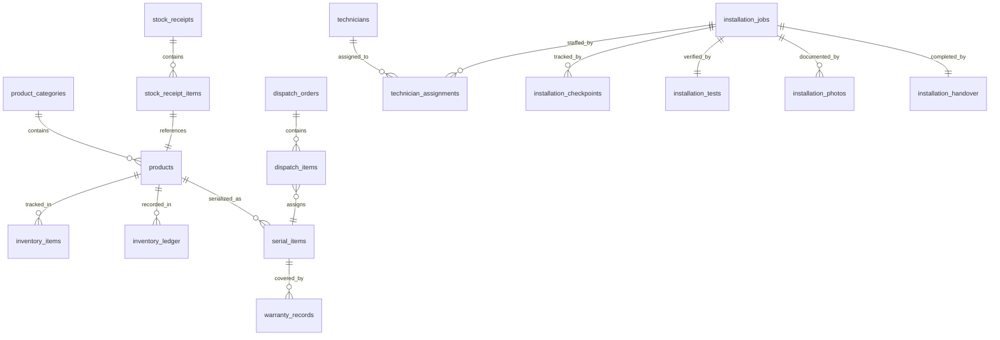
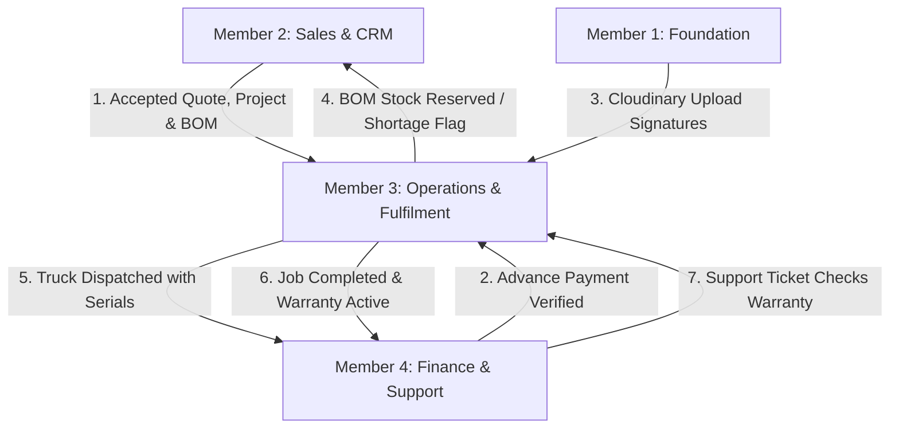

# Operations, Inventory & Fulfilment Contract Specification
**Project:** Solar Installation Management System (SunPower Solutions)  
**Author:** Member 3 — Operations & Fulfilment Lead  
**Module Scope:** Products, Inventory, Double-Entry Stock Ledger, Reservations, Dispatch, Serial Item Registry, Technician Crew Scheduling, Rooftop Installation, Electrical Safety Testing, Photo Proof, Handover Signature, Warranty Activation  
**API Mount Prefix:** `/api/v1/operations/`  
**Database Migration Target:** `server/src/db/migrations/102_operations.sql`  
**Cross-Module Alignment:** Member 1 (Platform Foundation), Member 2 (Sales & Projects), Member 4 (Support & Finance)  
**Version:** 1.1.0 (Phase 0 Contract Review & Correction)  
**Status:** Approved for Implementation

---

## 1. Products & Master Catalog Management

### 1.1 Product Categories Taxonomy (7 Standard Categories)
SunPower Solutions operates across seven core product categories that support rooftop systems between 1 kW and 5 kW (both On-Grid and Off-Grid). The documented list and the database definitions are in 100% agreement:
1. `PANEL`: Monocrystalline & Polycrystalline Solar PV Modules (e.g., 540W Mono PERC).
2. `INVERTER`: Grid-tied string inverters (1 kW to 5 kW) and hybrid inverters.
3. `BATTERY`: Deep-cycle solar storage units (e.g., 48V 150Ah Lithium/Lead-Acid for Off-Grid packages).
4. `CHARGE_CONTROLLER`: MPPT Solar Charge Controllers for battery voltage regulation.
5. `STRUCTURE`: Rooftop mounting stands, aluminium rails, mid/end clamps, anchor fasteners.
6. `ELECTRICAL`: DC/AC distribution boxes (DB), MCBs, SPDs, solar DC cables (4 sq mm / 6 sq mm), conduits.
7. `EARTHING`: Chemical earthing electrodes, copper-bonded ground rods, earthing pit compound, lightning arrestors.

### 1.2 Serialization Rules
- High-value hardware components **MUST** be marked `is_serialized = true`:
  - Every `INVERTER` (High value, individual warranty tracking).
  - Every `BATTERY` (High value, cycle life, individual warranty tracking).
  - Every `CHARGE_CONTROLLER` (High value component).
- `PANEL` units are serialized in demo seed data (`[NC-17]`), but serialization scope is configurable per product.
- Structural hardware, wires, conduits, and earthing kits are tracked strictly by quantity (`is_serialized = false`).

### 1.3 Master Catalog Attributes
Each product record defines:
- `id` (UUID v4): Unique product identifier.
- `sku` (VARCHAR(50), UNIQUE): Standardized SKU code (e.g., `INV-ONGRID-3KW-GROW`, `BAT-LITH-48V-150AH`, `PNL-MONO-540W`).
- `name` (VARCHAR(255)): Commercial name of the product.
- `category_id` (VARCHAR(50)): One of the 7 standard categories (References `product_categories.id`).
- `brand` (VARCHAR(100)): Manufacturer name (e.g., Growatt, Deye, Waaree, Luminous).
- `model` (VARCHAR(100)): Manufacturer model number.
- `specifications` (JSONB): Structured electrical/physical specs (rated capacity, input voltage window, dimensions, weight).
- `is_serialized` (BOOLEAN): Requires physical barcode/QR serial scanning on receipt and dispatch.
- `unit_of_measure` (VARCHAR(20)): `PCS`, `METERS`, `SETS`.
- `cost_price` (NUMERIC(12,2)): Internal acquisition unit cost (CONFIDENTIAL: Restricted to Director/Admin).
- `retail_price` (NUMERIC(12,2)): Default list price used in standard quotations.
- `min_reorder_level` (INTEGER): Warehouse safety stock threshold; alerts warehouse when available stock drops below.
- `is_active` (BOOLEAN): Available for quotation BOM derivation.

---

## 2. Inventory Architecture & Double-Entry Stock Ledger

### 2.1 Double-Entry Inventory Ledger Architecture
To eliminate unaccounted hardware loss and phantom stock, inventory updates operate on an immutable, double-entry stock ledger table (`inventory_ledger`). Physical stock balances are never updated via ad-hoc SQL increments without a matching transaction line:

```
[Inbound Vendor GRN]     --> CREDIT On-Hand Ledger
[Accepted Order Reserve]  --> DEBIT Available Ledger / CREDIT Reserved Ledger (On-Hand unchanged)
[Warehouse Dispatch]      --> DEBIT Reserved Ledger / DEBIT On-Hand Ledger / CREDIT In-Transit
[Customer Handover]      --> DEBIT In-Transit / CREDIT Installed Asset Base
[Quarantine / Return]    --> DEBIT On-Hand Ledger / CREDIT Damaged Quarantine
```

### 2.2 Ledger Transaction Entry Types
1. `RECEIPT`: Inbound vendor delivery via Goods Received Note (GRN). Increases on-hand stock.
2. `RESERVATION`: Order confirmation locks stock for a project. Increases reserved, decreases available.
3. `RESERVATION_RELEASE`: Project cancellation or scope reduction unlocks reserved stock.
4. `DISPATCH`: Material departs warehouse on truck. Decreases physical on-hand and reserved; marks units in-transit.
5. `RETURN_CUSTOMER`: De-installed or returned hardware from site. Enters quarantine or warehouse.
6. `RETURN_VENDOR`: Defective unit returned to manufacturer under vendor RMA.
7. `CORRECTION`: Physical stock count audit adjustment. Requires Admin approval.
8. `WRITE_OFF`: Scrap, transit damage, or stolen inventory. Requires Admin approval.

### 2.3 Warehouse Locations
SunPower Solutions tracks inventory across three authoritative physical/virtual locations:
- `CENTRAL_WAREHOUSE`: Primary warehouse facility where stock arrives and is packed.
- `IN_TRANSIT`: Material loaded on dispatch vehicles en route to customer rooftop sites.
- `QUARANTINE_SCRAP`: Damaged, defective, or returned stock undergoing vendor inspection.

---

## 3. Stock Quantity Calculations & Mathematical Invariants

### 3.1 Strict Mathematical Invariants
Every inventory item maintains three distinct quantities:
1. **`On_Hand_Quantity` ($Q_{on\_hand}$):** Total physical units currently resting inside the warehouse bins.
2. **`Reserved_Quantity` ($Q_{reserved}$):** Units committed to accepted customer projects awaiting physical dispatch.
3. **`Available_Quantity` ($Q_{available}$):** Unencumbered stock eligible for new project reservations.

$$\mathbf{Q_{available} = Q_{on\_hand} - Q_{reserved}}$$

### 3.2 Core Business Rules & Bounds
- **BR-INV-001 (Reservation Invariant):** Reserving stock for an accepted order **MUST NOT** reduce physical on-hand stock ($Q_{on\_hand}$). It increments $Q_{reserved}$ and reduces $Q_{available}$.
- **Non-Negativity Constraint:** $Q_{available} \ge 0$. Stock can never be reserved if $Q_{required} > Q_{available}$.
- **Dispatch Invariant:** When a truck is dispatched, both $Q_{on\_hand}$ and $Q_{reserved}$ decrement by the exact dispatched quantity ($Q_{dispatched}$), maintaining balance consistency.
- **Audited Ledger Reconciliation:** Physical count audits compare actual shelf counts against $Q_{on\_hand}$. Any discrepancy requires a formal `inventory_corrections` approval record.

---

## 4. Stock Reservation, Shortage Handling & Warehouse Dispatch Protocol

### 4.1 Advance Payment Gate for Dispatch (`[NC-01]`)
- **BR-PAY-001 Enforcement:** No warehouse packing order or dispatch order may be scheduled until Member 4 confirms that advance payment has been received (`orders.payment_status IN ('ADVANCE_PAID', 'FULLY_PAID')`).
- **Policy Rule (`[NC-01]`):** `SOLAR_MANAGEMENT_SYSTEM.md` states: *"A customer usually pays an advance, or the full amount, before work starts."* The exact required threshold (percentage or fixed advance amount) is configurable via `system_settings.advance_dispatch_threshold_pct` (with a labeled demo default of 25%), or waived via explicit Admin exception override.
- If an order is in `PENDING_ADVANCE`, warehouse operators can view reserved parts, but the "Create Dispatch Manifest" button is disabled in the UI and rejected with `403 Forbidden` (`ADVANCE_PAYMENT_REQUIRED`) at the API layer.

### 4.2 Automated BOM Stock Reservation Flow
1. Customer digitally accepts quotation (Triggered by Member 2 via `POST /api/v1/operations/projects/:id/reserve-stock`).
2. The Operations engine loads the complete project Bill of Materials (`project_bom_items`).
3. For each BOM line item, the engine checks `inventory_items.available_quantity`:
   - **Case A (Sufficient Stock):** Executes atomic transaction locking stock rows (`SELECT FOR UPDATE`), increments `reserved_quantity`, creates `stock_reservations` records, and logs ledger `RESERVATION`.
   - **Case B (Shortage Detected):** If $Q_{required} > Q_{available}$ for any single item, the system flags the project as `SHORTAGE_FLAGGED`, records the exact deficit amount, and generates an automated procurement task for warehouse management.

### 4.3 Dispatch Manifest Initialization
- Warehouse manager opens confirmed project in `Warehouse Dashboard`.
- Generates `dispatch_order` with target delivery date, driver name, vehicle registration number, and packing checklist.
- The dispatch manifest lists all non-serialized items (e.g., 20m cable, 2 structure sets) and reserves placeholder slots for serialized hardware.

### 4.4 Mandatory Serial Barcode Scanning Gate
- **BR-INV-002 Enforcement:** The truck cannot depart with unscanned or mismatched serial numbers.
- For every serialized item in the BOM (e.g., 1x 3.3 kW Inverter, 1x 48V Battery):
  1. Warehouse operator scans physical barcode/QR code using tablet camera or handheld scanner.
  2. The system verifies that the scanned serial exists in `serial_items` with status `IN_WAREHOUSE`.
  3. The system confirms the serial matches the exact product SKU specified in the BOM.
  4. The system validates that the serial is not assigned to any other project.
- The `POST /api/v1/operations/dispatch/:id/confirm` endpoint validates that `COUNT(scanned_serials) == COUNT(required_serialized_items)`. If any unit is unscanned, the endpoint rejects with `400 Bad Request` (`INCOMPLETE_SERIAL_SCANS`).

### 4.5 Dispatch Departure & Transit State
- Upon successful validation of all scanned serials:
  1. `dispatch_orders.status` transitions to `DISPATCHED`.
  2. `serial_items.status` transitions to `IN_TRANSIT` with `project_id` and `dispatch_id` locked.
  3. Physical on-hand stock and reserved stock decrement in `inventory_items`.
  4. Immutable ledger transaction logged: `DISPATCH`.
  5. System generates a downloadable Delivery Challan PDF with complete serialized equipment manifest.

---

## 5. Serial Number Tracking, Uniqueness & 360-Degree Traceability

### 5.1 Shared Table Agreement: `serial_items`
To ensure 100% interoperability with Member 4 (Support & Finance) without silent naming collisions:
- The authoritative PostgreSQL table name is **`serial_items`** (with primary key `id UUID`, unique column `serial_number`, foreign key `product_id`).
- Foreign keys across all modules reference `serial_item_id REFERENCES serial_items(id)`.
- For backwards-compatibility and semantic reporting, a database view `serial_registry` is defined as `SELECT * FROM serial_items`.
- Global uniqueness constraint: `UNIQUE (serial_number)`. Re-registering an existing serial number on inbound GRN fails with `409 Conflict`.

### 5.2 Serial Number Lifecycle States


### 5.3 360-Degree Serial Traceability (`GET /api/v1/operations/serials/:serialNumber/trace`)
Any staff member (Support, Warehouse, Sales, Director) can query a serial number and obtain the complete history in < 2 seconds:
- **Equipment Details:** Brand, model, SKU, manufacturing batch, rated capacity.
- **Inbound Record:** Vendor name, purchase order number, Goods Received Note date, receiving officer.
- **Dispatch Record:** Dispatch date, truck vehicle number, dispatching officer.
- **Project & Customer Dossier:** Customer name, rooftop installation address, contract capacity, invoice number.
- **Installation Record:** Assigned technicians, commissioning test readings, rooftop completion photos.
- **Warranty Status:** Active/Expired indicator, start date, expiration date, days remaining, manufacturer policy.
- **Service History:** Linked support tickets, reported fault codes, replacement logs.

---

## 6. Returns, Damaged Quarantine, Missing Items & Stock Corrections

### 6.1 Damaged Hardware Quarantine
- Hardware damaged during transit or defective out-of-the-box is isolated immediately:
  - Unit moved to `QUARANTINE_SCRAP` location.
  - Serial status set to `DAMAGED_QUARANTINE`.
  - Immutable ledger entry logged: `RETURN_VENDOR` or `WRITE_OFF`.
  - If linked to an active project, the reservation is released and an immediate replacement allocation is requested.

### 6.2 Customer Site Returns / De-Installations
- When equipment is returned from site (order cancellation, warranty replacement):
  - Returns note logged with reason code (`TRANSIT_DAMAGE`, `SITE_REJECTION`, `DEFECTIVE_COMPONENT`, `SPEC_MISMATCH`).
  - Serial number unlinked from customer project and marked `RETURNED_TO_WAREHOUSE` or `DAMAGED_QUARANTINE`.

### 6.3 Physical Stock Corrections & Auditing (`[NC-23]`)
- When physical bin count differs from ledger on-hand balance:
  - Warehouse operator submits `POST /api/v1/operations/inventory/corrections`.
  - Captures: `product_id`, `system_qty`, `counted_qty`, `variance`, `reason_code` (`BREAKAGE`, `MISCOUNT`, `PILFERAGE`, `SAMPLE`).
  - **Approval Gate (`[NC-23]`):** Threshold requiring Director/Admin digital approval is configurable (demo default: variance $> ₹2,000$). Stock reservations do not expire automatically.

---

## 7. 15-Technician Roster, Skill Profiles, Availability & Crew Scheduling

### 7.1 Roster Profiles & Skill Taxonomy
SunPower Solutions employs a core field team of 15 technicians (authoritative company fact from `SOLAR_MANAGEMENT_SYSTEM.md` §2.1). Each technician profile contains:
- `id` (UUID v4): References platform `users.id`.
- `skills` (TEXT[]): Specific competencies:
  - `ELECTRICAL_LEAD`: Certified to wire AC/DC distribution boxes, connect inverters, and conduct generation tests.
  - `STRUCTURAL_MOUNT`: Specialist in roof penetration, anchor brackets, panel mounting, and mechanical stability.
  - `SOLAR_PV`: Panel stringing, MC4 crimping, DC cable routing.
  - `HELPER`: Material staging, cable pulling, roof safety assistance.
- `certifications` (JSONB): Electrical wireman license details, working-at-height training validity.
- `daily_hourly_rate` (NUMERIC(10,2)): Internal cost rate for job profitability calculations (Confidential `[NC-07]`).
- `employment_type` (ENUM): `FULL_TIME`, `CONTRACTOR`.
- `status` (ENUM): `ACTIVE`, `ON_LEAVE`, `INACTIVE`.

### 7.2 Crew Composition & Business Rules (`[NC-12]`, `[NC-31]`)
- **Crew Size (`[NC-31]`):** Rooftop installations typically utilize 2 to 3 technicians. The recommended minimum crew size is configurable (demo default: 2 technicians).
- **Mandatory Electrical Lead:** Every installation crew **MUST** have at least one technician designated with the `ELECTRICAL_LEAD` skill. The API blocks scheduling if no electrical lead is present.
- **Conflict Prevention:** A technician cannot be assigned to two concurrent site surveys or installation jobs on overlapping dates.
- **Assignment Approval (`[NC-12]`):** Configurable whether Admin approval is required for every technician assignment (setting `require_admin_approval_for_assignment`, demo default: `false`).
- **Payroll Tracking (`[NC-07]`):** Hours worked $\times$ hourly rate tracking only; payroll tax deductions and statutory filings are out-of-scope.

---

## 8. Rooftop Installation Job Lifecycle & Mobile Progress Workflow

### 8.1 Installation Job State Machine
```
[SCHEDULED] 
    │ (Arrival on site, capacity confirmed)
    ▼
[IN_PROGRESS] 
    │ (Mounting, panels, wiring, inverter, earthing)
    ▼
[TESTING_PENDING] 
    │ (Electrical & Generation Safety Testing)
    ├── [FAILED] ──► [REWORK_REQUIRED] (Punch-list logged, rework scheduled)
    ▼ [PASSED]
[PHOTO_PENDING] 
    │ (Upload mandatory installation angles)
    ▼ [MANDATORY PHOTOS VERIFIED]
[HANDOVER_PENDING] 
    │ (Customer inspects system and signs touch screen)
    ▼ [CUSTOMER SIGNED]
[COMPLETED / COMMISSIONED] ──► Triggers Automated Warranty Activation
```

### 8.2 Mobile-First Job Card & Checkpoint Progression
Field technicians execute jobs using a dedicated mobile web interface:
1. **System Size Confirmation:** Technician verifies physical roof space and package size (1 kW to 5 kW) against work order.
2. **Start Job:** Technician clicks "Start Installation" -> Captures `started_at` timestamp and mobile device metadata.
3. **Sequential Hardware Checkpoints:**
   - Step 1: Roof structure stands erected, anchored, and waterproofed.
   - Step 2: Solar PV modules laid, clamped, and string voltage verified.
   - Step 3: DC & AC distribution boxes mounted and conduits routed.
   - Step 4: Inverter mounted, DC inputs connected, AC grid output coupled.
   - Step 5: Battery bank installed, wired in series/parallel (Off-Grid systems).
   - Step 6: Chemical earthing pit drilled, rod driven, compound sealed, and earth wire bonded.

---

## 9. Installation Testing, Mandatory Photo Proof & Customer Handover Sign-Off

### 9.1 Power Generation & Electrical Safety Testing Gate (`[NC-29]`)
- **BR-OPS-002 Enforcement:** `SOLAR_MANAGEMENT_SYSTEM.md` mandates: *"They test that power is being generated, then open a simple form on their phone or tablet."* Technicians must execute electrical tests and record instrument readings before handover sign-off is unlocked:
  - **Grid Voltage:** 210V to 250V AC (Standard single-phase operating window).
  - **Solar Array Open Circuit Voltage ($V_{oc}$):** Must be $> 0.0\text{ V}$.
  - **Active Inverter Power Generation:** Must be $> 0.00\text{ kW}$ (Confirmed during daylight hours, required by spec).
  - **Earthing Pit Resistance (`[NC-29]`):** Configurable safety limit with demo default **$\le 5.0\ \mathbf{\Omega}$**.
- **Rework Exception:** If earthing resistance exceeds threshold or power generation is zero, `installation_tests.status` is set to `FAILED`, the job transitions to `REWORK_REQUIRED`, and handover is blocked.

### 9.2 Mandatory Photo Proof Upload via Cloudinary (`[NC-30]`)
- **BR-OPS-004 Enforcement:** `SOLAR_MANAGEMENT_SYSTEM.md` mandates: *"upload photos of the finished roof."* Handover sign-off is **STRICTLY LOCKED** until verified photographs for all mandatory categories are uploaded directly to Cloudinary:
  1. `STRUCTURE_AND_PANELS`: Full rooftop perspective showing mounted panels and rail alignments.
  2. `INVERTER_AND_WIRING`: Inverter display, DC/AC breaker boxes, safety caution labels.
  3. `BATTERY_AND_CONTROLLER`: Battery storage bank and charge controller (or main disconnect switch for On-Grid).
  4. `EARTHING_PIT`: Earthing pit chamber, inspection cover, ground bond clamp.
- The minimum required photo count and categories are configurable (`[NC-30]`, demo default: 4 distinct angles).
- Direct upload to Cloudinary uses Member 1's shared `/api/v1/media/sign-upload` utility.

### 9.3 Customer Digital Handover Signature Gate
- **BR-OPS-005 Enforcement:** `SOLAR_MANAGEMENT_SYSTEM.md` mandates: *"The homeowner signs on the screen to accept the work. The company should have clear proof of the job, and the customer should have no doubt about what was installed."*
- **Workflow:**
  1. Homeowner inspects installation with lead technician.
  2. Technician presents touch device displaying system capacity, serial numbers, test readings, and completion checklist.
  3. Customer signs on-screen using the HTML5 touch signature pad.
  4. System captures: customer full name, signature vector data URL, completion timestamp, client IP, and GPS coordinates (if permitted).
  5. The job transitions to `COMPLETED`. An immutable PDF Handover & Commissioning Certificate is automatically generated.

---

## 10. Warranty Lifecycle, Automated Activation, Expiry & Claims Verification

### 10.1 Automated Warranty Clock Activation (`[NC-02]`, `[NC-03]`)
- **BR-WRN-001 Enforcement:** `SOLAR_MANAGEMENT_SYSTEM.md` mandates: *"The moment a delivery is done, the warranty clock should start by itself for every serial number: for example 2 years for an inverter or battery, and 20 years for solar panels. No one should have to type dates into a register."*
- **Warranty Start Event (`[NC-02]`):** Configurable between `DELIVERY` and `HANDOVER` (demo default: `HANDOVER`, when commissioning is signed).
- **Warranty Durations (`[NC-03]`):** Example values in specification are configured as demo defaults:
  - **Solar PV Modules:** **20 Years (240 Months)** performance warranty.
  - **Inverter:** **2 Years (24 Months)** manufacturer replacement warranty.
  - **Battery Storage:** **2 Years (24 Months)** replacement/cycle warranty.
  - Duration is stored per product/policy and is fully configurable.
- **No Manual Typing:** Manual entry of warranty dates into books or registers is strictly prohibited. Expiry dates are calculated via database interval arithmetic:
  $$\text{end\_date} = \text{start\_date} + \text{duration\_months}$$

### 10.2 Warranty Policies: Manufacturer vs Installer (`[NC-04]`, `[NC-20]`)
- **Dual Policy Modeling (`[NC-04]`):** Modeled in `warranty_records` with `party` (`'Manufacturer'` vs `'Installer'`) and `scope` (`'Full Replacement'`, `'Performance'`, `'Workmanship'`). Installer workmanship default is configurable (demo default: 12 months).
- **Replacement Unit Warranty (`[NC-20]`):** When a defective component is replaced under warranty, whether the replacement unit inherits the remaining term or restarts coverage is configurable via `system_settings.replacement_warranty_rule` (demo default: `INHERIT`).

### 10.3 Single Standardized Warranty Query API: `GET /api/v1/operations/warranties/:serialNumber`
To ensure complete consistency with Member 4's `warranty.adapter.js`, Operations exposes the unified endpoint:

#### Request
- **Method:** `GET`
- **Path:** `/api/v1/operations/warranties/:serialNumber`
- **Headers:** `Authorization: Bearer <token>`
- **URL Params:** `serialNumber` (string, required, case-insensitive)
- **Query Params:** `claimDate` (ISO date string `YYYY-MM-DD`, optional, defaults to current date)

#### Successful Response (200 OK)
```json
{
  "success": true,
  "message": "Warranty record retrieved successfully",
  "data": {
    "serialNumber": "INV-GROW-3K-26-00104",
    "warrantyCode": "WRN-INV-2026-00104",
    "productName": "Growatt 3.3kW On-Grid String Inverter",
    "productId": "4a71d620-3b1a-4d22-b5e1-95fae22a1001",
    "customerId": "8f12c340-9a2b-4e11-c3f2-12aeb44c3003",
    "projectId": "7e01b230-8a1a-4d00-b2e1-01aeb33b2002",
    "status": "WITHIN_PERIOD",
    "durationMonths": 24,
    "startDate": "2026-11-02",
    "endDate": "2028-11-02",
    "remainingDays": 550,
    "remainingMonths": 18.1,
    "party": "Manufacturer",
    "scope": "Full Replacement",
    "termsSummary": "Manufacturer replacement warranty covering inverter circuit defects.",
    "isAuthoritativeDB": true
  }
}
```

#### Status Enumeration
- `WITHIN_PERIOD`: Active warranty coverage; customer repair/replacement is billed at **₹0** (BR-WRN-002).
- `EXPIRED`: Warranty duration has elapsed; Member 4 auto-bills parts and labor.
- `VOID`: Warranty voided by administration due to unauthorized tampering or physical damage.
- `NOT_ACTIVE`: Start date is in the future.

#### Error Responses
- **400 Bad Request:**
  ```json
  {
    "success": false,
    "error": {
      "code": "INVALID_SERIAL_NUMBER",
      "message": "Serial number parameter is required and cannot be empty."
    }
  }
  ```
- **404 Not Found:**
  ```json
  {
    "success": false,
    "error": {
      "code": "WARRANTY_NOT_FOUND",
      "message": "No warranty contract found for serial number 'INV-UNKNOWN-999'."
    }
  }
  ```
- **500 Internal Server Error:**
  ```json
  {
    "success": false,
    "error": {
      "code": "DATABASE_ERROR",
      "message": "Failed to query warranty registry."
    }
  }
  ```

---

## 11. Complete REST API Endpoint Specification (`/api/v1/operations/*`)

### 11.1 Products & Categories Master Catalog
| Method | Endpoint | RBAC Access | Description |
|---|---|---|---|
| `GET` | `/api/v1/operations/products` | All Authenticated | List master products with category, SKU, stock status (Costs hidden from non-admins) |
| `POST` | `/api/v1/operations/products` | Admin/Owner, Warehouse | Create new product definition in catalog |
| `GET` | `/api/v1/operations/products/:id` | All Authenticated | Get detailed product specifications |
| `PUT` | `/api/v1/operations/products/:id` | Admin/Owner, Warehouse | Update product attributes, reorder levels, or status |
| `GET` | `/api/v1/operations/categories` | All Authenticated | List all 7 standard product categories |

### 11.2 Warehouse Inventory & Stock Ledger
| Method | Endpoint | RBAC Access | Description |
|---|---|---|---|
| `GET` | `/api/v1/operations/inventory` | Admin/Owner, Warehouse, Sales, Support | Current inventory stock summary (On-hand, Reserved, Available) |
| `GET` | `/api/v1/operations/inventory/ledger` | Admin/Owner, Warehouse | Immutable double-entry inventory ledger transaction history |
| `POST` | `/api/v1/operations/inventory/receipts` | Admin/Owner, Warehouse | Record Inbound Goods Received Note (GRN) with vendor bill reference |
| `GET` | `/api/v1/operations/inventory/shortages` | Admin/Owner, Warehouse, Sales | Active shortage alerts for accepted customer orders |
| `POST` | `/api/v1/operations/inventory/corrections` | Admin/Owner, Warehouse | Submit physical count variance adjustment (Admin approval gated `[NC-23]`) |

### 11.3 Project Stock Reservation & Shortage Alerts
| Method | Endpoint | RBAC Access | Description |
|---|---|---|---|
| `POST` | `/api/v1/operations/projects/:id/reserve-stock` | Admin/Owner, Warehouse, System | Lock BOM components for an accepted project; flags shortage if insufficient |
| `DELETE` | `/api/v1/operations/projects/:id/reserve-stock` | Admin/Owner, Warehouse | Release reserved stock back to available pool upon order cancellation |
| `GET` | `/api/v1/operations/projects/:id/reservation-status` | Admin/Owner, Warehouse, Sales | View reservation fulfillment status and assigned serial numbers |

### 11.4 Serial Items Registry & Barcode Verification
| Method | Endpoint | RBAC Access | Description |
|---|---|---|---|
| `POST` | `/api/v1/operations/serials/batch` | Admin/Owner, Warehouse | Bulk register inbound serial items from vendor delivery |
| `GET` | `/api/v1/operations/serials/:serialNumber/trace` | All Staff Roles | 360-degree serial number lookup (Receipt $\to$ Project $\to$ Install $\to$ Warranty) |
| `POST` | `/api/v1/operations/dispatch/:id/verify-serial` | Admin/Owner, Warehouse | Scan and attach a serial number to a dispatch order |

### 11.5 Dispatch & Delivery Management
| Method | Endpoint | RBAC Access | Description |
|---|---|---|---|
| `POST` | `/api/v1/operations/dispatch/create` | Admin/Owner, Warehouse | Initialize dispatch packing manifest (Advance payment prerequisite enforced `[NC-01]`) |
| `GET` | `/api/v1/operations/dispatch/:id` | Admin/Owner, Warehouse, Tech | Get dispatch details, driver info, and scanned serial checklist |
| `POST` | `/api/v1/operations/dispatch/:id/confirm` | Admin/Owner, Warehouse | Confirm truck departure; validates 100% serial scans; moves stock to In_Transit |
| `GET` | `/api/v1/operations/dispatch/:id/challan` | Admin/Owner, Warehouse | Download Delivery Challan PDF with serialized equipment list |

### 11.6 Technician Roster & Scheduling Board
| Method | Endpoint | RBAC Access | Description |
|---|---|---|---|
| `GET` | `/api/v1/operations/technicians` | Admin/Owner, Warehouse, Tech | List 15 technician profiles, skills, and current job loads |
| `GET` | `/api/v1/operations/technicians/availability` | Admin/Owner, Sales | Query technician availability for a specific date window |
| `POST` | `/api/v1/operations/installations/schedule` | Admin/Owner | Schedule installation date and assign 2-3 technician crew with electrical lead `[NC-31]` |

### 11.7 Mobile Rooftop Installation Execution & Handover
| Method | Endpoint | RBAC Access | Description |
|---|---|---|---|
| `GET` | `/api/v1/operations/installations/my-jobs` | Technician | View active and upcoming installation jobs assigned to logged-in technician |
| `GET` | `/api/v1/operations/installations/:id` | All Authenticated | Get full installation work order, BOM checklist, and progress state |
| `POST` | `/api/v1/operations/installations/:id/start` | Technician, Admin/Owner | Record job start timestamp after on-site system size confirmation |
| `POST` | `/api/v1/operations/installations/:id/checkpoint` | Technician, Admin/Owner | Check off physical installation milestone (Mounting, Panels, Wiring, etc.) |
| `POST` | `/api/v1/operations/installations/:id/testing` | Technician, Admin/Owner | Record electrical and generation safety test readings (Earthing $\le 5\Omega$ `[NC-29]`) |
| `POST` | `/api/v1/operations/installations/:id/photos` | Technician, Admin/Owner | Upload mandatory 4-angle proof photos via Cloudinary `[NC-30]` |
| `POST` | `/api/v1/operations/installations/:id/sign-handover` | Technician, Admin/Owner | Customer on-screen signature; generates Handover Certificate; completes job |
| `POST` | `/api/v1/operations/installations/:id/rework` | Technician, Admin/Owner | Log failed test rework causes and punch-list items |
| `GET` | `/api/v1/operations/installations/:id/handover-certificate` | All Staff, Customer | Download signed Handover and Commissioning Certificate PDF |

### 11.8 Serialized Warranties Registry
| Method | Endpoint | RBAC Access | Description |
|---|---|---|---|
| `POST` | `/api/v1/operations/warranties/activate-project-serials`| Admin/Owner, System | Trigger automated warranty activation for all installed project serials |
| `GET` | `/api/v1/operations/warranties` | All Staff Roles | List warranty records with filter by customer, project, or status |
| `GET` | `/api/v1/operations/warranties/:serialNumber` | All Staff Roles | Standard unified warranty lookup for Member 4 Support tickets |

---

## 12. Request and Response Payload Envelopes

### 12.1 Standard Envelope Conformance
All responses strictly follow Member 1's standardized envelope:
```json
{
  "success": true,
  "message": "Operation completed successfully",
  "data": { ... }
}
```

### 12.2 Inbound Stock Receipt (GRN) Payload
- **`POST /api/v1/operations/inventory/receipts`**
```json
{
  "vendorName": "Waaree Energies Ltd",
  "invoiceNumber": "INV-WAA-2026-9041",
  "receiptDate": "2026-11-02",
  "notes": "Delivered in good condition via SafeExpress",
  "items": [
    {
      "productId": "4a71d620-3b1a-4d22-b5e1-95fae22a1001",
      "quantity": 10,
      "unitCost": 32000.00,
      "serialNumbers": [
        "INV-GROW-3K-26-00101",
        "INV-GROW-3K-26-00102",
        "INV-GROW-3K-26-00103",
        "INV-GROW-3K-26-00104",
        "INV-GROW-3K-26-00105",
        "INV-GROW-3K-26-00106",
        "INV-GROW-3K-26-00107",
        "INV-GROW-3K-26-00108",
        "INV-GROW-3K-26-00109",
        "INV-GROW-3K-26-00110"
      ]
    },
    {
      "productId": "6b82e731-4c2b-5e33-c6f2-06abf33b2002",
      "quantity": 60,
      "unitCost": 12500.00,
      "serialNumbers": []
    }
  ]
}
```

### 12.3 Serial Barcode Scan Verification Payload
- **`POST /api/v1/operations/dispatch/:id/verify-serial`**
```json
{
  "serialNumber": "INV-GROW-3K-26-00104",
  "productId": "4a71d620-3b1a-4d22-b5e1-95fae22a1001"
}
```
**Response Data:**
```json
{
  "success": true,
  "message": "Serial number verified and attached to dispatch manifest",
  "data": {
    "serialNumber": "INV-GROW-3K-26-00104",
    "productName": "Growatt 3.3kW On-Grid String Inverter",
    "status": "ASSIGNED_TO_PROJECT",
    "remainingUnscannedCount": 0,
    "isComplete": true
  }
}
```

### 12.4 Generation Testing Form Payload
- **`POST /api/v1/operations/installations/:id/testing`**
```json
{
  "gridVoltageVolts": 232.5,
  "openCircuitVoltageVoc": 348.0,
  "activeGenerationKw": 2.85,
  "earthingResistanceOhms": 2.4,
  "instrumentModel": "Fluke 1625-2 Geo Earth Tester",
  "testingNotes": "Clear sunshine, stable grid synchronization within 45 seconds"
}
```

### 12.5 Customer Handover Sign-Off Payload
- **`POST /api/v1/operations/installations/:id/sign-handover`**
```json
{
  "customerName": "Ramesh Chandra Sharma",
  "customerPhone": "+919876543210",
  "signatureDataUrl": "data:image/png;base64,iVBORw0KGgoAAAANSUhEUgAA...",
  "confirmedCapacityKw": 3.0,
  "satisfactionScore": 5,
  "customerComments": "Neat wiring and panels installed professionally. App is working."
}
```

---

## 13. PostgreSQL Database Schema Specification (`102_operations.sql`)

### 13.1 Entity Relationship Architecture


### 13.2 Schema Table Definitions (Summary of `102_operations.sql`)

#### 1. `product_categories` & `products` (All 7 Standard Categories)
```sql
CREATE TABLE IF NOT EXISTS product_categories (
    id VARCHAR(50) PRIMARY KEY,
    name VARCHAR(100) NOT NULL,
    description TEXT,
    created_at TIMESTAMPTZ NOT NULL DEFAULT CURRENT_TIMESTAMP
);

-- Seed exactly 7 standard product categories
INSERT INTO product_categories (id, name, description) VALUES
    ('PANEL', 'Solar Panels', 'Monocrystalline and polycrystalline solar photovoltaic modules'),
    ('INVERTER', 'Inverters', 'Grid-tied, off-grid and hybrid string inverters'),
    ('BATTERY', 'Solar Batteries', 'Deep-cycle lithium and tubular solar battery storage units'),
    ('CHARGE_CONTROLLER', 'Charge Controllers', 'MPPT solar charge controllers'),
    ('STRUCTURE', 'Mounting Structures', 'Rooftop mounting stands, aluminium rails, fasteners'),
    ('ELECTRICAL', 'Electrical Hardware', 'DC/AC distribution boxes, solar DC cables, MCBs, SPDs'),
    ('EARTHING', 'Earthing & Protection', 'Chemical earthing electrodes, lightning arrestors, earthing compound')
ON CONFLICT (id) DO NOTHING;

CREATE TABLE IF NOT EXISTS products (
    id UUID PRIMARY KEY DEFAULT gen_random_uuid(),
    sku VARCHAR(50) NOT NULL UNIQUE,
    name VARCHAR(255) NOT NULL,
    category_id VARCHAR(50) NOT NULL REFERENCES product_categories(id),
    brand VARCHAR(100) NOT NULL,
    model VARCHAR(100) NOT NULL,
    specifications JSONB NOT NULL DEFAULT '{}'::jsonb,
    is_serialized BOOLEAN NOT NULL DEFAULT false,
    unit_of_measure VARCHAR(20) NOT NULL DEFAULT 'PCS',
    cost_price NUMERIC(12,2) NOT NULL DEFAULT 0.00,
    retail_price NUMERIC(12,2) NOT NULL DEFAULT 0.00,
    min_reorder_level INTEGER NOT NULL DEFAULT 5,
    is_active BOOLEAN NOT NULL DEFAULT true,
    created_at TIMESTAMPTZ NOT NULL DEFAULT CURRENT_TIMESTAMP,
    updated_at TIMESTAMPTZ NOT NULL DEFAULT CURRENT_TIMESTAMP
);
CREATE INDEX idx_products_sku ON products(sku);
CREATE INDEX idx_products_category ON products(category_id);
```

#### 2. `inventory_items` & `inventory_ledger`
```sql
CREATE TABLE IF NOT EXISTS inventory_items (
    id UUID PRIMARY KEY DEFAULT gen_random_uuid(),
    product_id UUID NOT NULL REFERENCES products(id) ON DELETE CASCADE,
    warehouse_id VARCHAR(50) NOT NULL DEFAULT 'CENTRAL_WAREHOUSE',
    on_hand_quantity INTEGER NOT NULL DEFAULT 0 CHECK (on_hand_quantity >= 0),
    reserved_quantity INTEGER NOT NULL DEFAULT 0 CHECK (reserved_quantity >= 0),
    updated_at TIMESTAMPTZ NOT NULL DEFAULT CURRENT_TIMESTAMP,
    CONSTRAINT chk_stock_balance CHECK (reserved_quantity <= on_hand_quantity),
    UNIQUE(product_id, warehouse_id)
);

CREATE TABLE IF NOT EXISTS inventory_ledger (
    id UUID PRIMARY KEY DEFAULT gen_random_uuid(),
    product_id UUID NOT NULL REFERENCES products(id),
    warehouse_id VARCHAR(50) NOT NULL DEFAULT 'CENTRAL_WAREHOUSE',
    entry_type VARCHAR(50) NOT NULL CHECK (entry_type IN (
        'RECEIPT', 'RESERVATION', 'RESERVATION_RELEASE', 'DISPATCH', 
        'RETURN_CUSTOMER', 'RETURN_VENDOR', 'CORRECTION', 'WRITE_OFF'
    )),
    quantity INTEGER NOT NULL,
    on_hand_after INTEGER NOT NULL,
    reserved_after INTEGER NOT NULL,
    reference_id VARCHAR(255),
    reference_type VARCHAR(100),
    performed_by UUID REFERENCES users(id),
    notes TEXT,
    created_at TIMESTAMPTZ NOT NULL DEFAULT CURRENT_TIMESTAMP
);
CREATE INDEX idx_ledger_product ON inventory_ledger(product_id);
CREATE INDEX idx_ledger_created ON inventory_ledger(created_at);
```

#### 3. `serial_items` & `serial_item_audit` (Agreed Naming with Member 4)
```sql
CREATE TABLE IF NOT EXISTS serial_items (
    id UUID PRIMARY KEY DEFAULT gen_random_uuid(),
    serial_number VARCHAR(100) NOT NULL UNIQUE,
    product_id UUID NOT NULL REFERENCES products(id),
    status VARCHAR(50) NOT NULL DEFAULT 'IN_WAREHOUSE' CHECK (status IN (
        'IN_WAREHOUSE', 'RESERVED', 'ASSIGNED_TO_PROJECT', 'IN_TRANSIT', 
        'INSTALLED', 'ACTIVE_WARRANTY', 'DAMAGED_QUARANTINE', 'RETURNED_TO_VENDOR', 'DECOMMISSIONED'
    )),
    project_id UUID,
    dispatch_id UUID,
    receipt_item_id UUID,
    installed_at TIMESTAMPTZ,
    created_at TIMESTAMPTZ NOT NULL DEFAULT CURRENT_TIMESTAMP,
    updated_at TIMESTAMPTZ NOT NULL DEFAULT CURRENT_TIMESTAMP
);
CREATE INDEX idx_serial_items_number ON serial_items(serial_number);
CREATE INDEX idx_serial_items_status ON serial_items(status);
CREATE INDEX idx_serial_items_project ON serial_items(project_id);

-- Backwards-compatibility view
CREATE OR REPLACE VIEW serial_registry AS 
SELECT * FROM serial_items;

CREATE TABLE IF NOT EXISTS serial_item_audit (
    id UUID PRIMARY KEY DEFAULT gen_random_uuid(),
    serial_item_id UUID NOT NULL REFERENCES serial_items(id) ON DELETE CASCADE,
    old_status VARCHAR(50),
    new_status VARCHAR(50) NOT NULL,
    project_id UUID,
    performed_by UUID REFERENCES users(id),
    notes TEXT,
    created_at TIMESTAMPTZ NOT NULL DEFAULT CURRENT_TIMESTAMP
);
```

#### 4. `technicians`, `installation_jobs` & Testing
```sql
CREATE TABLE IF NOT EXISTS technicians (
    id UUID PRIMARY KEY REFERENCES users(id) ON DELETE CASCADE,
    skills TEXT[] NOT NULL DEFAULT '{}',
    certifications JSONB DEFAULT '[]'::jsonb,
    employment_type VARCHAR(50) NOT NULL DEFAULT 'FULL_TIME',
    daily_rate NUMERIC(10,2) DEFAULT 0.00,
    status VARCHAR(50) NOT NULL DEFAULT 'ACTIVE' CHECK (status IN ('ACTIVE', 'ON_LEAVE', 'INACTIVE')),
    created_at TIMESTAMPTZ NOT NULL DEFAULT CURRENT_TIMESTAMP
);

CREATE TABLE IF NOT EXISTS installation_jobs (
    id UUID PRIMARY KEY DEFAULT gen_random_uuid(),
    project_id UUID NOT NULL,
    order_id UUID NOT NULL,
    customer_id UUID NOT NULL,
    lead_technician_id UUID NOT NULL REFERENCES technicians(id),
    scheduled_date DATE NOT NULL,
    status VARCHAR(50) NOT NULL DEFAULT 'SCHEDULED' CHECK (status IN (
        'SCHEDULED', 'IN_PROGRESS', 'TESTING_PENDING', 'REWORK_REQUIRED', 
        'PHOTO_PENDING', 'HANDOVER_PENDING', 'COMPLETED', 'CANCELLED'
    )),
    confirmed_capacity_kw NUMERIC(5,2) NOT NULL,
    started_at TIMESTAMPTZ,
    completed_at TIMESTAMPTZ,
    rework_notes TEXT,
    created_at TIMESTAMPTZ NOT NULL DEFAULT CURRENT_TIMESTAMP,
    updated_at TIMESTAMPTZ NOT NULL DEFAULT CURRENT_TIMESTAMP
);

CREATE TABLE IF NOT EXISTS installation_tests (
    id UUID PRIMARY KEY DEFAULT gen_random_uuid(),
    job_id UUID NOT NULL REFERENCES installation_jobs(id) ON DELETE CASCADE,
    grid_voltage_volts NUMERIC(6,2) NOT NULL,
    open_circuit_voltage_voc NUMERIC(6,2) NOT NULL,
    active_generation_kw NUMERIC(6,3) NOT NULL,
    earthing_resistance_ohms NUMERIC(6,2) NOT NULL,
    status VARCHAR(20) NOT NULL CHECK (status IN ('PASSED', 'FAILED')),
    tested_by UUID NOT NULL REFERENCES users(id),
    instrument_model VARCHAR(100),
    created_at TIMESTAMPTZ NOT NULL DEFAULT CURRENT_TIMESTAMP
);

CREATE TABLE IF NOT EXISTS installation_photos (
    id UUID PRIMARY KEY DEFAULT gen_random_uuid(),
    job_id UUID NOT NULL REFERENCES installation_jobs(id) ON DELETE CASCADE,
    angle_type VARCHAR(50) NOT NULL CHECK (angle_type IN (
        'STRUCTURE_AND_PANELS', 'INVERTER_AND_WIRING', 'BATTERY_AND_CONTROLLER', 'EARTHING_PIT'
    )),
    cloudinary_url TEXT NOT NULL,
    public_id VARCHAR(255),
    uploaded_by UUID NOT NULL REFERENCES users(id),
    created_at TIMESTAMPTZ NOT NULL DEFAULT CURRENT_TIMESTAMP,
    UNIQUE(job_id, angle_type)
);

CREATE TABLE IF NOT EXISTS installation_handover (
    id UUID PRIMARY KEY DEFAULT gen_random_uuid(),
    job_id UUID NOT NULL UNIQUE REFERENCES installation_jobs(id),
    customer_name VARCHAR(255) NOT NULL,
    customer_phone VARCHAR(20) NOT NULL,
    signature_data_url TEXT NOT NULL,
    satisfaction_score INTEGER CHECK (satisfaction_score BETWEEN 1 AND 5),
    signed_at TIMESTAMPTZ NOT NULL DEFAULT CURRENT_TIMESTAMP,
    certificate_pdf_url TEXT
);
```

#### 5. `warranty_records` (Agreed Schema Matching Member 4's Adapter)
```sql
CREATE TABLE IF NOT EXISTS warranty_records (
    id UUID PRIMARY KEY DEFAULT gen_random_uuid(),
    warranty_code VARCHAR(50) UNIQUE NOT NULL,
    serial_item_id UUID NOT NULL REFERENCES serial_items(id),
    project_id UUID NOT NULL,
    customer_id UUID NOT NULL,
    product_id UUID NOT NULL REFERENCES products(id),
    duration_months INTEGER NOT NULL,
    start_date DATE NOT NULL,
    end_date DATE NOT NULL,
    status VARCHAR(50) NOT NULL DEFAULT 'Active' CHECK (status IN ('Active', 'Expired', 'Void', 'Claimed')),
    party VARCHAR(50) NOT NULL DEFAULT 'Manufacturer' CHECK (party IN ('Manufacturer', 'Installer')),
    scope VARCHAR(100) NOT NULL DEFAULT 'Full Replacement',
    terms_summary TEXT,
    created_at TIMESTAMPTZ NOT NULL DEFAULT CURRENT_TIMESTAMP
);
CREATE INDEX idx_warranty_serial_item ON warranty_records(serial_item_id);
CREATE INDEX idx_warranty_customer ON warranty_records(customer_id);
CREATE INDEX idx_warranty_end_date ON warranty_records(end_date);
```

---

## 14. Role-Based Access Control (RBAC) & Data Privacy Rules

### 14.1 Operations Permissions Matrix
| Action / Capability | Admin/Owner | Warehouse | Technician | Sales | Support |
|---|:---:|:---:|:---:|:---:|:---:|
| View Stock Quantities (On-Hand/Available) | ✅ | ✅ | ❌ | ✅ | ✅ |
| View Unit Cost Prices (`cost_price`) | ✅ *(CONFIDENTIAL)* | ❌ | ❌ | ❌ | ❌ |
| View Technician Hourly Rates | ✅ *(CONFIDENTIAL)* | ❌ | ❌ | ❌ | ❌ |
| Create Goods Received Notes (GRN) | ✅ | ✅ | ❌ | ❌ | ❌ |
| Verify Serials & Confirm Dispatch | ✅ | ✅ | ❌ | ❌ | ❌ |
| Assign Technicians to Jobs | ✅ | ❌ | ❌ | ❌ | ❌ |
| Execute Mobile Job & Checkpoints | ✅ | ❌ | ✅ | ❌ | ❌ |
| Record Testing & Upload Photos | ✅ | ❌ | ✅ | ❌ | ❌ |
| Collect Handover Digital Signature | ✅ | ❌ | ✅ | ❌ | ❌ |
| 360 Serial Number Lookup | ✅ | ✅ | ✅ | ✅ | ✅ |
| Query Warranty Status for Claims | ✅ | ✅ | ❌ | ❌ | ✅ |
| Approve Physical Inventory Corrections | ✅ | ❌ | ❌ | ❌ | ❌ |

### 14.2 Financial Confidentiality Sanitization
In strict conformance with Member 1's `sanitizeFinancialResponse` middleware:
- Any query to `/api/v1/operations/products` or `/api/v1/operations/inventory` executed by non-Admin roles (Warehouse, Sales, Technician, Support) **MUST** strip:
  - `cost_price`
  - `inventory_value`
  - `technician_daily_rate`

---

## 15. Exact Cross-Module Integration Dependencies



### 15.1 Inbound Dependencies from Member 2 (Sales & Customer)
- **`orders` table:** Operations requires confirmed order record with `payment_status` (`ADVANCE_PAID` or `FULLY_PAID`) and `customer_id`.
- **`projects` table:** Operations links reservations, dispatch notes, installation jobs, and serial items to `projects.id`.
- **`project_bom_items` / `quotation_items`:** The authoritative source of parts to reserve and scan at dispatch (fields: `id`, `project_id`, `product_id`, `quantity`, `is_serialized`, `unit_cost`).
- **Site Survey Measurements:** Informs cable run lengths and roof mounting bracket requirements.

### 15.2 Inbound Dependencies from Member 4 (Finance & Support)
- **Advance Payment Verification Gate:** Dispatch initialization checks `orders.payment_status IN ('ADVANCE_PAID', 'FULLY_PAID')` originating from Razorpay HMAC verification.

### 15.3 Outbound Deliverables to Member 4 (Finance, Support & Analytics)
- **Direct Database Interface (Agreed Query):** Member 4's `server/src/modules/support-finance/warranty.adapter.js` directly queries:
  ```sql
  SELECT 
    w.id AS warranty_id,
    w.warranty_code,
    w.duration_months,
    w.start_date,
    w.end_date,
    w.status AS warranty_status,
    w.party,
    w.scope,
    s.serial_number,
    p.name AS product_name
  FROM warranty_records w
  JOIN serial_items s ON w.serial_item_id = s.id
  JOIN products p ON s.product_id = p.id
  WHERE LOWER(s.serial_number) = LOWER($1)
  LIMIT 1;
  ```
- **REST Warranty Endpoint:** Operations provides `GET /api/v1/operations/warranties/:serialNumber` for Member 4 frontend and service consumers.
- **Service Ticket Foreign Keys:** Member 4's `support_cases` and `service_tickets` reference `serial_item_id REFERENCES serial_items(id)`.
- **Project Profitability Cost Figures:** Executive analytics queries `inventory_ledger` for actual hardware acquisition costs and `installation_jobs` for technician hours.

### 15.4 Integration with Member 1 (Platform Foundation)
- Database connection pool: `import { db } from '../../db/index.js'`.
- Authentication middleware: `import { authenticate } from '../../middleware/auth.middleware.js'`.
- RBAC authorization: `import { authorize } from '../../middleware/rbac.middleware.js'`.
- Audit logging: `import { recordAuditLog } from '../../shared/utils/auditLogger.js'`.
- Cloudinary media: Direct browser upload via `/api/v1/media/sign-upload`.

---

## 16. Open Questions & Architectural Decisions Marked as `[NC]`

In strict compliance with architectural guidelines, unspecified decisions are explicitly marked `[NC]` and configured with labeled demo defaults:

| ID | Topic | Spec Section | Architectural Contract Decision / [DEMO] Default |
|---|---|---|---|
| **`[NC-01]`** | Advance Payment Dispatch Threshold | §7.3, §17 | Spec says: *"A customer usually pays an advance, or the full amount, before work starts."* Threshold is configurable via `system_settings.advance_dispatch_threshold_pct` (demo default: `[DEMO: 25%]`); Admin override available. |
| **`[NC-02]`** | Warranty Start Event | §7.5 | Spec says: *"The moment a delivery is done, the warranty clock should start by itself."* Configurable via `system_settings.warranty_start_event` (`DELIVERY` vs `HANDOVER`, demo default: `[DEMO: HANDOVER]`). |
| **`[NC-03]`** | Product Warranty Terms | §7.5 | Spec says: *"for example 2 years for an inverter or battery, and 20 years for solar panels."* Durations are examples in spec; configurable per product (demo defaults: `[DEMO: Panels 240m, Inverter 24m, Battery 24m]`). |
| **`[NC-04]`** | Manufacturer vs Installer Warranty | §7.5, §7.6 | Both modeled in `warranty_records` (`party = 'Manufacturer' \| 'Installer'`). Workmanship duration is configurable (demo default: `[DEMO: 12m workmanship]`). |
| **`[NC-07]`** | Technician Payroll Basis | §7.7 | Tracked as hours worked $\times$ hourly rate, configurable per technician in `technicians.daily_rate`. Statutory filings are out-of-scope. |
| **`[NC-12]`** | Technician Assignment Approval | §9 | Configurable whether Admin approval is required for every technician assignment (setting `require_admin_approval_for_assignment`, demo default: `[DEMO: false]`). |
| **`[NC-17]`** | Solar Panel Serialization | §7.3 | Inverters, batteries, and charge controllers mandatory serialized. Panels serialization is configurable per product (demo default: `[DEMO: Panels serialized in seed]`). |
| **`[NC-20]`** | Replacement Unit Warranty Term | §7.5 | Configurable whether replacement unit inherits remaining term or restarts coverage via `system_settings.replacement_warranty_rule` (demo default: `[DEMO: INHERIT]`). |
| **`[NC-23]`** | Inventory Write-Off Threshold | §7.3 | Discrepancies $> ₹2,000$ or write-offs require Admin approval; reservations have no auto-expiry (demo default: `[DEMO: ₹2,000 threshold]`). |
| **`[NC-29]`** | Electrical & Safety Test Thresholds | §7.4 | Spec mandates: *"test that power is being generated"* and *"finishes the earthing"*. Specific limits (Earthing $\le 5.0\ \Omega$, Grid voltage 210-250V AC, Generation $> 0\text{ kW}$) are configurable engineering limits (demo default: `[DEMO: Earthing <= 5.0 Ohms]`). |
| **`[NC-30]`** | Mandatory Installation Photo Count | §7.4 | Spec mandates: *"upload photos of the finished roof"*. Minimum photo count and categories (4 angles) are configurable (demo default: `[DEMO: 4 mandatory angles]`). |
| **`[NC-31]`** | Crew Size & Skill Composition | §7.4 | Rooftop crew size (2-3 technicians) and requirement of 1 `ELECTRICAL_LEAD` are configurable operational rules (demo default: `[DEMO: 2-3 technicians with 1 electrical lead]`). |

---

## 17. Contract Validation & Specification Compliance Matrix

| Specification Requirement | Section | Operations Contract Mechanism | Status |
|---|---|---|:---:|
| 1 kW to 5 kW On-Grid & Off-Grid BOM Tracking | §2, §7.3 | Master Catalog & BOM reservation with capacity validation | **COMPLIANT** |
| Double-entry stock ledger | §7.3 | Immutable `inventory_ledger` with 8 transaction types | **COMPLIANT** |
| Stock reservation does not reduce on-hand | §7.3 | $Q_{available} = Q_{on\_hand} - Q_{reserved}$; on-hand reduced only at dispatch | **COMPLIANT** |
| Advance payment prerequisite for dispatch | §7.3, §17 | Dispatch creation checks `payment_status == 'ADVANCE_PAID'` (`[NC-01]`) | **COMPLIANT** |
| Mandatory barcode/QR serial scanning | §3, §7.3 | Dispatch confirmation blocked until 100% serialized items scanned | **COMPLIANT** |
| Global serial number uniqueness | §7.3 | Database unique constraint on `serial_items.serial_number` | **COMPLIANT** |
| 360-degree serial traceability | §3, §7.3 | `GET /api/v1/operations/serials/:serialNumber/trace` (< 2s response) | **COMPLIANT** |
| 15-Technician roster & crew scheduling | §2, §7.4 | Roster management with certified `ELECTRICAL_LEAD` requirement | **COMPLIANT** |
| Mobile installation execution & time tracking | §3, §7.4 | Responsive mobile job card with start/complete timestamps | **COMPLIANT** |
| Power generation & earthing safety testing | §3, §7.4 | Threshold gates: Earthing $\le 5\Omega$, Active generation $> 0$ kW (`[NC-29]`) | **COMPLIANT** |
| Failed tests trigger rework | §7.4 | Handover locked; job marked `REWORK_REQUIRED` | **COMPLIANT** |
| Mandatory photo uploads | §7.4 | Cloudinary upload of finished roof photos unlocks handover (`[NC-30]`) | **COMPLIANT** |
| Customer on-screen digital signature | §3, §7.4 | Touch canvas signature stored with timestamp & IP/GPS | **COMPLIANT** |
| Automated warranty clock activation | §3, §7.5 | Handover triggers panel and inverter/battery activation (`[NC-02]`, `[NC-03]`) | **COMPLIANT** |
| Standardized Warranty Endpoint | §7.6 | `GET /api/v1/operations/warranties/:serialNumber` matching Member 4 adapter | **COMPLIANT** |
| Unified Database Naming | §7.5, §15 | `serial_items` and `warranty_records` matching Member 4 queries | **COMPLIANT** |
| 7 Standard Product Categories | §2, §15 | 7 categories agreed between catalog and database | **COMPLIANT** |
| Strict file & module ownership | Master | Only `docs/contracts/operations.md` modified in Phase 0 | **COMPLIANT** |
