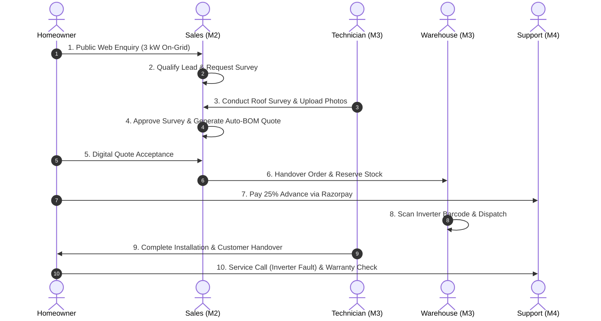

# Platform Integration Checklist & Team Coordination Specification

**Project:** Solar Installation Management System (SunPower Solutions)  
**Author:** Member 1 — Platform Foundation Lead & Team Leader  
**Target Audience:** Member 2 (Customer & Sales), Member 3 (Operations), Member 4 (Support & Finance)  
**Document Version:** 1.0.0  
**Status:** Approved Integration Plan  

---

## 1. Remote Branch Verification & Audit Baseline

The integration plan coordinates the latest audited commits across all team branches:

| Member / Domain | Git Branch | Audited Commit | Latest Status |
|---|---|---|---|
| **Member 1: Platform Foundation** | `feature/platform-foundation` | `b58f42e` | Verified against live PostgreSQL; All 42 tests passing |
| **Member 2: Customer & Sales** | `feature/customer-sales` | `806ae35` | Harmonized contract in `docs/contracts/customer-sales.md` |
| **Member 3: Operations & Fulfilment** | `feature/operations-fulfilment` | `2e29212` | Authoritative `serial_items` table, BOM reservation flow |
| **Member 4: Support, Finance & AI** | `feature/support-finance-ai` | `4efe641` | Aligned with `Admin/Owner` role, `serial_items` adapter |
| **Main Integration Target** | `main` | `1dbbfbc` | Protected baseline (PR #1 merged) |

---

## 2. Central Router Mounting & API Prefixes

The Express central application (`server/src/app.js`) mounts each module router under its official `/api/v1` prefix. When feature branches are merged, each member must export an Express router matching this mount contract:

```
                                  +------------------------------------+
                                  |     Express App (server.js)        |
                                  |       Mounts: /api/v1              |
                                  +-----------------+------------------+
                                                    |
         +--------------------------+---------------+--------------------------+
         |                          |                                          |
+--------v---------+       +--------v---------+                       +--------v---------+
|     Member 1     |       |     Member 2     |                       |     Member 3     |
|   Platform &     |       |    Customer &    |                       |   Operations &   |
|   Media Upload   |       |      Sales       |                       |    Fulfilment    |
| /auth & /media   |       | /customer-sales  |                       |   /operations    |
+------------------+       +------------------+                       +------------------+
                                                    |
                                           +--------v---------+
                                           |     Member 4     |
                                           | Support, Finance |
                                           |      & AI        |
                                           | /support-finance |
                                           +------------------+
```

### Exact Mount Points
1. **Member 1 (Platform Foundation):**
   - Authentication: `apiRouter.use('/auth', authRouter)` &rarr; `/api/v1/auth`
   - Media Direct Upload: `apiRouter.use('/media', mediaRouter)` &rarr; `/api/v1/media`
   - Health Probes: `GET /health`, `GET /api/health`, `GET /api/v1/health`
2. **Member 2 (Customer & Sales):**
   - Feature Router: `apiRouter.use('/customer-sales', customerSalesRouter)` &rarr; `/api/v1/customer-sales`
   - Public Inquiry: `POST /api/v1/customer-sales/public/enquiries` (Rate-limited, unauthenticated)
   - Public Quote Accept: `GET/POST /api/v1/customer-sales/public/quotes/:token/accept` (Token-authenticated)
3. **Member 3 (Operations & Fulfilment):**
   - Feature Router: `apiRouter.use('/operations', operationsRouter)` &rarr; `/api/v1/operations`
   - Stock Reservation: `POST /api/v1/operations/projects/:id/reserve-stock`
   - Dispatch Confirmation: `POST /api/v1/operations/dispatch/:id/confirm`
   - Serial Lookup: `GET /api/v1/operations/serials/:serialNumber/trace`
4. **Member 4 (Support, Finance & AI):**
   - Feature Router: `apiRouter.use('/support-finance', supportFinanceRouter)` &rarr; `/api/v1/support-finance`
   - Razorpay Order: `POST /api/v1/support-finance/payments/create-order`
   - Razorpay Webhook: `POST /api/v1/support-finance/payments/webhook` (Raw-body HMAC verification)
   - Warranty Lookup: `GET /api/v1/support-finance/tickets/:id/warranty-lookup`

---

## 3. Authentication & Five-Role RBAC Governance

### A. The 5 Canonical Project Roles
`SOLAR_MANAGEMENT_SYSTEM.md` defines exactly five roles for SunPower Solutions. No custom role may be added to PostgreSQL:
1. `Admin/Owner` (Director Rajesh Sharma) — Unrestricted operational & financial visibility.
2. `Sales` (Lead Priya Verma) — Enquiries, customer qualification, survey requests, quotation generation.
3. `Warehouse` (Manager Amit Patel) — Inbound GRN, stock ledger, BOM reservations, dispatch scanning.
4. `Technician` (Lead Vikram Singh) — Roof surveys, rooftop installation, electrical testing, customer sign-off.
5. `Support` (Lead Sneha Kulkarni) — Customer lookup, warranty verification, service tickets, complaint FSM.

### B. Prohibited Unapproved Roles & Mapping Rule
- **No `Finance` Role:** Financial administration (P&L reviews, payroll, subsidy checklist) is restricted strictly to `Admin/Owner`. Member 4's `FINANCE_ADMIN_ROLES` must map exclusively to `Admin/Owner`.
- **No `Customer` User Role in `users`:** Customer interactions (inquiry intake, quote acceptance, survey sign-off) are external interactions authorized via one-time tokens or public routes, NOT internal employee accounts in the `users` table.

### C. Request Identity Contract (`req.user`)
All protected endpoints must pass through `authenticate`. `req.user` is populated from PostgreSQL:
```typescript
interface RequestUser {
  id: string;        // UUID v4
  email: string;     // E.g. 'sales@sunpower.com'
  fullName: string;  // E.g. 'Priya Verma (Sales Lead)'
  role: 'Admin/Owner' | 'Sales' | 'Warehouse' | 'Technician' | 'Support';
  phone?: string;
  isActive: boolean;
}
```
*Security Invariant:* Client-supplied headers (e.g. `x-role`, `x-user-id`) are ignored.

---

## 4. Database Schema & Migration Execution Sequence

All DDL changes are tracked via sequential SQL migrations in `server/src/db/migrations/`:

```
+-----------------------------------------------------------------------------------------+
|                               MIGRATION EXECUTION ORDER                                 |
+------------------------------------+----------------------------------------------------+
| 001_platform_foundation.sql [M1]   | Core pgcrypto, users, refresh_tokens, audit_logs   |
+------------------------------------+----------------------------------------------------+
                                     |
+------------------------------------v----------------------------------------------------+
| 101_customer_sales.sql [M2]        | customers, enquiries, site_surveys, packages,      |
|                                    | quotations, orders, projects, project_bom_items,   |
|                                    | customer_timeline                                  |
+------------------------------------+----------------------------------------------------+
                                     |
+------------------------------------v----------------------------------------------------+
| 102_operations.sql [M3]            | product_categories, products, inventory_items,     |
|                                    | inventory_ledger, stock_reservations,              |
|                                    | dispatch_orders, serial_items, technician_profiles,|
|                                    | installation_jobs, commissioning_tests, warranties |
+------------------------------------+----------------------------------------------------+
                                     |
+------------------------------------v----------------------------------------------------+
| 103_support_finance.sql [M4]       | support_cases, case_timeline, service_tickets,     |
|                                    | ticket_charges, payment_requests, payment_ledger,   |
|                                    | invoices, project_expenses, technician_timesheets, |
|                                    | subsidy_applications, ai_invocations               |
+-----------------------------------------------------------------------------------------+
```

### Foreign Key Cross-Module Dependency Rules
1. `orders.customer_id` &rarr; `customers.id` (M2 internal)
2. `project_bom_items.product_id` &rarr; `products.id` (M2 references M3 catalog)
3. `stock_reservations.project_id` &rarr; `projects.id` (M3 references M2 project)
4. `serial_items.project_id` &rarr; `projects.id` (M3 references M2 project)
5. `dispatch_orders.order_id` &rarr; `orders.id` (M3 references M2 order)
6. `payment_requests.order_id` &rarr; `orders.id` (M4 references M2 order)
7. `support_cases.customer_id` &rarr; `customers.id` (M4 references M2 customer)
8. `service_tickets.serial_number` &rarr; `serial_items.serial_number` (M4 references M3 hardware)

---

## 5. Commercial, Fulfilment & Payment Status Flow

To eliminate state confusion between physical progress and financial balance, `orders` decouples commercial fulfilment from financial payments:

```
 COMMERCIAL FULFILMENT STATE:
 [Quote Accepted] ──> CONFIRMED ──> IN_FULFILMENT ──> COMPLETED
                                          │
 FINANCIAL PAYMENT STATE:                 │ (Requires ADVANCE_PAID)
 [Order Initialized] ──> PENDING_ADVANCE ─┴─> ADVANCE_PAID ──> FULLY_PAID
```

### Handover Sequence:
1. **Quotation Acceptance (M2):** Customer signs proposal; `quotations.status = 'ACCEPTED'`.
2. **Order Creation (M2):** Order created with `order_status = 'CONFIRMED'` and `payment_status = 'PENDING_ADVANCE'`.
3. **BOM Reservation (M2 &rarr; M3):** Member 2 invokes `POST /api/v1/operations/projects/:id/reserve-stock`.
4. **Advance Payment Order (M2 &rarr; M4):** Customer or Sales calls `POST /api/v1/support-finance/payments/create-order` with `Idempotency-Key` and `{ order_id, purpose: 'ADVANCE' }`. Amount derived server-side (`25%` of contract value `[NC-001]`).
5. **Payment Verification (M4):** Customer completes Razorpay test payment. Signature verified via HMAC-SHA256. `orders.payment_status` updated to `'ADVANCE_PAID'`.
6. **Dispatch Release Gate (M3):** Warehouse verifies `orders.payment_status IN ('ADVANCE_PAID', 'FULLY_PAID')` before allowing dispatch manifest generation.

---

## 6. Serial Number Tracking & Warranty Activation Handover

### A. Authoritative Hardware Table: `serial_items`
- Table: `serial_items` (`id`, `product_id`, `serial_number`, `status`, `unit_cost_paise`, `project_id`, `customer_id`).
- Constraint: `UNIQUE (serial_number)`.
- Compatibility view: `CREATE OR REPLACE VIEW serial_registry AS SELECT * FROM serial_items;` (provided by M3).
- Member 4's `warranty.adapter.js` queries `serial_items` primary with fallback to `serial_registry`.

### B. Barcode Scanning Gate at Dispatch (M3)
Every serialized item (Inverter, Battery, Charge Controller) must be scanned before truck departure. `POST /api/v1/operations/dispatch/:id/confirm` fails with `400 Bad Request` if any BOM serialized item is missing.

### C. Warranty Clock Trigger
Upon customer sign-off (`POST /api/v1/operations/installations/:id/sign-off`), warranty records are generated in `warranties`:
- Panels: 240 months (20 Years)
- Inverters: 24 months (2 Years)
- Batteries: 24 months (2 Years)
- Workmanship: 12 months (1 Year)

### D. Service Ticket Warranty Gate (M4)
When a breakdown is reported, Support queries `GET /api/v1/support-finance/tickets/:id/warranty-lookup`. If active, repair charges are billed at ₹0. Charges cannot be added while coverage is `PENDING`.

---

## 7. Audit Logging & Cloudinary Upload Contracts

### A. Cloudinary Direct Upload Contract
```javascript
// Browser/Client Direct Upload Flow
const { data: signData } = await api.post('/media/sign-upload', {
  folder: 'surveys', // Whitelist: 'surveys' | 'installations' | 'signatures' | 'receipts' | 'tickets'
  resourceType: 'image'
});

const formData = new FormData();
formData.append('file', fileObject);
formData.append('api_key', signData.data.apiKey);
formData.append('timestamp', signData.data.timestamp);
formData.append('signature', signData.data.signature);
formData.append('folder', signData.data.folder);

const res = await axios.post(signData.data.uploadUrl, formData);
const secureUrl = res.data.secure_url; // Persist in module table
```

### B. Immutable Audit Logging
```javascript
import { recordAuditLog } from '../../shared/utils/auditLogger.js';

await recordAuditLog({
  userId: req.user.id,
  action: 'DISPATCH_CONFIRMED',
  entity: 'DISPATCH_ORDER',
  entityId: dispatch.id,
  oldValues: { status: 'PACKING' },
  newValues: { status: 'DISPATCHED', vehicleNumber: 'GJ-01-AB-1234' },
  ipAddress: req.ip,
  userAgent: req.headers['user-agent'],
});
```

---

## 8. Test Scope Classification (Mock vs Live)

To maintain testing traceability and prevent false claims:

| Test File | Test Level | Mock vs Live | Description |
|---|---|---|---|
| `server/test/health.test.js` | Integration | **Live** | Tests `/health`, `/api/health`, `/api/v1/health` and 404 handler |
| `server/test/db.test.js` | Integration | **Live PostgreSQL** | Tests real pool connection, tables existence, and transaction rollback |
| `server/test/auth.test.js` | Integration | **Live PostgreSQL** | Tests bcrypt login, JWT access/refresh rotation, reuse detection, RBAC |
| `server/test/cloudinary.test.js` | Unit / Integration | **Config/Crypto** | Tests SHA-1 signing algorithm, whitelist validation, and 10MB limits |
| `server/test/integration_mounting.test.js` | Contract Harness | **Mock Sub-Routers** | Validates central mounting, router interoperability, and middleware propagation using mock sub-routers for M2, M3, and M4 |

---

## 9. End-to-End Monolith Integration Test Plan

When feature branches are merged, the end-to-end integration test (`server/test/e2e_lifecycle.test.js`) will execute the complete 9-stage lifecycle:



### Stage Verification Matrix:
1. **Stage 1 (Enquiry):** `POST /api/v1/customer-sales/public/enquiries` creates lead; auto-triggers duplicate screening.
2. **Stage 2 (Survey Request):** Sales calls preliminary check; requests site survey visit slot.
3. **Stage 3 (Survey Execution):** Technician conducts roof survey, captures tilt/cable distance, uploads roof photo via Cloudinary signed upload.
4. **Stage 4 (Quotation & BOM):** Sales reviews survey; approves engineering sign-off; derives BOM (panels, inverter, stands, safety DBs).
5. **Stage 5 (Quote Acceptance):** Customer accepts proposal digitally; order created in `orders`.
6. **Stage 6 (Stock Reservation):** Member 2 triggers `POST /api/v1/operations/projects/:id/reserve-stock`; `inventory_ledger` records `RESERVATION`.
7. **Stage 7 (Advance Payment):** Customer pays advance via Razorpay; HMAC verified; `orders.payment_status = 'ADVANCE_PAID'`.
8. **Stage 8 (Barcode Dispatch):** Warehouse scans inverter serial barcode; verifies against `serial_items`; dispatches truck.
9. **Stage 9 (Sign-Off & Warranty):** Technician finishes wiring; generation test verified; homeowner signs on screen; auto-activates 20-year panel and 2-year inverter warranties.
10. **Stage 10 (Service Complaint):** Support logs breakdown ticket; queries warranty status; confirms ₹0 billing coverage.

---

## 10. Unresolved Dependencies & Responsible Member Assignment

| Dependency / Open Issue | Responsible Member | Impact | Action Required |
|---|:---:|---|---|
| **Removal of Unapproved `Finance` & `Customer` Roles** | **Member 4** | Route RBAC consistency | Update `routes.js` to replace `FINANCE_ADMIN_ROLES` and `CUSTOMER_ADMIN_ROLES` with `['Admin/Owner']` and token authentication. |
| **Catalog Seeding (`products` & `categories`)** | **Member 3** | BOM generation in M2 | Migration `102_operations.sql` must seed standard 1-5 kW hardware components so Member 2's `bomGenerator` finds valid product SKUs. |
| **BOM Table Structure Agreement** | **Member 2 & Member 3** | Handover to inventory | Confirm column names in `project_bom_items` (`product_id`, `quantity`, `is_serialized`). |
| **Public Quote Acceptance Route** | **Member 2** | Customer quote signing | Implement public acceptance endpoint using UUID proposal token without requiring internal staff session. |
| **Real Cloudinary Credentials** | **DevOps / Team Lead** | Production media storage | Supply production `CLOUDINARY_*` keys in Render environment before live launch. |
