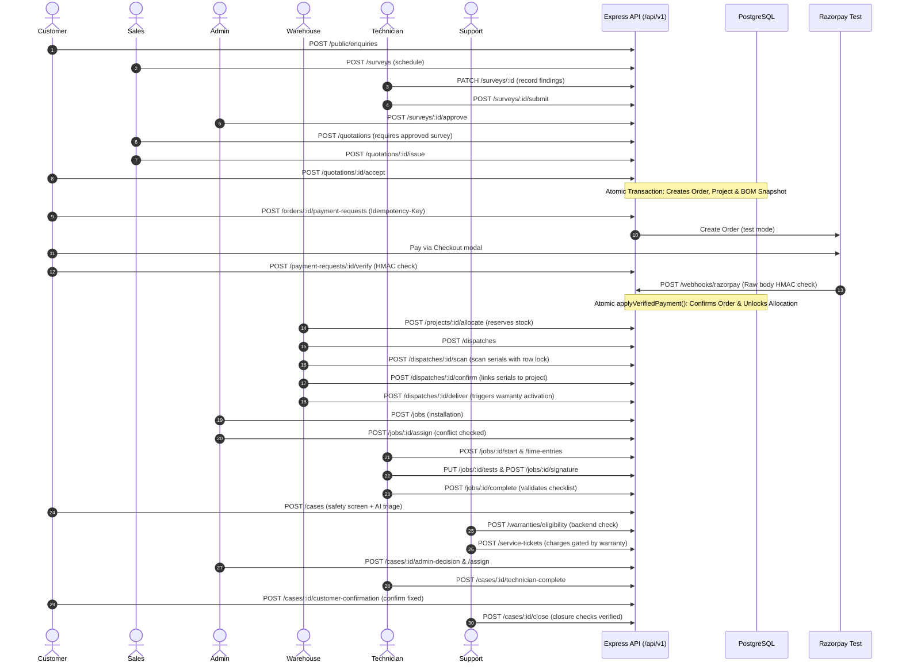

# Solar Installation Management System
## API Dependency Map & Endpoint Route Inventory

**Document Version:** 1.0  
**Status:** Approved Architectural Baseline  
**Authority:** `SOLAR_MANAGEMENT_SYSTEM.md` (§16 API Outline, §10 Workflow, §17 Razorpay)  
**Base Path:** `/api/v1`  
**Communication Protocol:** REST over HTTPS, JSON envelope

---

## 1. End-to-End API Sequence Architecture

The complete business lifecycle progresses through structured API invocation stages. Each stage depends upon the successful completion and verification of prior API calls.



---

## 2. Master Endpoint Inventory by Ownership Domain

### Group 1: Platform Foundation (Member 1)

| HTTP Method & Route | Owning Member | Required Permission | Prerequisite Routes | Consumed / Emitted Entities | Idempotency & Concurrency | Notes & Error Codes |
|---|---|---|---|---|---|---|
| `POST /auth/login` | Member 1 | Public | None | In: email, password<br>Out: JWT, User, Permissions | Rate-limited per IP | Generic 401 on bad credentials; 429 on lockout. |
| `POST /auth/refresh` | Member 1 | Public (Cookie) | `POST /auth/login` | In: refresh cookie<br>Out: new access token | Rotating token | Revokes refresh family on reuse. |
| `POST /auth/logout` | Member 1 | Authenticated | `POST /auth/login` | Out: revoked tokens | Idempotent | Clears httpOnly cookies. |
| `POST /auth/forgot-password` | Member 1 | Public | None | In: email | Rate-limited | Generic 202 Accepted. |
| `POST /auth/reset-password` | Member 1 | Public | `POST /auth/forgot-password` | In: token, new password | Token consumption | Invalidates existing sessions. |
| `GET /me` | Member 1 | Authenticated | `POST /auth/login` | Out: User profile, active permissions | Read-only | Returns dynamic permission array. |
| `GET /users` | Member 1 | `users.read` | None | Out: User list, roles | Read-only | Paginated. |
| `POST /users` | Member 1 | `users.create` | None | In: email, role_id, full_name | Unique email check | Audited with Admin ID. |
| `PATCH /users/:id` | Member 1 | `users.update` | `GET /users` | In: role_id, status | Optimistic lock (`version`) | Cannot demote last active Admin. |
| `GET /settings/:group` | Member 1 | `settings.read` | None | Out: System settings JSON | Read-only | In-memory cached. |
| `PATCH /settings/:group` | Member 1 | `settings.update` | `GET /settings/:group` | In: settings payload | Versioned update | Audited with old/new values diff. |
| `POST /files/sign-upload` | Member 1 | `files.create` | None | In: purpose, mime, size | Signed Cloudinary params | Enforces MIME allowlist & max bytes. |
| `POST /files/confirm` | Member 1 | `files.create` | `POST /files/sign-upload` | In: provider_public_id, bytes | Database record in `files` | Binds file to owner entity. |
| `GET /notifications` | Member 1 | Authenticated | None | Out: User in-app notifications | Read-only | Filter by read status. |
| `PATCH /notifications/:id/read` | Member 1 | Authenticated | `GET /notifications` | In: read boolean | Idempotent | Updates `read_at`. |
| `GET /admin/notification-outbox`| Member 1 | `audit.read` | None | Out: Simulated notification log | Read-only | Shows simulated messages for demo. |
| `GET /audit-logs` | Member 1 | `audit.read` | None | Out: Append-only audit entries | Read-only | Filter by entity, actor, date range. |

---

### Group 2: Customer and Sales (Member 2)

| HTTP Method & Route | Owning Member | Required Permission | Prerequisite Routes | Consumed / Emitted Entities | Idempotency & Concurrency | Notes & Error Codes |
|---|---|---|---|---|---|---|
| `POST /public/enquiries` | Member 2 | Public | None | In: lead details<br>Out: `ENQ-` code, `CUS-` code | IP Rate-limited | 400 Validation Error; duplicates flagged internally. |
| `GET /customers` | Member 2 | `customer.read` | None | Out: Customer directory | Read-only | Trigram search on name/phone. |
| `POST /customers` | Member 2 | `customer.create` | None | In: profile details | Phone deduplication | 409 `DUPLICATE_CANDIDATE` if phone matches. |
| `GET /customers/:id` | Member 2 | `customer.read` | `GET /customers` | Out: Customer 360 profile | Read-only | Role-based phone/email masking. |
| `PATCH /customers/:id` | Member 2 | `customer.update` | `GET /customers/:id` | In: profile updates | Optimistic lock (`version`) | 409 on version conflict. |
| `GET /customers/:id/timeline` | Member 2 | `customer.read` | `GET /customers/:id` | Out: Aggregated timeline events | Read-only | Filtered by caller role. |
| `POST /customers/:id/merge` | Member 2 | `customer.merge` | `GET /customers/:id` | In: target_id, reason | Atomic transaction | Soft merge; re-points all foreign keys. |
| `GET /enquiries` | Member 2 | `enquiry.read` | None | Out: Enquiry pipeline list | Read-only | Filter by status, channel, assignee. |
| `POST /enquiries` | Member 2 | `enquiry.create` | None | In: lead details, channel | Generates `ENQ-` code | Validates phone required for staff lead. |
| `GET /enquiries/:id` | Member 2 | `enquiry.read` | `GET /enquiries` | Out: Enquiry record & linked docs | Read-only | Displays repeat enquiry banner. |
| `PATCH /enquiries/:id` | Member 2 | `enquiry.update` | `GET /enquiries/:id` | In: requirements updates | Optimistic lock (`version`) | Updates capacity, notes. |
| `POST /enquiries/:id/status` | Member 2 | `enquiry.update` | `GET /enquiries/:id` | In: status, reason | Valid transitions only | 422 `REASON_REQUIRED` for Lost/Hold. |
| `POST /surveys` | Member 2 | `survey.schedule` | Customer Address Exists | In: enquiry_id, assignee, time | Conflict check query | 409 Conflict if surveyor booked/leave. |
| `GET /surveys` | Member 2 | `survey.read` | None | Out: Survey calendar / list | Read-only | Filter by status, assignee, date. |
| `GET /surveys/:id` | Member 2 | `survey.read` | `GET /surveys` | Out: Survey findings & photos | Read-only | Displays revision number. |
| `PATCH /surveys/:id` | Member 2 | `survey.update` | `POST /surveys` | In: technical findings | Draft allowed | Rejects if survey already Approved. |
| `POST /surveys/:id/photos/sign`| Member 2 | `survey.update` | `PATCH /surveys/:id` | In: category | Signed upload params | Categories: Roof, Shade, Meter, Cable. |
| `POST /surveys/:id/submit` | Member 2 | `survey.submit` | `PATCH /surveys/:id` | Out: status `Submitted` | Validation assertion | 422 `SURVEY_INCOMPLETE` if fields/photos missing. |
| `POST /surveys/:id/approve` | Member 2 | `survey.approve` | `POST /surveys/:id/submit` | Out: status `Approved` | Atomic lock | Locks survey; unlocks quote creation. |
| `POST /surveys/:id/reject` | Member 2 | `survey.approve` | `POST /surveys/:id/submit` | In: reasonCode, comment (≥10) | State change | Moves to `Rework Required`; notifies surveyor. |
| `POST /surveys/:id/resubmit` | Member 2 | `survey.submit` | `POST /surveys/:id/reject` | Out: new revision `Submitted` | Increments `revision_no` | Preserves historical snapshots. |
| `GET /packages` | Member 2 | `package.read` | None | Out: Solar packages (1–5 kW) | Read-only | System types: On-Grid / Off-Grid. |
| `POST /packages` | Member 2 | `package.manage` | None | In: package definition, BOM | Unique package name | Admin only. |
| `POST /quotations` | Member 2 | `quotation.create` | `POST /surveys/:id/approve` | In: enquiry_id, survey_id, pkg | **Survey Approval Guard** | **422 `SURVEY_NOT_APPROVED`** if survey unapproved. |
| `GET /quotations/:id` | Member 2 | `quotation.read` | `POST /quotations` | Out: Quotation summary & lines | Read-only | Customer views own quotations. |
| `PATCH /quotations/:id` | Member 2 | `quotation.update` | `GET /quotations/:id` | In: discount, terms | Threshold check | Admin approval if discount > threshold. |
| `POST /quotations/:id/bom/regenerate` | Member 2 | `quotation.update` | `POST /quotations` | Out: Calculated BOM lines | Mathematical formula | ⌈(capacity * 1000) / panel_W⌉. |
| `PATCH /quotations/:id/items/:itemId` | Member 2 | `quotation.update` | `GET /quotations/:id` | In: qty, justification reason | Mandatory reason | Records variance from template. |
| `POST /quotations/:id/issue` | Member 2 | `quotation.issue` | Validated BOM | Out: status `Issued` | Compatibility engine | 422 if Off-Grid lacks battery, etc. |
| `POST /quotations/:id/accept` | Member 2 | `quotation.accept` | `POST /quotations/:id/issue` | Out: `ORD-` code, `PRJ-` code | **Atomic Transaction** | Spawns Order, Project & frozen BOM snapshot. |
| `POST /quotations/:id/decline` | Member 2 | `quotation.accept` | `POST /quotations/:id/issue` | In: decline reason | State change | Advances quote to `Declined`. |

---

### Group 3: Operations and Fulfilment (Member 3)

| HTTP Method & Route | Owning Member | Required Permission | Prerequisite Routes | Consumed / Emitted Entities | Idempotency & Concurrency | Notes & Error Codes |
|---|---|---|---|---|---|---|
| `GET /products` | Member 3 | `inventory.read` | None | Out: Catalog products, SKUs | Read-only | Serialized flag, reorder level. |
| `POST /products` | Member 3 | `inventory.manage` | None | In: SKU, category, name, cost | Unique SKU | Admin only. |
| `GET /stock` | Member 3 | `inventory.read` | None | Out: On-hand, reserved, available | Read-only | Available = on_hand - reserved. |
| `GET /stock/movements` | Member 3 | `inventory.read` | None | Out: Transactional movement log | Read-only | Filter by product, project, date. |
| `POST /inventory/receipts` | Member 3 | `inventory.manage` | None | In: supplier, invoice, serials | Unique serial constraint | Increments on_hand; status `IN_STOCK`. |
| `POST /projects/:id/allocate` | Member 3 | `inventory.manage` | Order Confirmed / Exception | In: project_id | **Payment Gate Guard** | 422 `PAYMENT_GATE_NOT_MET` if unpaid. Flags Short. |
| `POST /projects/:id/reservations/release` | Member 3 | `inventory.manage` | Allocated BOM | In: project_id, reason | Atomic release | Decrements reserved; writes movement. |
| `POST /dispatches` | Member 3 | `dispatch.create` | Reserved BOM | In: project_id, line quantities | Qty <= reserved | 422 `INSUFFICIENT_STOCK` if unreserved. |
| `GET /dispatches/:id` | Member 3 | `dispatch.read` | `POST /dispatches` | Out: Dispatch lines & scan status | Read-only | Displays per-line scan progress. |
| `POST /dispatches/:id/scan` | Member 3 | `dispatch.scan` | `POST /dispatches` | In: serial_number, product_id | **Row Lock on serial** | 422 `SERIAL_ALREADY_ASSIGNED` / `SERIAL_UNKNOWN`. |
| `DELETE /dispatches/:id/scan/:serial` | Member 3 | `dispatch.scan` | `POST /dispatches/:id/scan` | In: serial_number, reason | Release lock | Unscans serial; status returns `RESERVED`. |
| `POST /dispatches/:id/confirm` | Member 3 | `dispatch.confirm` | Scanned Serial Counts Match | Out: status `Dispatched` | **Atomic Transaction** | 422 `SCAN_COUNT_MISMATCH`. Spawns pending warranties. |
| `POST /dispatches/:id/deliver` | Member 3 | `dispatch.deliver` | `POST /dispatches/:id/confirm` | In: delivered_at | **Warranty Trigger** | Status `Delivered`. Activates warranties under default rule. |
| `POST /stock-exceptions` | Member 3 | `inventory.manage` | None | In: type, serial, qty, photo | Exception record | Damage / site returns / stock adjustments. |
| `POST /stock-exceptions/:id/approve` | Member 3 | `inventory.approve` | `POST /stock-exceptions` | In: reason | Cost entry & movement | Admin approval for inventory write-offs. |
| `GET /serials/:serial/trace` | Member 3 | `serials.trace` | Registered Serial | Out: Complete chronological trace | Read-only | Trace: supplier → dispatch → roof → warranty. |
| `GET /technicians` | Member 3 | `technicians.read` | None | Out: Technician directory | Read-only | Cost rate visible to Admin only. |
| `PATCH /technicians/:id` | Member 3 | `technicians.manage` | `GET /technicians` | In: skills, areas, max jobs/day | Optimistic lock | Admin only. |
| `POST /technicians/:id/unavailability` | Member 3 | `technicians.manage` | `GET /technicians` | In: start_at, end_at, reason | Date range validation | Blocks assignment scheduler. |
| `GET /schedule` | Member 3 | `jobs.read` | None | Out: Master crew calendar | Read-only | Overlaps and conflicts highlighted. |
| `POST /jobs` | Member 3 | `jobs.schedule` | Materials Dispatched | In: project_id, type | Gate check | Spawns installation job. |
| `POST /jobs/:id/assign` | Member 3 | `jobs.assign` | `POST /jobs` | In: technician_ids, role (LEAD) | **Conflict Check** | 409 Conflict if crew member busy. Min 1 Lead. |
| `POST /jobs/:id/reschedule` | Member 3 | `jobs.schedule` | `POST /jobs/:id/assign` | In: new_start, reason, requester| History log | Notifies assigned crew. |
| `GET /my/jobs` | Member 3 | `jobs.execute` | None | Out: Assigned jobs only | **Row Scoped** | 403 if technician attempts unassigned job. |
| `POST /jobs/:id/start` | Member 3 | `jobs.execute` | `GET /my/jobs` | In: actual_start_at | State change | Advances job to `In Progress`. |
| `POST /jobs/:id/time-entries` | Member 3 | `jobs.execute` | `POST /jobs/:id/start` | In: clock_in, clock_out | Time validation | Feeds technician timesheets & labor cost. |
| `POST /jobs/:id/photos/sign` | Member 3 | `jobs.execute` | `POST /jobs/:id/start` | In: category | Signed upload | Mandatory 7 categories. |
| `PUT /jobs/:id/tests` | Member 3 | `jobs.execute` | `POST /jobs/:id/start` | In: test results (pass/fail, val) | Test checklist | Failed test moves job to `Rework Required`. |
| `POST /jobs/:id/signature` | Member 3 | `jobs.execute` | Passed Tests | In: signature image, signer_name | Stored in `signatures` | Customer digital signature. |
| `POST /jobs/:id/complete` | Member 3 | `jobs.execute` | Signature Captured | Out: status `Completed` | **Completion Guard** | 422 `COMPLETION_INCOMPLETE` if any item missing. |
| `POST /jobs/:id/reopen` | Member 3 | `jobs.reopen` | `POST /jobs/:id/complete` | In: reason | Admin only | Reopens job for rework; audited. |
| `GET /warranties` | Member 3 | `warranty.read` | None | Out: Warranty records | Read-only | Filter by customer, serial, status. |
| `GET /warranties/:id` | Member 3 | `warranty.read` | `GET /warranties` | Out: Term snapshot, dates | Read-only | Shows party badge (Manufacturer/Installer). |
| `POST /warranties/eligibility` | Member 3 | `warranty.read` | `GET /warranties` | In: serial/customer, claim_date | **Deterministic Engine** | Returns `WITHIN_PERIOD`, `EXPIRED`, `NOT_ACTIVE`, etc. |
| `POST /warranties/:id/void` | Member 3 | `warranty.void` | `GET /warranties/:id` | In: reason (min 10 chars) | Admin only | Audited with reason. |
| `POST /settings/warranty` | Member 3 | `settings.manage` | None | In: warranty term definitions | Future records only | Configures duration, party, start event. |

---

### Group 4: Support, Finance and AI (Member 4)

| HTTP Method & Route | Owning Member | Required Permission | Prerequisite Routes | Consumed / Emitted Entities | Idempotency & Concurrency | Notes & Error Codes |
|---|---|---|---|---|---|---|
| `POST /orders/:id/payment-requests` | Member 4 | `payment.create` | Order Accepted | In: purpose; Header: Idempotency-Key | **Server-Derived Amount** | Razorpay order created; repeated key returns same request. |
| `GET /payment-requests/:id` | Member 4 | `payment.read` | `POST /payment-requests` | Out: Payment status, order_id | Read-only | Polled by customer during checkout. |
| `POST /payment-requests/:id/verify` | Member 4 | `payment.verify` | Checkout Callback | In: razorpay_payment_id, signature | **HMAC Verification** | Validates signature with `RAZORPAY_KEY_SECRET`. |
| `POST /webhooks/razorpay` | Member 4 | Public (Webhook) | Razorpay Event | In: raw body buffer, signature | **Raw Body HMAC** | 400 Invalid signature; deduplicated by event ID. |
| `POST /payment-requests/:id/reconcile` | Member 4 | `payment.reconcile` | Stuck/Mismatch Payment | In: action, reason | Admin only | Reconciles discrepancies; reversing entries only. |
| `POST /payments/manual` | Member 4 | `payment.manual` | Order Confirmed | In: order_id, amount, proof | Admin only | Offline cash/bank entry; audited with proof file. |
| `GET /payments` | Member 4 | `finance.read` | None | Out: Verified payment ledger | Read-only | Filters by date, purpose; shows test mode flag. |
| `POST /invoices` | Member 4 | `finance.manage` | Order Confirmed | In: order_id | Derived from BOM | Status `Issued`. |
| `GET /invoices` | Member 4 | `finance.read` | None | Out: Invoice list & balances | Read-only | Outstanding = total - verified payments. |
| `POST /invoices/:id/void` | Member 4 | `finance.manage` | `POST /invoices` | In: reason | Admin only | Voids invoice; audited. |
| `POST /expenses` | Member 4 | `finance.manage` | None | In: project_id, amount, category | Stored unapproved | Requires Admin approval to impact P/L. |
| `POST /expenses/:id/approve` | Member 4 | `finance.approve` | `POST /expenses` | Out: status `Approved` | Admin only | Counts toward project actual costs. |
| `POST /timesheets/:id/approve` | Member 4 | `finance.approve` | Clock-Out Captured | Out: locked hours | Admin only | Freezes labor cost hours. |
| `GET /projects/:id/profitability` | Member 4 | `finance.read` | Dispatched / Worked Project | Out: Itemized P/L, margin % | Formula Calculation | Revenue - (Materials + Labor + Direct + Service). |
| `GET /dashboard/:role` | Member 4 | Authenticated | None | Out: Role-tailored metrics | Server Aggregated | Includes `ReconciliationWidget` (0 discrepancy). |
| `POST /cases` | Member 4 | Customer / Support | Installed Equipment | In: description, equipment_id | **Safety Interceptor** | **P1 Alert** if smoke/fire detected; bypasses AI. |
| `GET /cases` | Member 4 | `cases.read` | None | Out: Support cases queue | Read-only | P1 pinned at top; SLA timer tracking. |
| `GET /cases/:id` | Member 4 | `cases.read` | `POST /cases` | Out: Case detail & timeline | **Visibility Filter** | **Customer view excludes INTERNAL notes**. |
| `POST /cases/:id/messages` | Member 4 | `cases.update` | `GET /cases/:id` | In: body, visibility (INTERNAL) | Real-time chat | Internal notes visible to staff only. |
| `POST /cases/:id/triage` | Member 4 | System / Support | `POST /cases` | In: guided triage answers | Grounded guidance | Uses approved help articles for basic issues. |
| `POST /cases/:id/classification` | Member 4 | `cases.update` | `POST /cases/:id/triage` | In: category, priority, reason | Override log | Support confirms/overrides AI classification. |
| `POST /cases/:id/escalate-admin` | Member 4 | `cases.escalate` | `GET /cases/:id` | In: summary, proposed action | State change | Advances case to `Awaiting Admin Approval`. |
| `POST /cases/:id/admin-decision` | Member 4 | `cases.approve` | `POST /cases/:id/escalate-admin` | In: decision (Approve/Reject), reason | Admin only | Authorizes field technician dispatch. |
| `POST /cases/:id/assign` | Member 4 | `cases.assign` | Approved for Tech | In: technician_id, schedule | Conflict check | Status moves to `Assigned`. |
| `POST /cases/:id/technician-complete` | Member 4 | `cases.execute` | Assigned Job | In: work notes, parts used, resolved | State change | Moves to `Awaiting Support Review`. Never closes. |
| `POST /cases/:id/support-review` | Member 4 | `cases.review` | Work Completed | In: accept/rework, notes | State change | Requests customer confirmation. |
| `POST /cases/:id/customer-confirmation` | Member 4 | Customer (own) | Support Reviewed | In: result (CONFIRMED/DISPUTED) | Customer Sign-Off | Confirmed -> Resolved; Disputed -> Reopened. |
| `POST /cases/:id/close` | Member 4 | `cases.close` | Customer Confirmed | Out: status `Closed` | **Closure Guard** | 422 `CLOSURE_CHECKS_FAILED` if unconfirmed. |
| `POST /service-tickets` | Member 4 | `tickets.create` | `POST /cases` | In: case_id, serial_id | Linked ticket | Created when service action required. |
| `PATCH /service-tickets/:id/coverage`| Member 4 | `tickets.manage` | `POST /warranties/eligibility` | In: coverage decision, reason | Pre-Billing Gate | Sets `COVERED_WARRANTY` or `NOT_COVERED_PAID`. |
| `POST /service-tickets/:id/charges` | Member 4 | `tickets.manage` | Decided Coverage | In: charge type, amount | **Coverage Guard** | **422 `COVERAGE_PENDING`** if coverage undecided. |
| `POST /ai/enquiries/:id/summary` | Member 4 | `enquiry.read` | Saved Enquiry | Out: Grounded summary card | Read-only | Citations checked against context. |
| `POST /ai/enquiries/:id/missing-info` | Member 4 | `enquiry.read` | Saved Enquiry | Out: Missing required fields list | **Deterministic Rules** | Identifies unpopulated roof area, bill, address. |
| `POST /ai/cases/:id/summary` | Member 4 | `cases.read` | Saved Case | Out: Grounded case summary | Read-only | Summarizes history and linked warranties. |
| `POST /ai/warranties/:id/explain` | Member 4 | `warranty.read` | Active Warranty | Out: Plain-language explanation | Output Validator | Explains remaining period alongside system result. |
| `POST /ai/cases/:id/triage` | Member 4 | Public/Customer | Customer Issue Text | Out: Triage classification & advice | Pre-screened | Advice derived strictly from approved help articles. |

---

## 3. Cross-Module API Dependency Graph

The table below details which upstream API endpoint must successfully execute to produce the prerequisite entity required by a downstream API endpoint:

```
[POST /public/enquiries] ➔ Produces Customer & Enquiry (New)
    │
    ▼
[POST /surveys] ➔ Produces Survey (Scheduled)
    │
    ▼
[PATCH /surveys/:id & POST /submit] ➔ Produces Survey (Submitted)
    │
    ▼
[POST /surveys/:id/approve] ➔ Produces Survey (Approved)
    │
    ▼
[POST /quotations] ➔ Produces Quotation Draft (Strictly requires Approved Survey)
    │
    ▼
[POST /quotations/:id/issue] ➔ Validates compatibility, Produces Quotation (Issued)
    │
    ▼
[POST /quotations/:id/accept] ➔ ATOMIC: Produces Order (Created) & Project (Created)
    │
    ├──► [POST /orders/:id/payment-requests] ➔ Produces Razorpay Order (Created)
    │        │
    │        ▼
    │    [POST /payment-requests/:id/verify] ➔ ATOMIC: Produces Payment (Verified)
    │        │
    │        ▼
    │    [Order advances to Confirmed, Unlocks Allocation Gate]
    │
    └──► [POST /projects/:id/allocate] ➔ Reserves Stock in Warehouse
             │
             ▼
         [POST /dispatches] ➔ Produces Dispatch Note (Draft)
             │
             ▼
         [POST /dispatches/:id/scan] ➔ Validates & Locks Serial Numbers
             │
             ▼
         [POST /dispatches/:id/confirm] ➔ Links Serials to Project, Produces Pending Warranties
             │
             ▼
         [POST /dispatches/:id/deliver] ➔ Sets delivered_at, ACTIVATES WARRANTIES
             │
             ▼
         [POST /jobs] ➔ Dispatches Installation Crew (Lead + Helpers)
             │
             ▼
         [POST /jobs/:id/complete] ➔ Validates Tests & Signature, Produces Order (Installed)
             │
             ▼
         [POST /cases] ➔ Customer Reports Issue (Deterministic Safety Interception)
             │
             ▼
         [POST /warranties/eligibility] ➔ Evaluates Active Warranty Period
             │
             ▼
         [PATCH /service-tickets/:id/coverage] ➔ Unlocks Pre-Billing Charges Guard
             │
             ▼
         [POST /cases/:id/admin-decision & /assign] ➔ Dispatches Service Technician
             │
             ▼
         [POST /cases/:id/customer-confirmation] ➔ Customer Confirms Issue Resolved
             │
             ▼
         [POST /cases/:id/close] ➔ Enforces Closure Checklist, Closes Ticket & Case
             │
             ▼
         [GET /projects/:id/profitability] ➔ Reconciles Revenue against Actual Costs
```
