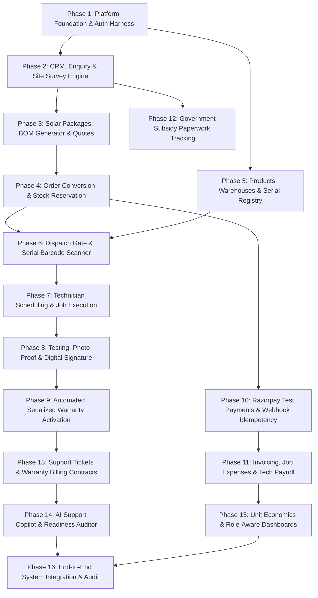

# DEVELOPMENT PHASES & GRANULAR TASK BREAKDOWN
**Project:** Solar Installation Management System (SunPower Solutions)  
**Architecture:** Modular Monolith (Node.js/Express + PostgreSQL + React/Vite/Tailwind CSS)  
**Document Version:** 1.0.0  

---

## Phase Overview & Sequencing

---

## Phase 1: Platform Foundation, Architecture Scaffold & Auth Harness
**Lead:** Member 1  
**Dependencies:** None

### Task 1.1: Monorepo Project Scaffolding & Configuration
- **Objective:** Establish the Node.js/Express backend, React/Vite/Tailwind CSS frontend, root scripts, git configuration, and environment variable schema.
- **Files Created:** `backend/package.json`, `frontend/package.json`, `backend/.env.example`, `frontend/.env.example`, `backend/src/server.js`, `backend/src/app.js`, `frontend/vite.config.js`, `frontend/tailwind.config.js`, `frontend/postcss.config.js`, `frontend/index.html`, `frontend/src/index.css`.
- **Files Modified:** None (initial bootstrap).
- **Database Changes:** None.
- **API Changes:** `GET /health` (returns `{ status: 'UP', timestamp, uptime }`).
- **Frontend Screens:** Base root layout shell with Tailwind CSS typography.
- **Business Rules:** Monolith structure; no microservices.
- **Validations:** Node.js v18+ check, environment schema validation on boot.
- **Error States:** 500 if mandatory environment variables are missing.
- **Authorization:** Public endpoint for health check.
- **Audit Req:** Server start and stop events logged.
- **Test Cases:** TC-PLT-001 (Server boots up), TC-PLT-002 (Health endpoint returns 200).
- **Definition of Done:** `npm install` and `npm run dev` succeed cleanly in both frontend and backend directories.
- **Dependencies:** None.

### Task 1.2: PostgreSQL Connection Pool, Migration Harness & Base Schema
- **Objective:** Build PostgreSQL client connection pool with connection pooling, transaction wrapper, and automated migration runner executing `001_platform_foundation.sql`.
- **Files Created:** `backend/src/config/database.js`, `backend/src/common/db.js`, `backend/src/migrations/001_platform_foundation.sql`, `backend/src/scripts/migrate.js`.
- **Files Modified:** `backend/src/app.js`.
- **Database Changes:** Tables created: `users`, `roles`, `user_roles`, `refresh_tokens`, `audit_logs`, `media_attachments`.
- **API Changes:** None (database layer).
- **Frontend Screens:** None.
- **Business Rules:** Foreign keys, cascade constraints, indexed primary keys, strict timestamp columns (`created_at`, `updated_at`).
- **Validations:** Pool size limits (max 20 connections), SSL configuration for production.
- **Error States:** Database unreachable on boot triggers retry with exponential backoff and fatal exit after 5 failures.
- **Authorization:** System/DBA level.
- **Audit Req:** Migration version logged in `schema_migrations` table.
- **Test Cases:** TC-DB-001 (Connection pool establishes), TC-DB-002 (Migration runner executes idempotently).
- **Definition of Done:** `npm run migrate` runs successfully and creates all foundational tables in PostgreSQL.
- **Dependencies:** Task 1.1.

### Task 1.3: Central JWT Authentication & Refresh Token Rotation
- **Objective:** Implement user registration, password hashing (bcrypt), login issuance of short-lived JWT (15 min) and persistent rotated refresh tokens (7 days).
- **Files Created:** `backend/src/modules/platform/auth.controller.js`, `backend/src/modules/platform/auth.service.js`, `backend/src/modules/platform/auth.routes.js`, `backend/src/middleware/auth.middleware.js`, `frontend/src/context/AuthContext.jsx`, `frontend/src/features/auth/LoginPage.jsx`.
- **Files Modified:** `backend/src/app.js`, `frontend/src/App.jsx`.
- **Database Changes:** Refresh token storage with token family tracking.
- **API Changes:** `POST /api/auth/login`, `POST /api/auth/refresh`, `POST /api/auth/logout`, `GET /api/auth/me`.
- **Frontend Screens:** Login Screen with email/password, error banner, and persistent session recovery.
- **Business Rules:** Access token contains `user_id` and `roles`; refresh tokens rotated on each refresh; replayed refresh tokens invalidate token family immediately.
- **Validations:** Email regex, password length >= 8 characters.
- **Error States:** 401 Invalid Credentials, 401 Expired Token, 403 Reuse Detected.
- **Authorization:** Login/refresh endpoints public; `GET /me` requires Bearer token.
- **Audit Req:** All login attempts, failed logins, and logouts recorded in `audit_logs`.
- **Test Cases:** TC-AUTH-001 (Valid login), TC-AUTH-002 (Invalid password), TC-AUTH-003 (Token refresh), TC-AUTH-004 (Token reuse detection).
- **Definition of Done:** Users can log in, receive valid JWTs, and maintain session across page refreshes.
- **Dependencies:** Task 1.2.

### Task 1.4: 5-Role RBAC & Row-Level Authorization Middleware
- **Objective:** Implement role enforcement middleware supporting 5 distinct roles: `Director`, `Sales`, `Technician`, `Warehouse`, `Support`.
- **Files Created:** `backend/src/middleware/rbac.middleware.js`, `frontend/src/components/shared/ProtectedRoute.jsx`, `frontend/src/layout/Sidebar.jsx`, `frontend/src/layout/AppLayout.jsx`.
- **Files Modified:** `frontend/src/App.jsx`.
- **Database Changes:** Role seed data populated: Director, Sales, Technician, Warehouse, Support.
- **API Changes:** None (middleware).
- **Frontend Screens:** Sidebar navigation dynamically filters menu items based on active user's roles.
- **Business Rules:** Least privilege; unauthorized routes blocked with 403 Forbidden.
- **Validations:** User must have at least one valid role attached in JWT payload.
- **Error States:** 403 Forbidden with `{ error: 'INSUFFICIENT_PERMISSIONS', requiredRoles: [...] }`.
- **Authorization:** Internal middleware.
- **Audit Req:** Unauthorized access attempts logged in `audit_logs` with severity 'WARNING'.
- **Test Cases:** TC-RBAC-001 (Technician blocked from viewing financial routes), TC-RBAC-002 (Director has omni-access).
- **Definition of Done:** Route guards verified for all 5 roles on both API and frontend router.
- **Dependencies:** Task 1.3.

### Task 1.5: Central Immutable Audit Logging Engine & Viewer
- **Objective:** Provide a global audit logging helper and an administrative audit viewer for the Director.
- **Files Created:** `backend/src/middleware/audit.middleware.js`, `backend/src/modules/platform/audit.controller.js`, `backend/src/modules/platform/audit.service.js`, `frontend/src/features/auth/AuditLogView.jsx`.
- **Files Modified:** `backend/src/app.js`.
- **Database Changes:** `audit_logs` table schema optimized with indexes on `entity_name`, `entity_id`, `created_at`.
- **API Changes:** `GET /api/audit-logs` (filterable by date, actor, entity, action).
- **Frontend Screens:** Director Audit Log viewer table with JSON payload inspector.
- **Business Rules:** Audit logs are append-only; update/delete operations on `audit_logs` are prohibited.
- **Validations:** Payload must contain `actor_id`, `action`, `entity_name`, `entity_id`.
- **Error States:** Audit write failure must not abort core transaction but write to backup fallback file.
- **Authorization:** Director role only for viewing.
- **Audit Req:** Viewing audit logs is itself logged in `audit_logs`.
- **Test Cases:** TC-AUDIT-001 (Mutation creates audit log), TC-AUDIT-002 (Non-director gets 403).
- **Definition of Done:** All mutating actions automatically captured in immutable audit records.
- **Dependencies:** Task 1.4.

### Task 1.6: Cloudinary Media Storage Integration & Upload Primitives
- **Objective:** Configure Cloudinary SDK for secure media uploads (survey photos, installation proof, signatures, receipts).
- **Files Created:** `backend/src/config/cloudinary.js`, `frontend/src/components/shared/PhotoUploader.jsx`, `frontend/src/components/shared/SignaturePad.jsx`.
- **Files Modified:** `backend/src/app.js`.
- **Database Changes:** `media_attachments` table linked to entity types.
- **API Changes:** `POST /api/media/sign-upload` (generates signed parameters for direct-to-Cloudinary upload).
- **Frontend Screens:** Reusable Photo Uploader with thumbnail preview, compression, and Signature Pad canvas.
- **Business Rules:** Max file size 10MB; allowed types: image/jpeg, image/png, image/webp, application/pdf.
- **Validations:** MIME type verification; file signature check.
- **Error States:** 400 Bad Request on oversized/invalid files.
- **Authorization:** Authenticated users.
- **Audit Req:** Upload metadata stored in database.
- **Test Cases:** TC-MEDIA-001 (Upload valid JPEG), TC-MEDIA-002 (Reject executable file).
- **Definition of Done:** Reusable UI components upload media directly to Cloudinary and return secure URLs.
- **Dependencies:** Task 1.1.

---

## Phase 2: CRM, Public Enquiry, Deduplication & Site Survey Engine
**Lead:** Member 2 (Assisted by Member 1 on Shared UI)  
**Dependencies:** Phase 1

### Task 2.1: Database Migration for Customer & Sales Subsystem
- **Objective:** Deploy migration `002_customer_sales.sql` defining customers, enquiries, site surveys, and reviews.
- **Files Created:** `backend/src/migrations/002_customer_sales.sql`.
- **Files Modified:** None.
- **Database Changes:** Tables created: `customers`, `enquiries`, `site_surveys`, `survey_measurements`, `survey_reviews`.
- **API Changes:** None.
- **Frontend Screens:** None.
- **Business Rules:** Foreign keys to `users` (assigned sales/technician); customer phone number indexed.
- **Validations:** Phone format (+91 or 10 digits), positive numbers for bill and roof area.
- **Error States:** Database constraint errors handled cleanly.
- **Authorization:** Member 2 ownership.
- **Audit Req:** Schema migration recorded.
- **Test Cases:** TC-DB-003 (Execute 002_customer_sales.sql cleanly).
- **Definition of Done:** All CRM and survey tables and indexes exist in PostgreSQL.
- **Dependencies:** Task 1.2.

### Task 2.2: Public Rooftop Enquiry Intake Form & Rate Limiting
- **Objective:** Create the public homeowner landing form for solar enquiries with anti-spam rate limiting.
- **Files Created:** `frontend/src/features/sales/PublicEnquiryForm.jsx`, `backend/src/modules/sales/enquiry.controller.js`, `backend/src/modules/sales/enquiry.service.js`, `backend/src/modules/sales/sales.routes.js`, `backend/src/modules/sales/sales.validators.js`.
- **Files Modified:** `backend/src/app.js`, `frontend/src/App.jsx`.
- **Database Changes:** Inserts into `enquiries`.
- **API Changes:** `POST /api/sales/public/enquiries`.
- **Frontend Screens:** Branded public enquiry page: Name, Phone, Email, Address, Pincode, Average Monthly Electricity Bill (₹), Preferred System Type (On-Grid / Off-Grid).
- **Business Rules:** New enquiries enter in status 'NEW'; immediate email/SMS acknowledgment simulated.
- **Validations:** 10-digit Indian phone validation; monthly bill >= 500; valid email.
- **Error States:** 429 Too Many Requests (rate limit: 5 submissions/15 min/IP); 400 Bad Request on invalid fields.
- **Authorization:** Public access (no JWT required).
- **Audit Req:** Submission logged with client IP and user agent.
- **Test Cases:** TC-ENQ-001 (Valid enquiry submission), TC-ENQ-002 (Rate limit triggered).
- **Definition of Done:** Homeowner submits form; record is created in database with 'NEW' status.
- **Dependencies:** Task 2.1, Task 1.4.

### Task 2.3: Automated Duplicate Lead Detection & Merging Workflow
- **Objective:** Detect incoming leads matching existing phone numbers or emails, and provide sales team with a side-by-side merge dialog.
- **Files Created:** `frontend/src/features/sales/EnquiryInboxPage.jsx`, `frontend/src/features/sales/CustomerDetailPage.jsx`.
- **Files Modified:** `backend/src/modules/sales/enquiry.service.js`, `backend/src/modules/sales/enquiry.controller.js`.
- **Database Changes:** Updates to `enquiries.duplicate_of_id`, `enquiries.status`.
- **API Changes:** `GET /api/sales/enquiries`, `GET /api/sales/enquiries/duplicates`, `POST /api/sales/enquiries/:id/merge`.
- **Frontend Screens:** Sales Enquiry Inbox with 'DUPLICATE' badge, filter tabs (New, Qualified, Survey_Scheduled, Merged), Side-by-side merge modal.
- **Business Rules:** Duplicate detected if phone number matches exactly or email matches existing customer/enquiry; merging consolidates notes into primary customer record.
- **Validations:** Merged ID must exist and not be self-referential.
- **Error States:** 400 on circular merge attempt; 404 on missing record.
- **Authorization:** Sales, Director.
- **Audit Req:** Lead merge event logged in `audit_logs` with previous and consolidated IDs.
- **Test Cases:** TC-ENQ-003 (Exact phone duplicate flagged), TC-ENQ-004 (Lead merge consolidates history).
- **Definition of Done:** Sales inbox alerts on duplicates and allows one-click side-by-side merge without losing customer data.
- **Dependencies:** Task 2.2.

### Task 2.4: Preliminary Lead Qualification & Customer Record Establishment
- **Objective:** Sales representative calls lead to verify basic parameters (shadow-free roof space >= 100 sq ft, electricity bill >= ₹1,500, grid connection stable).
- **Files Created:** `backend/src/modules/sales/customer.controller.js`, `backend/src/modules/sales/customer.service.js`.
- **Files Modified:** `frontend/src/features/sales/EnquiryInboxPage.jsx`, `frontend/src/features/sales/CustomerDetailPage.jsx`.
- **Database Changes:** Creates record in `customers` upon qualification; updates `enquiries.status = 'QUALIFIED'`.
- **API Changes:** `POST /api/sales/enquiries/:id/qualify`, `GET /api/sales/customers`, `GET /api/sales/customers/:id`.
- **Frontend Screens:** Qualification checklist modal; Customer 360 profile page.
- **Business Rules:** Only qualified leads with verified parameters can proceed to Site Survey scheduling.
- **Validations:** Roof space (sq ft) > 0; bill amount > 0; grid status confirmed.
- **Error States:** 400 Bad Request if mandatory qualification checks are unchecked.
- **Authorization:** Sales, Director.
- **Audit Req:** Qualification decision and agent ID logged in `audit_logs`.
- **Test Cases:** TC-CUST-001 (Qualify lead creates customer), TC-CUST-002 (Unqualified lead rejected).
- **Definition of Done:** Qualified lead transitions to permanent Customer dossier with full contact details.
- **Dependencies:** Task 2.3.

### Task 2.5: Site Survey Scheduling & Technician Assignment
- **Objective:** Schedule on-site physical survey with slot booking and technician assignment.
- **Files Created:** `frontend/src/features/sales/SurveyScheduleModal.jsx`.
- **Files Modified:** `backend/src/modules/sales/survey.controller.js`, `backend/src/modules/sales/survey.service.js`.
- **Database Changes:** Creates record in `site_surveys` (status = 'SCHEDULED'); updates technician schedule.
- **API Changes:** `POST /api/sales/surveys/schedule`, `GET /api/sales/surveys/available-technicians`.
- **Frontend Screens:** Survey Scheduling Modal with calendar date picker and technician workload indicator.
- **Business Rules:** Survey can ONLY be scheduled for a Qualified lead/customer; technician cannot have conflicting bookings.
- **Validations:** Survey date must be in future; assigned user must have 'Technician' role.
- **Error States:** 409 Conflict if technician is already booked in chosen slot.
- **Authorization:** Sales, Director.
- **Audit Req:** Survey scheduling and assigned technician logged in `audit_logs`.
- **Test Cases:** TC-SRV-001 (Successful survey schedule), TC-SRV-002 (Technician double-booking blocked).
- **Definition of Done:** Site survey created with scheduled date and technician assigned; appears on technician's job queue.
- **Dependencies:** Task 2.4.

### Task 2.6: Mobile-Optimized On-Site Survey Execution & Photo Capture
- **Objective:** Enable field technicians to enter compass direction, tilt angle, shading analysis, cable distance, and upload roof photos on-site.
- **Files Created:** `frontend/src/features/sales/SiteSurveyExecutionForm.jsx`.
- **Files Modified:** `backend/src/modules/sales/survey.controller.js`, `backend/src/modules/sales/survey.service.js`.
- **Database Changes:** Inserts into `survey_measurements` and `media_attachments`; updates `site_surveys.status = 'SUBMITTED'`.
- **API Changes:** `POST /api/sales/surveys/:id/execute`, `POST /api/sales/surveys/:id/photos`.
- **Frontend Screens:** Mobile-friendly survey form with compass azimuth input, tilt angle selector (10°-30°), cable run length (m), multi-angle photo uploader.
- **Business Rules:** Minimum 2 roof photos mandatory; cable distance must be specified.
- **Validations:** Tilt angle between 0° and 90°; azimuth between 0° and 360°; cable run > 0 meters.
- **Error States:** 400 Bad Request if photos or measurements are missing.
- **Authorization:** Technician, Director.
- **Audit Req:** Submission logged with technician ID and timestamp.
- **Test Cases:** TC-SRV-003 (Submit complete survey), TC-SRV-004 (Submit without photos rejected).
- **Definition of Done:** Technician submits survey from mobile device; status becomes 'SUBMITTED' with verified photos stored in Cloudinary.
- **Dependencies:** Task 2.5, Task 1.6.

### Task 2.7: Survey Engineering Review & Approval Gate
- **Objective:** Engineering/Sales manager reviews survey measurements, evaluates structural feasibility, and marks Approved, Rejected, or Rework.
- **Files Created:** `frontend/src/features/sales/SurveyApprovalPage.jsx`.
- **Files Modified:** `backend/src/modules/sales/survey.controller.js`, `backend/src/modules/sales/survey.service.js`.
- **Database Changes:** Creates record in `survey_reviews`; updates `site_surveys.status` ('APPROVED', 'REJECTED', 'REWORK').
- **API Changes:** `POST /api/sales/surveys/:id/approve`, `POST /api/sales/surveys/:id/reject`, `POST /api/sales/surveys/:id/rework`.
- **Frontend Screens:** Survey Review Screen displaying photo gallery, tilt/shading data, and review action buttons.
- **Business Rules:** CRITICAL BUSINESS GATE: Quotation generation is strictly blocked until survey status is 'APPROVED'. If Rework is chosen, reason is mandatory and survey returns to technician queue.
- **Validations:** Rejection/Rework requires minimum 10-character reason.
- **Error States:** 400 Bad Request on missing comments for rejection/rework.
- **Authorization:** Sales Manager, Director.
- **Audit Req:** Approval/rejection decision and manager notes logged in `audit_logs`.
- **Test Cases:** TC-SRV-005 (Approve survey opens quote creation), TC-SRV-006 (Rework status routes back to technician).
- **Definition of Done:** Manager can review, approve, or request rework on survey; approved survey unlocks quotation engine.
- **Dependencies:** Task 2.6.

---

## Phase 3: Solar Packages, Automated BOM Generator & Quotation Flow
**Lead:** Member 2  
**Dependencies:** Phase 2

### Task 3.1: Standard Solar Packages Catalog (1 kW to 5 kW On/Off Grid)
- **Objective:** Establish standard package catalog templates for 1 kW, 2 kW, 3 kW, 4 kW, 5 kW systems in On-Grid and Off-Grid configurations.
- **Files Created:** `backend/src/migrations/002_packages.sql` (or integrated into 002), `backend/src/modules/sales/package.service.js`.
- **Files Modified:** `backend/src/modules/sales/sales.routes.js`.
- **Database Changes:** Tables created: `packages`, `package_components`.
- **API Changes:** `GET /api/sales/packages`, `GET /api/sales/packages/:id`.
- **Frontend Screens:** Package Selector component in Quotation Builder.
- **Business Rules:** System size strictly 1.0 kW to 5.0 kW; grid types strictly 'ON_GRID' (grid-tied, no battery) or 'OFF_GRID' (includes battery backup).
- **Validations:** Capacity must be between 1.0 and 5.0 in increments of 1 kW; base price > 0.
- **Error States:** 404 on invalid package ID.
- **Authorization:** Sales, Director.
- **Audit Req:** Package template modifications logged.
- **Test Cases:** TC-PKG-001 (Fetch 3 kW Off-Grid package spec).
- **Definition of Done:** Packages API returns standardized component specifications for all 10 standard configurations.
- **Dependencies:** Task 2.1.

### Task 3.2: Automated Bill of Materials (BOM) Generation Engine
- **Objective:** Automatically calculate the complete parts list (panels, inverter, stands, switches, wires, safety parts) based on package capacity and surveyed cable distance.
- **Files Created:** `backend/src/modules/sales/bomGenerator.service.js`.
- **Files Modified:** `backend/src/modules/sales/quotation.service.js`.
- **Database Changes:** `quotation_items` table populated from BOM engine.
- **API Changes:** `POST /api/sales/quotations/generate-bom`.
- **Frontend Screens:** BOM interactive table inside Quotation Builder.
- **Business Rules:** Automatic BOM calculation:
  - 1 kW = 2x 540W panels, 1x 1kW inverter, 1 structure set, 20m cable, 1 earthing kit.
  - 3 kW = 6x 540W panels, 1x 3.3kW inverter, 2 structure sets, 35m cable, 2 earthing rods.
  - 5 kW = 10x 540W panels, 1x 5kW inverter, 3 structure sets, 50m cable, 2 earthing rods.
  - Off-Grid adds: battery bank (e.g. 48V 150Ah) and charge controller.
- **Validations:** Cable distance adjusted if survey measurement exceeds default package cable length.
- **Error States:** 400 Bad Request if surveyed cable distance is unfeasible (> 100m without line-loss check).
- **Authorization:** Sales, Director.
- **Audit Req:** Generated BOM items logged against quotation version.
- **Test Cases:** TC-BOM-001 (3 kW On-Grid auto-generates 6 panels, 1 inverter, structure, wiring), TC-BOM-002 (Off-Grid adds battery and controller).
- **Definition of Done:** Selecting package capacity automatically yields complete BOM with zero missing small parts.
- **Dependencies:** Task 3.1, Task 2.7.

### Task 3.3: Quotation Builder, PDF Engine & Delivery
- **Objective:** Construct comprehensive quotation with itemized hardware, installation labor, GST calculation, subsidy estimates, terms, and branded PDF generation.
- **Files Created:** `frontend/src/features/sales/QuotationBuilderPage.jsx`, `backend/src/modules/sales/quotation.controller.js`, `backend/src/modules/sales/quotation.service.js`.
- **Files Modified:** `backend/src/modules/sales/sales.routes.js`.
- **Database Changes:** Tables created: `quotations`, `quotation_versions`, `quotation_items`.
- **API Changes:** `POST /api/sales/quotations`, `GET /api/sales/quotations/:id`, `GET /api/sales/quotations/:id/pdf`, `POST /api/sales/quotations/:id/send`.
- **Frontend Screens:** Quotation Builder with price summary, discount limits, validity period (15 days), and PDF preview.
- **Business Rules:** Quotation CANNOT be created if site survey is not in 'APPROVED' status. Maximum sales discount capped at 10% without Director approval.
- **Validations:** Expiration date > current date; grand total = sum of BOM + labor + tax - discount.
- **Error States:** 403 Forbidden if survey is unapproved; 400 if discount exceeds threshold.
- **Authorization:** Sales, Director.
- **Audit Req:** Quote creation, edits, and delivery logged with version number.
- **Test Cases:** TC-QTE-001 (Create quotation for approved survey), TC-QTE-002 (Blocked if survey pending), TC-QTE-003 (Generate branded PDF).
- **Definition of Done:** Quotation PDF generated and email/link sent to customer with unique token.
- **Dependencies:** Task 3.2.

### Task 3.4: Customer Quotation Review & Digital Acceptance Flow
- **Objective:** Dedicated customer-facing portal page for reviewing quotation details, BOM, payment schedule, and digitally accepting or declining the quote.
- **Files Created:** `frontend/src/features/sales/CustomerQuoteAcceptPage.jsx`.
- **Files Modified:** `backend/src/modules/sales/quotation.controller.js`, `backend/src/modules/sales/quotation.service.js`.
- **Database Changes:** Updates `quotations.status = 'ACCEPTED'`; creates `quotation_acceptance` record.
- **API Changes:** `GET /api/sales/public/quotations/:token`, `POST /api/sales/public/quotations/:token/accept`, `POST /api/sales/public/quotations/:token/decline`.
- **Frontend Screens:** Clean, responsive customer quotation view with itemized cards, subsidy breakdown, terms checkbox, and 'Accept & Sign' or 'Decline' buttons.
- **Business Rules:** CRITICAL BUSINESS GATE: Accepting a quotation advances Quote to 'ACCEPTED' and automatically triggers Order/Project Creation. Expired quotes cannot be accepted.
- **Validations:** Digital acceptance requires full name and confirmation checkbox.
- **Error States:** 400 if quote expired; 409 if already accepted.
- **Authorization:** Public access via secure cryptographically random token.
- **Audit Req:** Customer IP address, acceptance timestamp, and token logged.
- **Test Cases:** TC-QTE-004 (Customer accepts quote; status becomes ACCEPTED), TC-QTE-005 (Decline quote captures feedback).
- **Definition of Done:** Customer accepts quote online; system marks quote accepted and emits event for Order creation.
- **Dependencies:** Task 3.3.

---

## Phase 4: Order Conversion, Payment Orders & Stock Reservation
**Lead:** Member 2 (Order Creation) + Member 3 (Stock Reservation) + Member 4 (Advance Payment Order)  
**Dependencies:** Phase 3

### Task 4.1: Order & Project Initialization Engine
- **Objective:** Automatically convert accepted quotation into an active Order and Project with project milestones.
- **Files Created:** `backend/src/modules/sales/order.service.js`, `backend/src/modules/sales/order.controller.js`.
- **Files Modified:** `backend/src/modules/sales/quotation.service.js`.
- **Database Changes:** Tables created: `orders`, `projects`, `project_milestones`.
- **API Changes:** `POST /api/sales/orders/create-from-quote`, `GET /api/sales/orders/:id`, `GET /api/sales/projects/:id`.
- **Frontend Screens:** Project Overview tab in Customer Profile.
- **Business Rules:** CRITICAL GATE: Order creation REQUIRES quotation acceptance. Order contains target system capacity, BOM snapshot, and project milestones. Initial status = 'PENDING_ADVANCE'.
- **Validations:** Quotation status must be strictly 'ACCEPTED'.
- **Error States:** 400 Bad Request if quote is not accepted or already ordered.
- **Authorization:** System automated / Sales Executive / Director.
- **Audit Req:** Order created with reference to quotation ID, customer ID, and initial total.
- **Test Cases:** TC-ORD-001 (Quote acceptance spawns Order and Project), TC-ORD-002 (Duplicate conversion blocked).
- **Definition of Done:** Order and Project records created with status 'PENDING_ADVANCE'.
- **Dependencies:** Task 3.4.

### Task 4.2: Automated BOM Stock Reservation & Shortage Flagging
- **Objective:** Lock required BOM components in warehouse inventory to prevent double-allocation; flag shortages if on-hand stock is insufficient.
- **Files Created:** `backend/src/modules/operations/inventory.service.js` (reservation methods).
- **Files Modified:** `backend/src/modules/sales/order.service.js`.
- **Database Changes:** Inserts into `stock_reservations`; updates `inventory_ledger`.
- **API Changes:** `POST /api/operations/projects/:id/reserve-stock`, `GET /api/operations/inventory/shortages`.
- **Frontend Screens:** Shortage warning banner on Project card; Warehouse shortage queue.
- **Business Rules:** CRITICAL GATE: Stock cannot be reserved beyond Available = On-Hand - Existing Reservations. If shortage occurs, status = 'SHORTAGE_FLAGGED' and procurement task created.
- **Validations:** Quantity reserved must match BOM requirement.
- **Error States:** 409 Conflict with shortage details (SKU, deficit amount).
- **Authorization:** Warehouse Manager, System automated.
- **Audit Req:** Stock reservation transaction logged with project ID.
- **Test Cases:** TC-INV-001 (Reserve available stock succeeds), TC-INV-002 (Shortage flagged when inventory insufficient).
- **Definition of Done:** Inventory reservation created; available stock decremented; shortage alert raised if deficit exists.
- **Dependencies:** Task 4.1.

---

## Phase 5: Products Catalog, Warehouse Receipts & Serial Registry
**Lead:** Member 3  
**Dependencies:** Phase 1

### Task 5.1: Database Migration for Operations & Inventory Subsystem
- **Objective:** Deploy migration `003_operations_fulfilment.sql` defining products, inventory ledger, warehouses, serial registry, jobs, and warranties.
- **Files Created:** `backend/src/migrations/003_operations_fulfilment.sql`.
- **Files Modified:** None.
- **Database Changes:** Tables created: `products`, `product_categories`, `warehouses`, `inventory_ledger`, `serial_registry`, `stock_receipts`, `stock_receipt_items`, `dispatch_orders`, `technicians`, `installation_jobs`, `installation_checkpoints`, `installation_tests`, `installation_photos`, `warranty_records`.
- **API Changes:** None.
- **Frontend Screens:** None.
- **Business Rules:** Double-entry inventory ledger; serial uniqueness constraints; foreign key constraints.
- **Validations:** Category IDs valid; SKU unique.
- **Error States:** SQL migration errors handled.
- **Authorization:** Member 3 ownership.
- **Audit Req:** Migration recorded.
- **Test Cases:** TC-DB-004 (Execute 003_operations_fulfilment.sql cleanly).
- **Definition of Done:** All operational and inventory tables exist in PostgreSQL.
- **Dependencies:** Task 1.2.

### Task 5.2: Product Master Catalog & SKU Management
- **Objective:** Manage product definitions, categories (Panels, Inverters, Batteries, Mounting, Electrical), specifications, and standard unit costs.
- **Files Created:** `frontend/src/features/operations/ProductCatalogPage.jsx`, `backend/src/modules/operations/inventory.controller.js`, `backend/src/modules/operations/inventory.service.js`, `backend/src/modules/operations/operations.routes.js`, `backend/src/modules/operations/operations.validators.js`.
- **Files Modified:** `backend/src/app.js`, `frontend/src/App.jsx`.
- **Database Changes:** Inserts and updates to `products` and `product_categories`.
- **API Changes:** `GET /api/operations/products`, `POST /api/operations/products`, `PUT /api/operations/products/:id`.
- **Frontend Screens:** Product Catalog Page with category filters, SKU search, unit costs, and serialized flag.
- **Business Rules:** High-value items (Inverters, Batteries, Charge Controllers) MUST be marked `is_serialized = true`.
- **Validations:** SKU must be unique uppercase alphanumeric string; cost price >= 0.
- **Error States:** 409 Conflict on duplicate SKU; 400 Bad Request on invalid category.
- **Authorization:** Warehouse Manager, Director.
- **Audit Req:** Product creation and cost changes logged in `audit_logs`.
- **Test Cases:** TC-PRD-001 (Create serialized inverter product), TC-PRD-002 (Duplicate SKU blocked).
- **Definition of Done:** Products viewable and manageable by warehouse team; serialized flag accurately set.
- **Dependencies:** Task 5.1.

### Task 5.3: Goods Received Note (GRN) & Inbound Serial Number Importer
- **Objective:** Record incoming vendor stock deliveries with Goods Received Notes and register individual serial numbers for high-value items.
- **Files Created:** `frontend/src/features/operations/StockReceiptPage.jsx`, `frontend/src/features/operations/WarehouseInventoryPage.jsx`.
- **Files Modified:** `backend/src/modules/operations/inventory.controller.js`, `backend/src/modules/operations/inventory.service.js`.
- **Database Changes:** Inserts into `stock_receipts`, `stock_receipt_items`, `inventory_ledger`, and `serial_registry`.
- **API Changes:** `POST /api/operations/inventory/receipts`, `POST /api/operations/inventory/serials/batch`.
- **Frontend Screens:** Stock Receipt (GRN) form with vendor name, invoice number, item selector, and bulk serial paste/scan textarea.
- **Business Rules:** Total serialized entries must exactly equal received quantity for serialized products; serial numbers enter in status 'IN_WAREHOUSE'.
- **Validations:** Serial number uniqueness check across entire `serial_registry` table.
- **Error States:** 409 Conflict if any serial number is already registered in the system.
- **Authorization:** Warehouse Manager, Director.
- **Audit Req:** Stock receipt and ledger credit logged with receiving officer ID.
- **Test Cases:** TC-INV-003 (Receive 10 inverters and register 10 serial numbers), TC-INV-004 (Duplicate serial rejected).
- **Definition of Done:** Inbound stock updates warehouse ledger and registers unique serial numbers ready for dispatch.
- **Dependencies:** Task 5.2.

---

## Phase 6: Dispatch Verification & Serial Barcode Scanning Gate
**Lead:** Member 3  
**Dependencies:** Phase 4, Phase 5

### Task 6.1: Warehouse Dispatch Order Initialization
- **Objective:** Create a dispatch packing manifest for confirmed orders where advance payment has been verified.
- **Files Created:** `backend/src/modules/operations/dispatch.controller.js`, `backend/src/modules/operations/dispatch.service.js`.
- **Files Modified:** `backend/src/modules/operations/operations.routes.js`.
- **Database Changes:** Tables created: `dispatch_orders`, `dispatch_items`.
- **API Changes:** `POST /api/operations/dispatch/create`, `GET /api/operations/dispatch/:id`.
- **Frontend Screens:** Dispatch Queue on Warehouse Dashboard.
- **Business Rules:** Dispatch order CANNOT be created if project advance payment is unverified. Dispatch order items pull from reserved BOM.
- **Validations:** Target project must be in 'ADVANCE_PAID' status.
- **Error States:** 403 Forbidden if advance payment is unpaid.
- **Authorization:** Warehouse Manager.
- **Audit Req:** Dispatch order creation logged.
- **Test Cases:** TC-DSP-001 (Create dispatch manifest for paid project), TC-DSP-002 (Blocked if advance unpaid).
- **Definition of Done:** Packing manifest generated listing reserved quantities and serialized slots to be scanned.
- **Dependencies:** Task 4.2.

### Task 6.2: Serial Number Barcode/QR Scanner & Verification Gate
- **Objective:** Provide camera/barcode scanner interface to verify and attach individual serial numbers before dispatch.
- **Files Created:** `frontend/src/features/operations/DispatchScannerPage.jsx`, `backend/src/modules/operations/serialRegistry.service.js`.
- **Files Modified:** `backend/src/modules/operations/dispatch.controller.js`, `backend/src/modules/operations/dispatch.service.js`.
- **Database Changes:** Updates `serial_registry.status = 'ASSIGNED_TO_PROJECT'`, `serial_registry.project_id`, `serial_registry.dispatch_id`.
- **API Changes:** `POST /api/operations/dispatch/:id/verify-serial`.
- **Frontend Screens:** Mobile-friendly Barcode/QR camera scanning interface with audio beep, green tick verification, and remaining serials count.
- **Business Rules:** CRITICAL BUSINESS GATE:
  1. Every inverter, battery, and charge controller must have its unique serial scanned.
  2. Scanned serial must exist in warehouse in status 'IN_WAREHOUSE'.
  3. Scanned serial must NOT be assigned to any other project.
  4. Scanned serial must match the exact product model in the BOM.
- **Validations:** Serial string validation; duplicate scan rejection.
- **Error States:** 400 Mismatched product model; 409 Serial already assigned elsewhere; 404 Serial unknown.
- **Authorization:** Warehouse Manager.
- **Audit Req:** Scanned serial, scanner user ID, timestamp recorded in `serial_audit_history`.
- **Test Cases:** TC-DSP-003 (Scan valid inverter attaches to dispatch), TC-DSP-004 (Scan already assigned serial rejected).
- **Definition of Done:** All mandatory serialized units scanned and verified against order BOM.
- **Dependencies:** Task 6.1.

### Task 6.3: Dispatch Confirmation & Material Transit Departure
- **Objective:** Confirm truck departure with verified serials, update inventory ledger to 'In_Transit', and issue delivery challan.
- **Files Created:** `frontend/src/features/operations/SerialTrackerPage.jsx`.
- **Files Modified:** `backend/src/modules/operations/dispatch.controller.js`, `backend/src/modules/operations/dispatch.service.js`.
- **Database Changes:** Updates `dispatch_orders.status = 'DISPATCHED'`, `serial_registry.status = 'IN_TRANSIT'`, `inventory_ledger` (debit on-hand, credit transit).
- **API Changes:** `POST /api/operations/dispatch/:id/confirm`, `GET /api/operations/serials/:serialNumber/trace`.
- **Frontend Screens:** Dispatch confirmation summary with driver/vehicle details; 360 Serial Tracker lookup page.
- **Business Rules:** CRITICAL GATE: System strictly blocks dispatch confirmation if any serialized item is missing or unverified.
- **Validations:** Vehicle number, driver phone, delivery address confirmed.
- **Error States:** 400 Bad Request if serialized requirements are not 100% fulfilled.
- **Authorization:** Warehouse Manager.
- **Audit Req:** Full dispatch audit: truck details, driver, list of serial numbers, dispatched by.
- **Test Cases:** TC-DSP-005 (Confirm complete dispatch transitions to IN_TRANSIT), TC-DSP-006 (Serial lookup traces to project).
- **Definition of Done:** Truck leaves warehouse; stock marked In_Transit; serials traceable; delivery challan PDF printed.
- **Dependencies:** Task 6.2.

---

## Phase 7: Technician Scheduling & Mobile Rooftop Job Execution
**Lead:** Member 3  
**Dependencies:** Phase 6

### Task 7.1: 15-Technician Roster, Availability & Crew Assignment Board
- **Objective:** Manage SunPower's 15-technician roster, skill sets (Electrical, Structure, Helper), and assign 2-3 technician crews to installation jobs.
- **Files Created:** `frontend/src/features/operations/TechnicianRosterPage.jsx`, `backend/src/modules/operations/technician.controller.js`, `backend/src/modules/operations/technician.service.js`.
- **Files Modified:** `backend/src/modules/operations/operations.routes.js`.
- **Database Changes:** Tables created: `technicians`, `technician_assignments`, `crew_teams`.
- **API Changes:** `GET /api/operations/technicians`, `GET /api/operations/technicians/availability`, `POST /api/operations/installations/schedule`.
- **Frontend Screens:** Technician Roster Board (Gantt calendar style) showing daily assignments across the 15 technicians.
- **Business Rules:** Crew must include at least one Certified Electrical Technician. Prevents scheduling technicians who are on leave or already assigned.
- **Validations:** Minimum 2 technicians per rooftop installation; date >= dispatch arrival date.
- **Error States:** 409 Conflict if any crew member is double-booked; 400 if electrical lead missing.
- **Authorization:** Operations Lead, Director.
- **Audit Req:** Crew assignment and lead technician logged in `audit_logs`.
- **Test Cases:** TC-SCH-001 (Assign 3-person crew to installation), TC-SCH-002 (Reject crew without electrical lead).
- **Definition of Done:** Installation job scheduled with valid crew; visible on technician mobile dashboard.
- **Dependencies:** Task 5.1, Task 6.3.

### Task 7.2: Mobile-First Rooftop Installation Job Card & Checklist
- **Objective:** Provide technicians on the roof with a responsive mobile interface to start the job, record timestamps, and check off hardware installation milestones.
- **Files Created:** `frontend/src/features/operations/InstallationJobMobilePage.jsx`, `backend/src/modules/operations/installation.controller.js`, `backend/src/modules/operations/installation.service.js`.
- **Files Modified:** `backend/src/modules/operations/operations.routes.js`.
- **Database Changes:** Inserts and updates to `installation_jobs`, `installation_checkpoints`.
- **API Changes:** `POST /api/operations/installations/:id/start`, `POST /api/operations/installations/:id/checkpoint`.
- **Frontend Screens:** Mobile Job Card: System size banner, Start Job button, step-by-step checklist (Mounting stands, laying panels, wiring boxes, inverter/battery placement, earthing pit).
- **Business Rules:** Technician must confirm system size matches order before starting; hardware checklist items must be checked sequentially.
- **Validations:** Job start timestamp recorded; checklist items cannot be skipped.
- **Error States:** 400 Bad Request on invalid checkpoint sequence.
- **Authorization:** Field Technician, Operations Lead.
- **Audit Req:** Job start and milestone checkpoints logged with timestamp.
- **Test Cases:** TC-JOB-001 (Start job records start timestamp), TC-JOB-002 (Complete checklist steps).
- **Definition of Done:** Technicians record installation progress step-by-step on phone/tablet with live duration tracking.
- **Dependencies:** Task 7.1.

---

## Phase 8: Power Generation Testing, Proof Photos & Handover Signature
**Lead:** Member 3 (Assisted by Member 1 on Signature & Media)  
**Dependencies:** Phase 7

### Task 8.1: Power Generation & Electrical Safety Testing Validation
- **Objective:** Validate on-site electrical parameters (open circuit voltage Voc, short circuit current Isc, inverter active generation in kW, earthing pit resistance in Ohms).
- **Files Created:** `frontend/src/features/operations/GenerationTestingForm.jsx`.
- **Files Modified:** `backend/src/modules/operations/installation.controller.js`, `backend/src/modules/operations/installation.service.js`.
- **Database Changes:** Tables created: `installation_tests`.
- **API Changes:** `POST /api/operations/installations/:id/testing`.
- **Frontend Screens:** Testing Form with input fields for Voc (V), Isc (A), Inverter Power Generation (kW), Grid Voltage (V), Earthing Resistance (Ohms).
- **Business Rules:** CRITICAL BUSINESS GATE:
  1. Earthing resistance MUST be <= 5.0 Ohms.
  2. Inverter generation must be > 0.0 kW during daylight hours.
  3. If tests fail safety thresholds, system BLOCKS completion and flags job for rework.
- **Validations:** Numeric validation; threshold range checking.
- **Error States:** 422 Unprocessable Entity if safety parameters fail (e.g. earthing = 12 Ohms).
- **Authorization:** Field Technician.
- **Audit Req:** Test instrument readings, tester name, test timestamp logged.
- **Test Cases:** TC-TST-001 (Valid test passes within thresholds), TC-TST-002 (Failed earthing resistance triggers rework).
- **Definition of Done:** Test readings validated against safety rules; passing test unlocks photo proof step.
- **Dependencies:** Task 7.2.

### Task 8.2: Mandatory Installation Proof Photos Upload
- **Objective:** Enforce uploading clear photographic proof of the finished installation across 4 mandatory angles before handover can occur.
- **Files Created:** `backend/src/modules/operations/installationPhoto.service.js`.
- **Files Modified:** `frontend/src/features/operations/InstallationJobMobilePage.jsx`.
- **Database Changes:** Inserts into `installation_photos`.
- **API Changes:** `POST /api/operations/installations/:id/photos`, `GET /api/operations/installations/:id/photos`.
- **Frontend Screens:** 4 Mandatory Photo Upload Slots with live preview:
  1. Panels & Roof Mounting Structure
  2. Inverter & DC/AC Distribution Boxes
  3. Battery Bank (Off-Grid) / Charge Controller
  4. Earthing Pit & Ground Wire Connection
- **Business Rules:** Handover signature is STRICTLY LOCKED until all 4 mandatory photo angles are uploaded and verified.
- **Validations:** File must be valid image; min 4 distinct photo categories.
- **Error States:** 400 Bad Request if trying to proceed to signature with missing photos.
- **Authorization:** Field Technician.
- **Audit Req:** Upload metadata, image URLs, and technician ID logged.
- **Test Cases:** TC-PHT-001 (Upload all 4 photo categories unlocks signature), TC-PHT-002 (Missing photo prevents handover).
- **Definition of Done:** All 4 required installation photos uploaded to Cloudinary and associated with job record.
- **Dependencies:** Task 8.1, Task 1.6.

### Task 8.3: Customer On-Screen Handover Digital Signature & Sign-Off
- **Objective:** Homeowner inspects installation, confirms system size and operating status, and signs directly on technician's touch device to accept the work.
- **Files Created:** `frontend/src/features/operations/HandoverSignatureModal.jsx`.
- **Files Modified:** `backend/src/modules/operations/installation.controller.js`, `backend/src/modules/operations/installation.service.js`.
- **Database Changes:** Tables created: `installation_handover`, `digital_signatures`; updates `installation_jobs.status = 'COMPLETED'`.
- **API Changes:** `POST /api/operations/installations/:id/sign-handover`, `GET /api/operations/installations/:id/handover-certificate`.
- **Frontend Screens:** Customer Handover Screen: Confirmation of working generation, HTML5 touch signature pad, Clear & Sign buttons, Certificate viewer.
- **Business Rules:** CRITICAL BUSINESS GATE:
  1. Job cannot be signed without passed generation test and 4 mandatory photos.
  2. Signature data URL stored with timestamp and customer name.
  3. Signing completes installation job and generates Handover Certificate.
- **Validations:** Signature canvas must contain drawn vector strokes (non-empty data URL).
- **Error States:** 400 Bad Request if signature is blank or prerequisite tests are incomplete.
- **Authorization:** Customer (assisted by Field Technician).
- **Audit Req:** Digital signature hash, customer name, date/time, IP/GPS logged in `audit_logs`.
- **Test Cases:** TC-SIG-001 (Customer signs on screen; handover certificate generated; job marked COMPLETED).
- **Definition of Done:** Homeowner signs on screen; installation marked completed; signed certificate PDF available for download.
- **Dependencies:** Task 8.2.

---

## Phase 9: Serialized Warranty Activation Engine
**Lead:** Member 3 (Warranty Core) + Member 4 (Service Link)  
**Dependencies:** Phase 6, Phase 8

### Task 9.1: Automated Serialized Warranty Activation
- **Objective:** Automatically activate warranty records for every serial number installed on the project upon completion sign-off without manual register typing.
- **Files Created:** `frontend/src/features/operations/WarrantyRegistryPage.jsx`, `backend/src/modules/operations/warranty.controller.js`, `backend/src/modules/operations/warranty.service.js`.
- **Files Modified:** `backend/src/modules/operations/operations.routes.js`.
- **Database Changes:** Inserts into `warranty_records`; updates `serial_registry.status = 'ACTIVE_WARRANTY'`.
- **API Changes:** `POST /api/operations/warranty/activate-project-serials`, `GET /api/operations/warranty/records`, `GET /api/operations/warranty/:serialNumber`.
- **Frontend Screens:** Warranty Registry Page with warranty cards, active days remaining, expiration alerts, and PDF warranty certificates.
- **Business Rules:** CRITICAL BUSINESS GATE:
  - Solar Panels: 20-Year (240 months) performance warranty.
  - Inverter: 2-Year (24 months) manufacturer replacement warranty [Configurable].
  - Battery: 2-Year (24 months) cycle warranty [Configurable].
  - Clock starts automatically on completion/delivery date.
  - Manual typing of dates is forbidden.
- **Validations:** Start date = job handover date; expiration date calculated exactly by calendar arithmetic.
- **Error States:** 409 Conflict if warranty already active; 400 if serial not attached to project.
- **Authorization:** System automated / Operations Lead.
- **Audit Req:** Warranty activation event logged with all serial IDs and computed expiration timestamps.
- **Test Cases:** TC-WRN-001 (Job handover automatically creates 20-year panel and 2-year inverter warranties), TC-WRN-002 (Warranty status query returns ACTIVE).
- **Definition of Done:** All installed serial numbers have active warranty records with precise end dates.
- **Dependencies:** Task 8.3, Task 6.3.

---

## Phase 10: Razorpay TEST MODE Payments & Webhook Idempotency
**Lead:** Member 4  
**Dependencies:** Phase 1, Phase 4

### Task 10.1: Database Migration for Support, Finance & AI Subsystem
- **Objective:** Deploy migration `004_support_finance_ai.sql` defining payments, webhooks, invoices, expenses, timesheets, subsidies, tickets, and AI logs.
- **Files Created:** `backend/src/migrations/004_support_finance_ai.sql`.
- **Files Modified:** None.
- **Database Changes:** Tables created: `payments`, `payment_transactions`, `payment_webhooks`, `invoices`, `invoice_lines`, `project_expenses`, `technician_timesheets`, `subsidy_applications`, `support_tickets`, `ticket_messages`, `ai_audit_logs`.
- **API Changes:** None.
- **Frontend Screens:** None.
- **Business Rules:** Financial ledger constraints; balance checks; unique payment IDs.
- **Validations:** Foreign keys to `projects`, `users`, `customers`.
- **Error States:** Migration errors trapped.
- **Authorization:** Member 4 ownership.
- **Audit Req:** Migration recorded.
- **Test Cases:** TC-DB-005 (Execute 004_support_finance_ai.sql cleanly).
- **Definition of Done:** All finance, support, and AI tables exist in PostgreSQL.
- **Dependencies:** Task 1.2.

### Task 10.2: Razorpay TEST MODE Order Creation & Frontend Checkout
- **Objective:** Integrate Razorpay SDK in TEST MODE to generate payment orders for advance payments and final balance settlements.
- **Files Created:** `frontend/src/features/finance_support_ai/RazorpayCheckoutModal.jsx`, `backend/src/modules/finance_support_ai/payment.controller.js`, `backend/src/modules/finance_support_ai/payment.service.js`, `backend/src/config/razorpay.js`.
- **Files Modified:** `backend/src/app.js`.
- **Database Changes:** Inserts into `payments`, `payment_transactions`.
- **API Changes:** `POST /api/finance/payments/razorpay/create-order`, `POST /api/finance/payments/razorpay/verify`.
- **Frontend Screens:** Payment Modal embedding Razorpay standard test checkout with mock card/UPI options.
- **Business Rules:** CRITICAL BUSINESS GATE:
  - Advance payment (e.g. 25% or full amount) unlocks warehouse packing and installation crew dispatch.
  - Backend MUST cryptographically verify Razorpay HMAC SHA256 signature using test secret before acknowledging payment.
- **Validations:** Amount in paise > 0; currency = 'INR'; receipt string = project ID.
- **Error States:** 400 Bad Request on invalid signature; 422 Payment failed from gateway.
- **Authorization:** Customer, Sales, Finance.
- **Audit Req:** Payment order creation, raw gateway response, and verification result logged in `audit_logs`.
- **Test Cases:** TC-PAY-001 (Create test order and verify valid HMAC signature), TC-PAY-002 (Tampered signature rejected with 400).
- **Definition of Done:** Customer pays in Razorpay Test Mode; backend verifies signature; order advances to 'ADVANCE_PAID'.
- **Dependencies:** Task 10.1, Task 4.1.

### Task 10.3: Idempotent Razorpay Webhook Processing Engine
- **Objective:** Build a resilient, idempotent webhook consumer that processes `payment.captured` and `payment.failed` events without creating duplicate financial records.
- **Files Created:** `backend/src/modules/finance_support_ai/webhook.controller.js`.
- **Files Modified:** `backend/src/modules/finance_support_ai/payment.service.js`.
- **Database Changes:** Inserts into `payment_webhooks` with unique index on `event_id`.
- **API Changes:** `POST /api/finance/payments/razorpay/webhook`.
- **Frontend Screens:** Webhook monitoring table in Finance Dashboard.
- **Business Rules:** CRITICAL BUSINESS GATE:
  - Replayed or duplicate webhooks MUST NOT credit customer balance or create duplicate ledger entries.
  - System checks `event_id` in `payment_webhooks`; if exists, returns 200 OK immediately without re-processing.
- **Validations:** Webhook signature verification via `crypto.createHmac('sha256', secret)`.
- **Error States:** 400 Bad Request on invalid webhook signature.
- **Authorization:** Public webhook endpoint secured by signature secret.
- **Audit Req:** Every incoming webhook stored with processing outcome.
- **Test Cases:** TC-PAY-003 (Process new payment webhook credits project), TC-PAY-004 (Duplicate webhook processed idempotently with zero double-credit).
- **Definition of Done:** Webhooks handle network retries cleanly without ledger distortion.
- **Dependencies:** Task 10.2.

---

## Phase 11: Invoicing, Job Expenses & Technician Payroll
**Lead:** Member 4  
**Dependencies:** Phase 8, Phase 10

### Task 11.1: Automated GST Tax Invoicing & Balance Settlement
- **Objective:** Generate formal GST Tax Invoices detailing hardware BOM, labor charges, GST breakdown, advance deduction, and outstanding balance.
- **Files Created:** `frontend/src/features/finance_support_ai/InvoicesPage.jsx`, `backend/src/modules/finance_support_ai/invoice.controller.js`, `backend/src/modules/finance_support_ai/invoice.service.js`.
- **Files Modified:** `backend/src/modules/finance_support_ai/financeSupport.routes.js`.
- **Database Changes:** Inserts into `invoices`, `invoice_lines`.
- **API Changes:** `POST /api/finance/invoices/generate`, `GET /api/finance/invoices/:id`, `GET /api/finance/invoices/:id/pdf`.
- **Frontend Screens:** Invoices Management Page with Tax Invoice viewer and PDF download.
- **Business Rules:** Invoice balance = Grand Total - Advance Payments. HSN/SAC codes included for solar equipment and installation services.
- **Validations:** Balance cannot be negative; invoice items must match actual installed equipment.
- **Error States:** 400 Bad Request on duplicate invoice generation for same milestone.
- **Authorization:** Finance, Director.
- **Audit Req:** Invoice generation, dispatch, and payments credited logged in `audit_logs`.
- **Test Cases:** TC-INV-005 (Generate tax invoice deducting advance payment), TC-INV-006 (Verify GST calculation).
- **Definition of Done:** Accurate GST tax invoice PDF generated and accessible to customer and finance team.
- **Dependencies:** Task 10.2, Task 8.3.

### Task 11.2: Project Expense Logging & Receipt Management
- **Objective:** Allow operations and field crew to record project-specific incidental expenses (local transport, extra wiring conduit, permits, food) with receipt photos.
- **Files Created:** `frontend/src/features/finance_support_ai/ProjectExpensesPage.jsx`, `backend/src/modules/finance_support_ai/expense.service.js`.
- **Files Modified:** `backend/src/modules/finance_support_ai/financeSupport.routes.js`.
- **Database Changes:** Inserts into `project_expenses`.
- **API Changes:** `POST /api/finance/projects/:id/expenses`, `GET /api/finance/projects/:id/expenses`.
- **Frontend Screens:** Expense Entry Screen with category picker, amount, notes, and receipt photo upload.
- **Business Rules:** Incidental expenses tagged to specific Project ID; amounts over ₹500 require receipt photo upload.
- **Validations:** Amount > 0; category must be in `['TRANSPORT', 'PERMITS', 'EXTRA_HARDWARE', 'MEALS', 'OTHER']`.
- **Error States:** 400 Bad Request if receipt missing for large amount.
- **Authorization:** Operations Lead, Finance, Director.
- **Audit Req:** Expense logged with user ID and approval status.
- **Test Cases:** TC-EXP-001 (Log expense with receipt), TC-EXP-002 (Reject expense over ₹500 without receipt).
- **Definition of Done:** Project expenses recorded and automatically factored into net job margin.
- **Dependencies:** Task 1.6, Task 4.1.

### Task 11.3: Technician Timesheet Tracking & Payout Calculation
- **Objective:** Aggregate verified installation job hours for the 15-technician crew and compute weekly/monthly payroll amounts.
- **Files Created:** `frontend/src/features/finance_support_ai/TechnicianPayrollPage.jsx`, `backend/src/modules/finance_support_ai/timesheet.controller.js`, `backend/src/modules/finance_support_ai/timesheet.service.js`.
- **Files Modified:** `backend/src/modules/finance_support_ai/financeSupport.routes.js`.
- **Database Changes:** Inserts into `technician_timesheets`, `technician_payouts`.
- **API Changes:** `POST /api/finance/timesheets/log`, `GET /api/finance/timesheets/summary`, `POST /api/finance/timesheets/approve-payout`.
- **Frontend Screens:** Technician Timesheet Review Board with total hours, hourly rate / per-kW multiplier, and Director sign-off button.
- **Business Rules:** On-site hours pulled from verified mobile job start and completion timestamps. Prevents manual tampering beyond authorized manager override.
- **Validations:** Hours per day <= 16; hourly rate > 0.
- **Error States:** 400 Bad Request on excessive hours without justification.
- **Authorization:** Operations Lead, Director.
- **Audit Req:** Timesheet approvals and payout runs logged in `audit_logs`.
- **Test Cases:** TC-PAY-005 (Aggregate technician hours across jobs), TC-PAY-006 (Director approves weekly payout run).
- **Definition of Done:** Director reviews and approves technician payroll based on verified field hours.
- **Dependencies:** Task 7.2.

---

## Phase 12: Government Subsidy Documentation Tracking
**Lead:** Member 4  
**Dependencies:** Phase 4, Phase 8

### Task 12.1: Government Subsidy Application & Paperwork Tracker
- **Objective:** Track the multi-step government rooftop solar subsidy workflow (e.g. PM Surya Ghar portal submission, DISCOM inspection, bi-directional net meter installation, subsidy credit).
- **Files Created:** `frontend/src/features/finance_support_ai/SubsidyTrackerPage.jsx`, `backend/src/modules/finance_support_ai/subsidy.controller.js`, `backend/src/modules/finance_support_ai/subsidy.service.js`.
- **Files Modified:** `backend/src/modules/finance_support_ai/financeSupport.routes.js`.
- **Database Changes:** Tables created: `subsidy_applications`, `subsidy_milestones`.
- **API Changes:** `POST /api/finance/projects/:id/subsidy`, `PUT /api/finance/projects/:id/subsidy/milestone`, `GET /api/finance/subsidies`.
- **Frontend Screens:** Subsidy Pipeline Board (Kanban style: Application Submitted -> DISCOM Inspection -> Net Meter Installed -> Subsidy Credited).
- **Business Rules:** Tracks consumer electricity number, national portal registration number, and milestone inspection dates.
- **Validations:** Application number format; milestone progression sequential.
- **Error States:** 400 Bad Request on skipping sequential subsidy stages.
- **Authorization:** Sales, Finance, Director.
- **Audit Req:** Subsidy milestone updates and DISCOM approval dates logged.
- **Test Cases:** TC-SUB-001 (Initialize subsidy application), TC-SUB-002 (Advance subsidy through net metering to disbursement).
- **Definition of Done:** Complete subsidy documentation and inspection status tracked per project.
- **Dependencies:** Task 4.1.

---

## Phase 13: Support Ticketing & Warranty-Based Billing Contracts
**Lead:** Member 4  
**Dependencies:** Phase 9

### Task 13.1: Support Helpdesk & Service Ticket Lifecycle
- **Objective:** Manage post-installation customer complaints and breakdown calls with automated customer project lookup.
- **Files Created:** `frontend/src/features/finance_support_ai/SupportHelpdeskPage.jsx`, `frontend/src/features/finance_support_ai/TicketDetailPage.jsx`, `backend/src/modules/finance_support_ai/ticket.controller.js`, `backend/src/modules/finance_support_ai/ticket.service.js`.
- **Files Modified:** `backend/src/modules/finance_support_ai/financeSupport.routes.js`.
- **Database Changes:** Tables created: `support_tickets`, `ticket_messages`, `ticket_feedback`.
- **API Changes:** `POST /api/support/tickets`, `GET /api/support/tickets`, `GET /api/support/tickets/:id`, `PUT /api/support/tickets/:id/status`.
- **Frontend Screens:** Support Helpdesk Kanban/Table (Open, Assigned, In_Progress, Pending_Customer, Closed) with customer quick-search by phone.
- **Business Rules:** Entering customer phone number immediately links active project, installed inverter/battery models, and serial numbers.
- **Validations:** Category mandatory ('ZERO_POWER', 'INVERTER_FAULT', 'PHYSICAL_DAMAGE', 'BILLING', 'OTHER'); description >= 10 chars.
- **Error States:** 404 Customer/Project not found.
- **Authorization:** Support Agent, Director, Customer.
- **Audit Req:** Ticket creation, assignment, and status transitions logged in `audit_logs`.
- **Test Cases:** TC-TCK-001 (Create support ticket attaches customer serials), TC-TCK-002 (Assign ticket to field technician).
- **Definition of Done:** Support tickets created and linked to authoritative customer serial records within seconds.
- **Dependencies:** Task 9.1, Task 2.4.

### Task 13.2: Automated Warranty Eligibility & Repair Billing Contract
- **Objective:** Check serial number warranty status during support ticket processing and automatically bill parts/labor if expired.
- **Files Created:** `backend/src/modules/finance_support_ai/warrantyContract.service.js`.
- **Files Modified:** `frontend/src/features/finance_support_ai/TicketDetailPage.jsx`, `backend/src/modules/finance_support_ai/ticket.service.js`.
- **Database Changes:** Inserts into `service_estimates`; updates `support_tickets.warranty_status`.
- **API Changes:** `POST /api/support/tickets/:id/verify-warranty`, `POST /api/support/tickets/:id/generate-repair-quote`.
- **Frontend Screens:** Prominent Warranty Status Badge on Ticket Detail (Green: 'UNDER_WARRANTY', Red: 'WARRANTY_EXPIRED') with cost breakdown.
- **Business Rules:** CRITICAL BUSINESS GATE:
  1. If unit is UNDER WARRANTY: Repair/replacement labor and parts cost = ₹0.
  2. If unit is WARRANTY EXPIRED: System automatically calculates standard replacement parts and technician visit charge.
  3. No manual fee waiver without explicit Director role authorization.
- **Validations:** Ticket incident date checked against warranty expiration date.
- **Error States:** 400 Bad Request if serial number is missing on ticket.
- **Authorization:** Support Agent, Director.
- **Audit Req:** Warranty check result, eligibility decision, and repair quote logged in `audit_logs`.
- **Test Cases:** TC-WRN-003 (Inverter at 18 months bills ₹0 under 2-year warranty), TC-WRN-004 (Inverter at 26 months automatically bills parts + labor).
- **Definition of Done:** System automatically determines warranty coverage and generates ₹0 or billable repair quote.
- **Dependencies:** Task 13.1, Task 9.1.

### Task 13.3: Customer Resolution Confirmation Gate
- **Objective:** Enforce that service tickets cannot be closed unilaterally by an agent until the customer confirms resolution.
- **Files Created:** `frontend/src/features/finance_support_ai/CustomerTicketConfirmModal.jsx`.
- **Files Modified:** `backend/src/modules/finance_support_ai/ticket.controller.js`, `backend/src/modules/finance_support_ai/ticket.service.js`.
- **Database Changes:** Updates `support_tickets.status = 'CLOSED'`, `support_tickets.customer_confirmed_at`.
- **API Changes:** `POST /api/support/tickets/:id/customer-confirm`.
- **Frontend Screens:** Customer Confirmation Dialog (Confirm Working / Still Having Issue) with star rating feedback.
- **Business Rules:** CRITICAL BUSINESS GATE: Status 'Resolved' requires customer confirmation to advance to 'Closed'. Tickets cannot be closed unilaterally by support staff.
- **Validations:** Customer must select 'CONFIRMED_WORKING' or 'UNRESOLVED'.
- **Error States:** 403 Forbidden if agent attempts to mark 'Closed' without customer confirmation.
- **Authorization:** Customer, Support Agent (assisted with customer authorization reference).
- **Audit Req:** Customer confirmation timestamp and feedback logged.
- **Test Cases:** TC-TCK-003 (Customer confirmation closes ticket), TC-TCK-004 (Agent unilateral close attempt blocked).
- **Definition of Done:** Tickets require customer sign-off to close, ensuring real customer satisfaction.
- **Dependencies:** Task 13.2.

---

## Phase 14: AI Support Copilot, Fault Grounding & Readiness Auditor
**Lead:** Member 4  
**Dependencies:** Phase 13

### Task 14.1: Mock AI Provider Adapter & Architecture Guardrails
- **Objective:** Establish the AI service layer with a deterministic Mock Provider (default for tests/demo) and configurable LLM adapters (OpenAI/Anthropic), enforcing strict guardrails against consequential actions.
- **Files Created:** `backend/src/modules/finance_support_ai/aiCopilot.service.js`, `backend/src/modules/finance_support_ai/ai.controller.js`, `backend/src/modules/finance_support_ai/aiGuardrails.middleware.js`.
- **Files Modified:** `backend/src/modules/finance_support_ai/financeSupport.routes.js`.
- **Database Changes:** Inserts into `ai_audit_logs`.
- **API Changes:** `POST /api/ai/triage-ticket`, `POST /api/ai/explain-fault`.
- **Frontend Screens:** AI Copilot sidebar panel on Ticket Detail page with "AI Suggestion - Requires Human Verification" badge.
- **Business Rules:** CRITICAL GUARDRAIL: AI CANNOT alter database records, cannot issue refunds, cannot close tickets, and cannot alter warranties. AI provides grounded explanations and suggestions only.
- **Validations:** Input prompt sanitized; PII masked.
- **Error States:** 403 Forbidden if AI service attempts a mutating database operation.
- **Authorization:** Support Agent, Director.
- **Audit Req:** Every AI interaction logged: prompt, model, input context, source grounding, output, agent review action.
- **Test Cases:** TC-AI-001 (AI explains inverter fault code with grounded manual source), TC-AI-002 (AI blocked from executing refund).
- **Definition of Done:** AI copilot explains fault codes based on manufacturer knowledge base without executing consequential actions.
- **Dependencies:** Task 10.1, Task 13.1.

### Task 14.2: AI Readiness & Missing-Information Audit Engine
- **Objective:** Provide automated pre-submission readiness checks on site surveys and installation job cards, flagging missing photos, unfeasible specs, or shadow risks.
- **Files Created:** `frontend/src/features/finance_support_ai/AIReadinessBadge.jsx`.
- **Files Modified:** `backend/src/modules/finance_support_ai/aiCopilot.service.js`, `backend/src/modules/finance_support_ai/ai.controller.js`.
- **Database Changes:** Inserts into `ai_audit_logs`.
- **API Changes:** `POST /api/ai/audit-readiness`.
- **Frontend Screens:** AI Readiness Banner on Survey Review and Installation pages (e.g. "Ready for Review" vs "Missing 1 roof angle photo, high cable resistance risk").
- **Business Rules:** AI provides advisory audit score (0-100%); flags missing inputs or anomalous readings for human reviewers.
- **Validations:** Payload format validation.
- **Error States:** 200 with fallback advisory if AI model is unreachable.
- **Authorization:** Field Tech, Sales, Operations, Director.
- **Audit Req:** Audit check logged with entity ID and warnings generated.
- **Test Cases:** TC-AI-003 (Readiness checker flags missing photo), TC-AI-004 (Readiness checker confirms 100% complete survey).
- **Definition of Done:** Technicians and managers receive instant AI feedback on missing documentation before submitting.
- **Dependencies:** Task 14.1, Task 2.6, Task 8.2.

---

## Phase 15: Unit Economics, Profitability & Role-Aware Dashboards
**Lead:** Member 4  
**Dependencies:** Phase 11, Phase 13

### Task 15.1: Project Unit Economics & Profitability View
- **Objective:** Compute authoritative net margin and profit/loss on every completed solar installation by aggregating invoiced revenue, actual BOM hardware cost, technician labor, and logged incidental expenses.
- **Files Created:** `frontend/src/features/finance_support_ai/ProjectProfitabilityPage.jsx`, `backend/src/modules/finance_support_ai/profitability.service.js`.
- **Files Modified:** `backend/src/modules/finance_support_ai/financeSupport.routes.js`.
- **Database Changes:** Authoritative analytical view: `v_project_profitability`.
- **API Changes:** `GET /api/finance/analytics/projects/:id/profitability`, `GET /api/finance/analytics/profitability-summary`.
- **Frontend Screens:** Director Unit Economics Card: Contract Price, Invoiced Amount, BOM Hardware Cost, Labor Cost, Incidentals, Net Profit (₹), Net Margin (%).
- **Business Rules:** CRITICAL ACCURACY RULE: Numbers MUST derive strictly from underlying DB records (invoices, inventory ledger, timesheets, expenses). No hardcoded mock values.
- **Validations:** Hardware cost computed from actual scanned serials/BOM; revenue from settled invoices.
- **Error States:** 403 Forbidden for non-Director roles.
- **Authorization:** Director only.
- **Audit Req:** Access to profitability analytics logged in `audit_logs`.
- **Test Cases:** TC-PRF-001 (Calculate project net profit accurately), TC-PRF-002 (Non-director access blocked).
- **Definition of Done:** Director views exact profit/loss breakdown across all 40 monthly installations with low-margin warnings.
- **Dependencies:** Task 11.1, Task 11.2, Task 11.3, Task 6.3.

### Task 15.2: 5 Role-Aware Real-Time Dashboards with Recharts
- **Objective:** Implement dedicated, role-tailored dashboards for Director, Sales, Operations, Warehouse, and Support featuring interactive Recharts (monthly installations, revenue vs cost, pipeline, ticket resolution).
- **Files Created:**
  - `frontend/src/features/finance_support_ai/dashboards/DirectorDashboard.jsx`
  - `frontend/src/features/finance_support_ai/dashboards/SalesDashboard.jsx`
  - `frontend/src/features/finance_support_ai/dashboards/OperationsDashboard.jsx`
  - `frontend/src/features/finance_support_ai/dashboards/WarehouseDashboard.jsx`
  - `frontend/src/features/finance_support_ai/dashboards/SupportDashboard.jsx`
  - `backend/src/modules/finance_support_ai/dashboard.controller.js`
  - `backend/src/modules/finance_support_ai/dashboard.service.js`
- **Files Modified:** `backend/src/modules/finance_support_ai/financeSupport.routes.js`, `frontend/src/App.jsx`.
- **Database Changes:** Indexed views for dashboard KPI aggregates.
- **API Changes:** `GET /api/finance/dashboards/:role`.
- **Frontend Screens:** 5 Role-Specific Dashboards with KPI summary cards, Recharts bar/line/donut charts, and actionable task queues.
- **Business Rules:** Each role sees only data relevant to their operational domain. Metrics must tie out 100% to authoritative records.
- **Validations:** Role parameter must match authenticated user's assigned role.
- **Error States:** 403 Forbidden on accessing unauthorized role dashboard.
- **Authorization:** Role-restricted.
- **Audit Req:** Dashboard loads recorded.
- **Test Cases:** TC-DSH-001 (Director dashboard displays revenue, margins, open tickets), TC-DSH-002 (Technician/Ops dashboard displays active field jobs).
- **Definition of Done:** All 5 user roles log into tailored dashboards powered by live authoritative PostgreSQL data and Recharts visualizations.
- **Dependencies:** Task 15.1, Task 1.4.

---

## Phase 16: End-to-End System Integration, Staging & Hardening
**Lead:** All Members (Led by Member 1)  
**Dependencies:** Phases 1 through 15

### Task 16.1: Cross-Module Integration Testing of 26-Stage Happy Path
- **Objective:** Execute automated end-to-end integration test exercising all 26 stages from public lead submission to 20-year warranty activation and service ticketing.
- **Files Created:** `backend/tests/integration/e2e_26_stage_workflow.test.js`.
- **Files Modified:** None.
- **Database Changes:** None.
- **API Changes:** None.
- **Frontend Screens:** Full UI manual walk-through verification.
- **Business Rules:** Verify all 26 lifecycle stages complete with correct state transitions, serial scanning, payments, and warranty records.
- **Validations:** Data integrity check at each stage handover.
- **Error States:** Test fails if any transition gate permits unauthorized advancement.
- **Authorization:** Automated test harness with simulated roles.
- **Audit Req:** End-to-end test run results logged.
- **Test Cases:** TC-E2E-001 (Full 26-Stage Lifecycle Happy Path).
- **Definition of Done:** E2E test runs cleanly from start to finish with 100% pass rate.
- **Dependencies:** All previous tasks.

### Task 16.2: Exception & Negative Path Resilience Verification
- **Objective:** Test all documented failure modes: survey rework, inventory shortage, unscanned serial dispatch block, failed earthing test, replayed webhook, expired warranty billing, unauthorized AI actions.
- **Files Created:** `backend/tests/integration/exception_paths.test.js`.
- **Files Modified:** None.
- **Database Changes:** None.
- **API Changes:** None.
- **Frontend Screens:** Verification of error banners and recovery flows.
- **Business Rules:** Every business gate strictly halts unauthorized execution and logs security audit.
- **Validations:** Boundary and negative payload tests.
- **Error States:** Expected HTTP 400, 403, 409, 422 codes verified.
- **Authorization:** Security test harness.
- **Audit Req:** All expected security alerts recorded.
- **Test Cases:** TC-EXC-001 to TC-EXC-008 (All 8 core exception paths).
- **Definition of Done:** All exception scenarios gracefully handled with clear user feedback and audit trails.
- **Dependencies:** Task 16.1.
